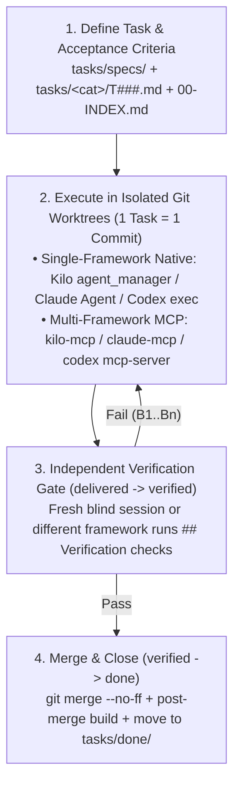

# ai-orchestration

**Versioned Specification & Task Management, Worktree Execution Control, and Independent Verification for AI Coding Assistants (Kilo, Claude, Codex).**

`ai-orchestration` covers the complete engineering lifecycle in **two decoupled phases**:

1. **Specification, Task Definition & State Management in Git (`tasks/`):**
   Distills raw ideas (`_inbox/`) into **versioned specifications** (`tasks/specs/` with locked-in decisions and non-goals), decomposes initiatives into **atomic execution tasks** (`NN-<slug>/plan.md`, `1 task = 1 commit`), captures **emergent mid-session tasks** (`<category>/T###-<slug>.md`) with a machine-validated 13-field header and runnable acceptance criteria (`## Verification`), and keeps the live backlog (`tasks/00-INDEX.md`) deterministically synced via `./bin/ai-orch tasks`.
2. **Worktree-Isolated Execution & Independent Verification (`orchestration.toml`):**
   Keeps your main AI session lean (acting strictly as **Architect**) while delegating implementation and verification to isolated Git worktree workers. Because task management is completely decoupled from the execution channel, it works out of the box both in **Single-Framework Mode** (only Kilo, only Claude, or only Codex—zero MCP required) and in **Multi-Framework Mode** (orchestrating external agents via `kilo-mcp`, `claude-mcp`, `codex`).

---

## Value Added at a Glance

| Ad-Hoc Chat Session | With `ai-orchestration` |
| :--- | :--- |
| ❌ Specs & decisions vanish when context compacts | ✅ **Versioned Specs & Tasks** in Git (`tasks/00-INDEX.md`, `specs/`, `T###`) |
| ❌ Main session bloats writing 10 files inline | ✅ **Main session only orchestrates**; workers run in parallel |
| ❌ Parallel agents overwrite each other's files/ports | ✅ **Isolated Git Worktrees** + port/DB/registry guardrails |
| ❌ Same agent writes the bug and claims "Done!" | ✅ **Independent Verification Gate** (`verifier != executor`) |
| ❌ Frontier model wasted on mechanical edits | ✅ **4 Role Profiles** (`deep-reasoning`, `orchestration`, `bulk-execution`, `exploration`) |

---

## How It Works



---

## Two Execution Modes (Same Tasks, Pluggable Execution)

1. **Single-Framework Native (Zero MCP required)**
   Use only **Kilo Code**, only **Claude Code**, or only **Codex CLI**. The main session dispatches parallel native worktrees/subagents (`agent_manager` & `task` in Kilo; `Agent` in Claude; `codex exec` in Codex) and verifies `delivered` work using a **fresh, context-blind subagent** (`independent-session`) on the `deep-reasoning` model.
2. **Multi-Framework via MCP (`kilo-mcp`, `claude-mcp`, `codex`)**
   Combine multiple tools (e.g., Claude as Architect delegating implementation and RAG search to Kilo via `kilo-mcp`, and verifying with Codex or Claude via `cross-agent` / `panel`).

---

## Installation

You can install `ai-orchestration` across **Kilo Code**, **Claude Code**, and **Codex CLI** with a single script (from a local clone or from scratch), or via each assistant's native plugin/marketplace mechanism:

```bash
# Option A — One-command installer (installs skills + initializes ~/.config/ai-orchestration/orchestration.toml)
./install.sh                  # add --with-mcp to also provision & register kilo-mcp / codex-mcp

# Option B — One-liner from scratch (clones into ~/.ai-orchestration/repos/ and installs)
curl -fsSL https://raw.githubusercontent.com/primax79/ai-orchestration/main/install.sh | bash

# Option C — Native Claude Code marketplace
claude plugin marketplace add https://github.com/primax79/ai-orchestration.git
/plugin install architect-side executor-side shared
```

For targeted per-assistant installs (`--assistants kilo claude codex`), project-scope installs, Kilo Skill URLs, AI Swissknife integration, and MCP server registration, see the dedicated **[Installation Guide (`docs/INSTALLATION.md`)](docs/INSTALLATION.md)**.

---

## Project Quickstart

### Option 1: Interactive Setup via Skill (Recommended)
Open your AI assistant (Kilo, Claude, or Codex) in your project and invoke **`orchestration-setup`**:
> *"Use `orchestration-setup` to configure orchestration for this project and generate `AGENTS.md`."*

The skill interactively:
1. Discovers your installed tools (`kilo`, `claude`, `codex`), MCP servers, and available models, and saves your global mapping to `~/.config/ai-orchestration/orchestration.toml` if not yet configured;
2. Asks whether this project runs in **Single-Framework Mode** (e.g. Kilo-only or Claude-only) or **Multi-Framework MCP Mode**, and inspects the repo for shared ports, DBs, conflict-prone files, and test commands;
3. Calls `orchestration_config.py` (`./bin/ai-orch`) to write the **unversioned** local project config (`~/.config/ai-orchestration/projects/<repo>/orchestration.toml`) and render the orchestration block in `AGENTS.md`.

### Option 2: Non-Interactive CLI (`./bin/ai-orch`)
The same deterministic scripts used by the skill can be run directly from the terminal (or by a UI/CI):

```bash
# 1. Configure a project (Single-Framework example: Kilo-only; or set --orchestrator claude --executor kilo)
./bin/ai-orch config init-project --workspace /path/to/repo --orchestrator kilo --executor kilo

# 2. Generate the always-on orchestration rules in /path/to/repo/AGENTS.md
./bin/ai-orch render-agents-md --workspace /path/to/repo --apply

# 3. Verify environment health, tasks, and config at any time
./bin/ai-orch env status
./bin/ai-orch tasks validate --tasks-dir tasks
```

---

## Included Skills (`plugins/`)

| Plugin | Skill | Role Profile | Purpose |
| :--- | :--- | :--- | :--- |
| `architect-side` | **`orchestration-workflow`** | `orchestration` | 6-phase Architect/Executor loop (Discovery → Isolation → Dispatch → Monitor → Verify → Merge). |
| `architect-side` | **`task-pipeline`** | `orchestration` | Manages `tasks/` (`00-INDEX.md`, `specs/`, initiatives `NN-<slug>`, emergent tasks `T###`) + `tasks_engine.py`. |
| `architect-side` | **`task-spec-authoring`** | `deep-reasoning` | Writing grounded task specs, `## Verification` gates, parallel batch scopes & blind review panels. |
| `architect-side` | **`task-worktree-ops`** | `deep-reasoning` | Git-worktree safety & `apply_fix_to_worktree.sh` for permission-blocked worktrees. |
| `architect-side` | **`conflict-resolver`** | `deep-reasoning` | Resolving parallel branch conflicts (mechanical merge vs. incompatible-design fork). |
| `architect-side` | **`orchestration-metrics`** | `deep-reasoning` | Analyzing delegation ROI, bounce/cancel rates, and spec guardrails. |
| `executor-side` | **`executor-contract`** | `bulk-execution` | Worker contract: zero interactivity, `focus_files` first, `1 task = 1 commit`, `## Final Report`. |
| `shared` | **`orchestration-setup`** | `deep-reasoning` | Configures `orchestration.toml` (tools, models per profile, verification) & renders `AGENTS.md`. |

---

## Documentation

See **[`docs/README.md`](docs/README.md)** for the full structured documentation index:
- **[Installation Guide (`docs/INSTALLATION.md`)](docs/INSTALLATION.md)** — From-scratch installer, per-assistant setup (Kilo, Claude, Codex, AI Swissknife), MCP registration, and drift checks.
- **[Quickstart & Operator Playbooks (`docs/00-QUICKSTART-AND-PLAYBOOK.md`)](docs/00-QUICKSTART-AND-PLAYBOOK.md)** — Visual pipeline diagrams and step-by-step walkthroughs for Single-Framework and Multi-Framework setups.
- **[Task & State Machine Spec (`tasks/specs/task-and-state-model.md`)](tasks/specs/task-and-state-model.md)** — Formal 13-field header, state transitions, and verification guards.
- **[Config Schema (`docs/05-orchestration-config-schema.md`)](docs/05-orchestration-config-schema.md)** — Reference for Global & Project `orchestration.toml`.
- **[Extension Spec (`tasks/specs/orchestration-extension-spec.md`)](tasks/specs/orchestration-extension-spec.md)** — Spec for the Backlog Manager & Environment Configurator UI.

## License

[MIT](LICENSE)
