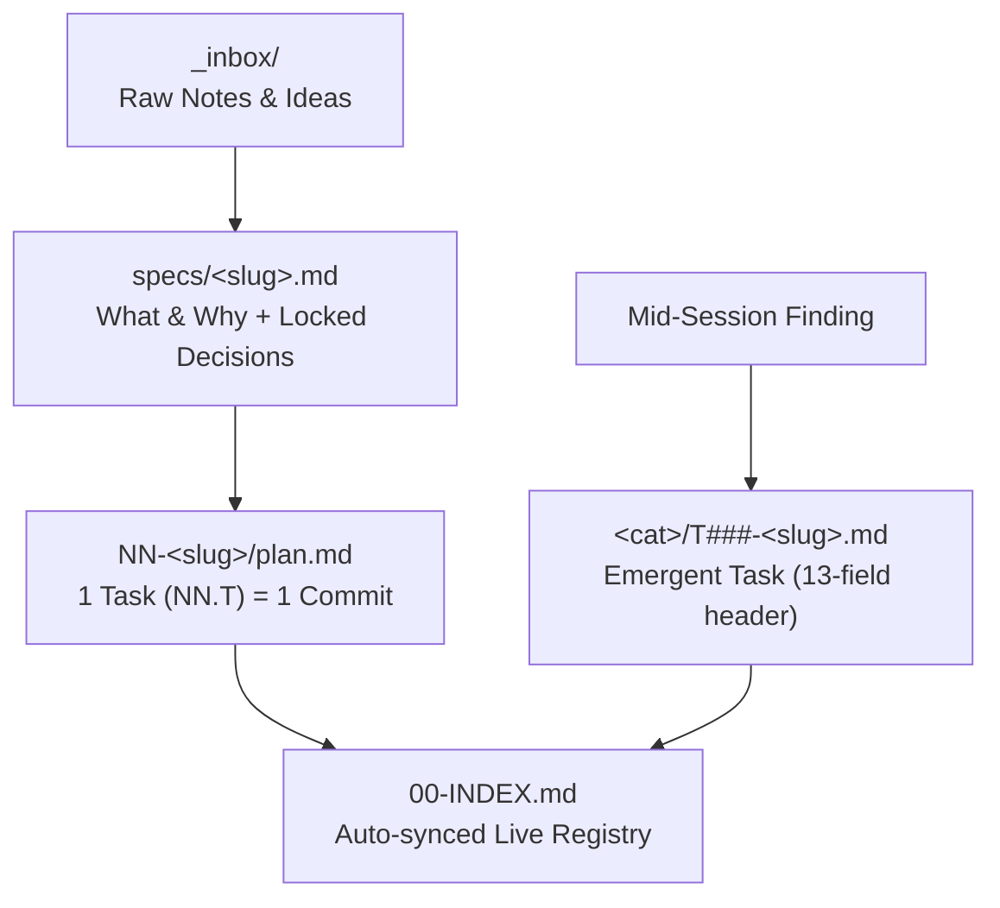
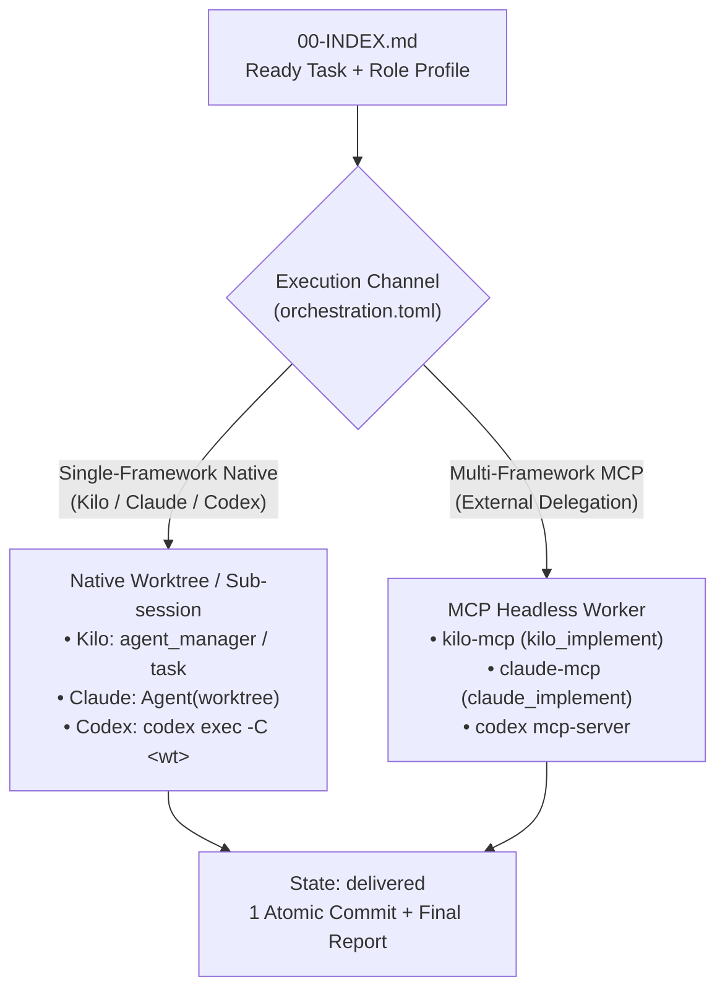
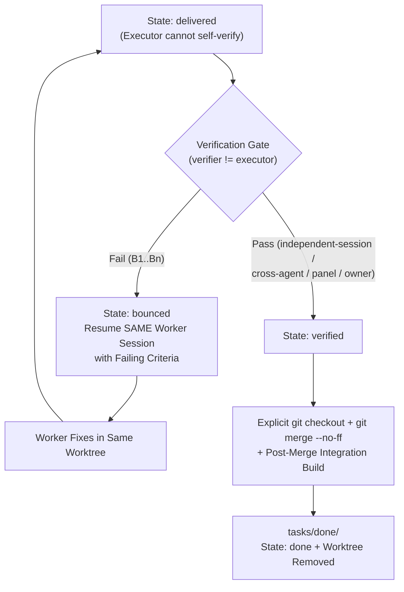
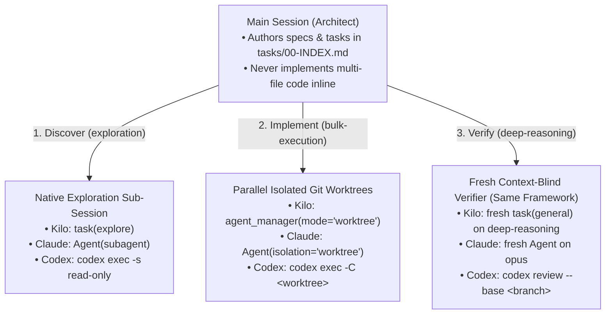
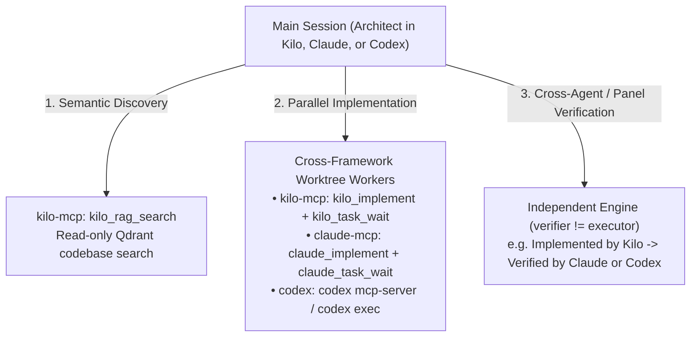

# Quickstart & Operator Playbook — `ai-orchestration`

This guide shows how to configure and use `ai-orchestration` end to end—both in **Single-Framework Native Mode** (only Kilo Code, or only Claude Code, with zero MCP servers) and in **Multi-Framework MCP Mode** (orchestrating across Kilo, Claude, and Codex via MCP/CLI).

---

## 1. Core Mental Model & Visual Architecture

1. **Task Definition & Acceptance Criteria (`tasks/`):**
   - Work lives in files inside `tasks/` (`00-INDEX.md`, `CONTEXT.md`, `specs/`, `NN-<slug>/plan.md`, `<category>/T###-<slug>.md`), never only in chat memory.
   - Every task has concrete, runnable acceptance criteria (`## Verification`) and moves through a strict path:
     `open` → `in progress` → `delivered` → `verified` → `done`.
   - **Rule:** The Executor that wrote the code may only mark a task `delivered`. Moving to `verified` requires an independent check (`independent-session` in the same framework, `cross-agent` in another framework, `panel`, or explicit `owner` approval).
2. **Role Profiles (`deep-reasoning`, `orchestration`, `bulk-execution`, `exploration`):**
   - Skills and tasks never hardcode model names (like `opus` or `gemini-3.8-flash`). They declare a **cognitive profile** based on error tolerance.
   - `orchestration.toml` maps each profile to the concrete model and reasoning effort/variant for each tool you use (**Kilo**, **Claude**, **Codex**).
3. **Execution Channel (Native vs. MCP):**
   - When `primary_orchestrator == default_executor` (Single-Framework Mode), the main session dispatches parallel work using the host's **native** worktree and subagent tools (`agent_manager` + `task` in Kilo; `Agent` in Claude; `codex exec` in Codex).
   - When `primary_orchestrator != default_executor` (Multi-Framework Mode), the main session dispatches work through the target tool's **MCP server** (`kilo-mcp`, `claude-mcp`, `codex mcp-server`) or CLI.

### 1.1 End-to-End Pipeline (3 Stages)

#### Stage A — Specification & Task Pipeline (`tasks/`)


#### Stage B — Isolated Parallel Execution (`orchestration.toml`)


#### Stage C — Independent Verification Gate & Integration


### 1.2 Single-Framework vs. Multi-Framework Topologies

#### Topology A: Single-Framework Native (Kilo-Only, Claude-Only, or Codex-Only — Zero External MCP)


#### Topology B: Multi-Framework Orchestration via MCP (`kilo-mcp`, `claude-mcp`, `codex mcp-server`)


### 1.3 Cognitive Role Profiles Across Kilo, Claude & Codex

| Role Profile | Error Tolerance & Nature of Work | Typical Activities | Default Mapping (Kilo / Claude / Codex) |
| :--- | :--- | :--- | :--- |
| **`deep-reasoning`** | **Silent failure** — a flawed spec, missed caller, or bad conflict merge looks plausible and poisons downstream work. | Spec authoring, blind spec/code review, architecture design, semantic conflict resolution. | `gemini-4-argon (high)` / `opus (high)` / `gpt-5-codex (high)` |
| **`orchestration`** | **Immediate/noisy failure** — coordinating steps, reading diffs, running verification gates, updating `00-INDEX.md`. | Main session task decomposition, dispatch, monitoring, Phase 5 verification. | `gemini-4-argon (medium)` / `sonnet (medium)` / `gpt-5-codex (medium)` |
| **`bulk-execution`** | **Spec-bounded** — executing a well-scoped task spec with pinned `focus_files` and runnable `## Verification`. | Feature/module implementation inside an isolated worktree (`executor-contract`). | `gemini-3.8-flash (medium)` / `sonnet (medium)` / `gpt-5-codex-mini (medium)` |
| **`exploration`** | **Read-only** — fast, high-volume codebase search and caller tracing. | `explore` subagents, RAG queries (`kilo_rag_search`), catalog/file inspection. | `gemini-3.8-flash (low)` / `haiku (low)` / `gpt-5-codex-mini (low)` |

---

## 2. Playbook 1: First-Time Machine Setup (Global `orchestration.toml`)

### Interactive (via `orchestration-setup` Skill — Recommended)
In your AI assistant chat, ask:
> *"Run `orchestration-setup` to discover my available tools and models and configure `~/.config/ai-orchestration/orchestration.toml`."*

The skill discovers which tools (`kilo`, `claude`, `codex`) and MCP servers are reachable, ranks candidate models for each of the 4 cognitive profiles (`deep-reasoning`, `orchestration`, `bulk-execution`, `exploration`) with you, verifies compatibility, and invokes `orchestration_config.py` to write and validate `~/.config/ai-orchestration/orchestration.toml`.

### Non-Interactive (via CLI Script)
You can also run the underlying script directly:

```bash
# 1. Initialize ~/.config/ai-orchestration/orchestration.toml with default profiles
./bin/ai-orch config init-global

# 2. Customize models per tool and profile (examples):
./bin/ai-orch config set-profile kilo deep-reasoning --model "google/gemini-4-argon" --variant high --basis operator-stated
./bin/ai-orch config set-profile kilo bulk-execution --model "google/gemini-3.8-flash" --variant medium --basis operator-stated
./bin/ai-orch config set-profile claude deep-reasoning --model "opus" --effort high --basis operator-stated

# 3. Inspect and validate your global setup
./bin/ai-orch config show
./bin/ai-orch config validate
```

---

## 3. Playbook 2: Bootstrapping a Project (`tasks/` + `AGENTS.md`)

### Interactive (via `orchestration-setup` Skill — Recommended)
Open your project workspace and ask:
> *"Configure `ai-orchestration` for this project, set up `tasks/orchestration.toml`, and generate `AGENTS.md`."*

The skill interviews you on the project's execution topology (Single-Framework Native vs. Multi-Framework MCP) and verification policy (`independent-session`, `cross-agent`, `panel`, `owner`), inspects the repo for shared DBs, ports, conflict-prone files, and test commands, and runs `orchestration_config.py` to write `tasks/orchestration.toml` and update `AGENTS.md`.

### Non-Interactive (via CLI Script)
When automating or scripting project setup (`/path/to/repo`):

### Option A — Single-Framework Project (e.g., Kilo-only or Claude-only, no MCP)
```bash
# Initialize tasks/orchestration.toml for Kilo-only native mode
python3 plugins/shared/skills/orchestration-setup/scripts/orchestration_config.py \
  init-project --workspace /path/to/repo --name my-repo \
  --orchestrator kilo --executor kilo --verification-mode independent-session

# Render/update the managed orchestration block in /path/to/repo/AGENTS.md
python3 plugins/shared/skills/orchestration-setup/scripts/orchestration_config.py \
  render-agents-md --workspace /path/to/repo --apply
```

### Option B — Multi-Framework Project (e.g., Claude orchestrating Kilo via `kilo-mcp`)
```bash
# Initialize tasks/orchestration.toml for Claude Architect + Kilo Executor + Cross-Agent Verification
python3 plugins/shared/skills/orchestration-setup/scripts/orchestration_config.py \
  init-project --workspace /path/to/repo --name my-repo \
  --orchestrator claude --executor kilo --verification-mode cross-agent

# Render/update /path/to/repo/AGENTS.md
python3 plugins/shared/skills/orchestration-setup/scripts/orchestration_config.py \
  render-agents-md --workspace /path/to/repo --apply
```

### Adding Project-Specific Isolation & Verification Rules
Edit `/path/to/repo/tasks/orchestration.toml` to declare shared resources that Git worktrees do **not** isolate (databases, ports, conflict-prone files, zero-conflict plugin registries, and subsystem check commands), then re-run `render-agents-md --apply`:

```toml
[project.isolation]
shared_databases = ["./data/app.db", "PostgreSQL :5433"]
shared_ports = [8765, 5433]
worker_port_range = [8766, 8779]
conflict_prone_files = ["backend/app.py", "frontend/index.html"]
zero_conflict_registries = ["backend/scrapers/registry.py"]

[project.verification_checks.backend]
description = "Verify module import and API tests against a disposable DB"
commands = ["PYTHONPATH=. .venv/bin/python -m pytest tests/"]
```

---

## 4. Playbook 3: Defining Work (Inline vs. Emergent Task `T###` vs. Initiative `NN-<slug>`)

| Work Shape | What to Create | When to Use |
| --- | --- | --- |
| **Single self-contained task** (finished in the current turn) | Inline task spec in the delegation call (`agent_manager`, `task`, or `kilo_implement`) | One module/feature you are dispatching right now and verifying in this turn. |
| **Emergent Task (`T###`)** (`tasks/<category>/T###-<slug>.md`) | Task file with 13-field header + `Goal` / `Steps` / `Verification` + row in `tasks/00-INDEX.md` | Any bug, follow-up, out-of-scope finding, or user request that appears mid-session and will **not** be finished in the current turn. **Rule: Capture first, then continue.** |
| **Multi-Task Initiative (`NN-<slug>`)** (`tasks/specs/<slug>.md` → `tasks/NN-<slug>/plan.md`) | Structured Spec (*what/why* + Locked-in decisions + Non-goals) driving an Initiative plan with tasks `NN.1`, `NN.2` (1 task = 1 commit) | Large features, refactors, or multi-session rollouts with dependencies across steps. |

---

## 5. Playbook 4: Executing & Verifying Tasks

### Step 1 — Dispatch (Phase 2 & 3)
- **In Kilo-only mode:** Use `agent_manager(mode="worktree")` for parallel code changes or `task(subagent_type="general", background=true)` for strictly file-disjoint work. Pass the model/variant from Rule 4 of `AGENTS.md`.
- **In Claude-only mode:** Use `Agent(isolation="worktree", run_in_background=true)`.
- **In MCP mode (`kilo-mcp` / `claude-mcp`):** Call `kilo_implement(isolation="worktree", focus_files=[...], model=...)` and await with `kilo_task_wait(task_id)`.

### Step 2 — Independent Verification (Phase 5: `delivered → verified`)
When the Executor finishes, it commits its changes, runs its self-check, outputs the `Final Report`, and leaves the task at `delivered`. Choose the verification mode matching the task's risk:

1. **`independent-session` (Single-Framework, zero MCP):**
   Spawn a fresh, context-blind subagent in the same framework on the `deep-reasoning` model:
   > *"Read `tasks/<category>/T012.md`. Inspect `git diff` in worktree `<path>` and run the commands in `## Verification` against a disposable DB copy. Do not trust the Executor's report. Report `VERIFIED` or list blocking findings `B1..Bn`."*
2. **`cross-agent` (Multi-Framework):**
   Dispatch verification to a tool different from `executor` (e.g., task executed by `kilo` → verified by `claude:deep-reasoning`).
3. **`panel` (Multi-Engine Blind/Primed Panel for Specs or Critical Tasks):**
   Dispatch to 2–3 independent engines (`kilo:deep-reasoning`, `claude:deep-reasoning`, `codex:deep-reasoning`), writing `reviews/NNN-<target>-<engine>.md`. On cycle 2+, pass prior findings to most reviewers while keeping at least one reviewer completely blind.
4. **`owner` (Human Approval):**
   Present the verification evidence and diff summary to the user; on approval, record the date and approval in `PROGRESS.md` and transition to `verified`.

### Step 3 — Merge & Close (Phase 6: `verified → done`)
```bash
git status --short
git checkout <target-branch>
git merge --no-ff <task-branch> -m "Merge <task-id>: <summary>"
git log --oneline --graph -5
# Run post-merge integration build/tests, then clean up worktree:
git worktree remove <worktree-path>
```

---

## 6. Per-Skill Quick Reference

| Skill | Used By | Trigger / When to Load | Companion Script |
| --- | --- | --- | --- |
| `orchestration-setup` | Operator / Architect | Setting up or updating `orchestration.toml` (tools, models, verification mode) or rendering a project's `AGENTS.md`. | `scripts/orchestration_config.py`, `scripts/validate_roles.py` |
| `task-pipeline` | Architect | Creating/updating `tasks/` (`00-INDEX.md`, `CONTEXT.md`, `specs/`, `NN-<slug>/plan.md`, emergent tasks `T###`), transitioning task states. | `scripts/tasks_engine.py` |
| `task-spec-authoring` | Architect / Reviewer | Writing a task spec or `## Verification` criteria, scoping parallel batches, or running a blind/primed spec review panel. | — |
| `orchestration-workflow` | Architect | Running the 6-phase loop (Discovery, Isolation, Delegation, Monitoring, Verification, Merge). | — |
| `task-worktree-ops` | Architect | Applying a fix to a permission-blocked Executor worktree via git plumbing, or checking if a live worktree is safe to touch. | `scripts/apply_fix_to_worktree.sh` |
| `conflict-resolver` | Architect | Resolving merge conflicts between parallel Executor branches at Phase 6. | — |
| `orchestration-metrics` | Architect | Analyzing delegation cost, cancellation/discard rates, and recurring defect patterns. | — |
| `executor-contract` | Executor | Loaded by background/worktree Executor sessions to enforce zero interactivity, scope discipline, 1-task-1-commit, and the `Final Report` format. | — |
