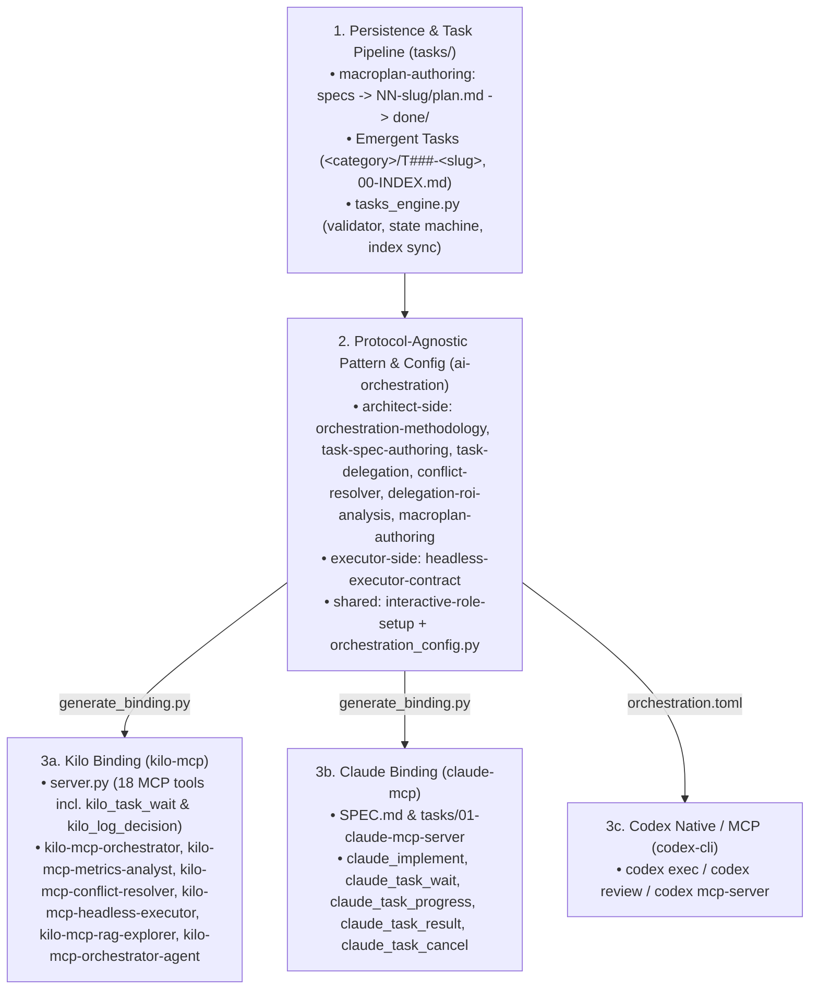

# Current Architecture and Inventory: Orchestration & Task Definition

> **Verified against workspace checkouts:** 2026-10-15
> **Scope:** `agentic-coding-kit` (v0.3.1), `ai-architect-executor` (v0.2.1), `kilo-mcp` (v0.2.1), `claude-mcp` (spec round-001).

---

## 1. Architectural Overview

**Foundational Principle:** *Task definition, acceptance criteria, and orchestration mechanics are completely autonomous from the execution channel.* The system works identically whether an operator runs a **Single-Framework Native setup** (only Kilo using `agent_manager`/`task`, or only Claude Code using `Agent` with parallel sub-sessions/worktrees and zero MCP servers) or a **Multi-Framework MCP setup** (delegating across `kilo-mcp`, `claude-mcp`, and `codex`).

The orchestration and task-management stack is split into **three distinct layers** across separate repositories so that persistent task state, abstract delegation methodology, and execution bindings never couple unnecessarily:

1. **Task & Pipeline Persistence Layer (`agentic-coding-kit` → `common-tools` plugin)**
   Defines how work is structured on disk inside any repository (`tasks/`), both for planned multi-session initiatives and for work that emerges mid-conversation.
2. **Protocol-Agnostic Pattern & Role Layer (`ai-architect-executor`)**
   Defines *how* an **Architect** (orchestrating AI) and an **Executor** (headless coding worker AI) divide labor, write specs, isolate worktrees, monitor progress, verify results, resolve conflicts, and map abstract capability profiles (`deep-reasoning`, `orchestration`, `bulk-execution`, `exploration`) to concrete host models. Also provides the template engine (`scripts/generate_binding.py`) that produces tool-bound skills without copy-paste drift.
3. **Concrete Execution Bindings (`kilo-mcp`, `claude-mcp`)**
   Bind the abstract pattern to a real CLI/protocol:
   - `kilo-mcp`: production MCP server (`server.py`) + generated Kilo skills + read-only RAG skill + autonomous initiative-runner subagent (`mcp-orchestrator-agent`).
   - `claude-mcp`: specification for an equivalent MCP server wrapping headless `claude` CLI sessions so any orchestrator (including Kilo) can delegate work to Claude Code.

---

## 2. Complete Inventory of Skills and Agents

### 2.1 `agentic-coding-kit` (Task Definition & Pre-Planning)

| Artifact | Type | Plugin | Path | Purpose |
| --- | --- | --- | --- | --- |
| `macroplan-authoring` | Skill | `common-tools` | `plugins/common-tools/skills/macroplan-authoring/SKILL.md` | Authors and maintains the `tasks/` tree: structured pipeline (`_inbox/` → `specs/` → `NN-<slug>/plan.md` → `done/` → `merged/`) + emergent tasks (`<category>/T###-<slug>`). Includes `references/template.md`. |
| `grill-me` | Skill | `third-party` | `plugins/third-party/skills/grill-me/SKILL.md` | Relentlessly interviews the user one question at a time down each branch of the design decision tree before locking a plan/spec. |
| `merge-resolver` | Agent | `common-tools` | `plugins/common-tools/agents/merge-resolver.md` | Legacy RooCode-migrated agent for resolving GitHub PR conflicts (`gh pr checkout`, `git rebase`, `git blame` intent analysis). |

### 2.2 `ai-architect-executor` (Protocol-Agnostic Pattern)

| Artifact | Type | Plugin | Role Profile (`skill-requirements.json`) | Template? | Purpose |
| --- | --- | --- | --- | --- | --- |
| `orchestration-methodology` | Skill | `architect-side` | `orchestration` | Yes (`SKILL.template.md`) | 6-phase Architect loop (Discovery, Isolation, Delegation, Monitoring & Intervention, Verification & Integration Gate, Closure & Telemetry), analysis-task rigor, emergent-task capture, state-path discipline. |
| `task-spec-authoring` | Skill | `architect-side` | `deep-reasoning` | No (pure `SKILL.md`) | Spec authoring & verification calibration: multi-engine blind/primed review panel, negative-claim rule, reference-drift defense, caller tracing, 1-task-1-commit, parallel batch scoping. |
| `task-delegation` | Skill | `architect-side` | `deep-reasoning` | No (`SKILL.md` + `scripts/` + `references/`) | Manual/CLI git-worktree mechanics when no MCP server mediates: applying fixes to permission-blocked worktrees via `git hash-object`/`update-index`/`checkout-index` (`apply_fix_to_worktree.sh`) and avoiding live-session races. |
| `conflict-resolver` | Skill | `architect-side` | `deep-reasoning` | Yes (`SKILL.template.md`) | Resolving merge conflicts produced by parallel Executor worktrees while preserving both features' semantics. |
| `delegation-roi-analysis` | Skill | `architect-side` | `deep-reasoning` | Yes (`SKILL.template.md`) | Evaluating delegation cost vs. inline estimate, cancelled runs, defect grouping, and spec-guardrail feedback loop. |
| `headless-executor-contract` | Skill | `executor-side` | `bulk-execution` | Yes (`SKILL.template.md`) | Behavioral contract for background Executor runs: zero interactivity, read `focus_files` first, fail fast, scope/blast-radius discipline, mandatory `Final Report`. |
| `interactive-role-setup` | Skill | `shared` | `deep-reasoning` | No (`SKILL.md` + `scripts/validate_roles.py`) | Maps the 4 abstract role profiles to reachable host models in `~/.config/ai-architect-executor/roles.toml` via live discovery, evidence-based ranking (`basis`), and read-only/behavioral verification. |

### 2.3 `kilo-mcp` (Concrete Kilo Binding over MCP)

| Artifact | Type | Plugin | Source / Generation | Purpose |
| --- | --- | --- | --- | --- |
| `kilo-mcp-orchestrator` | Skill | `architect-side` | Generated from `orchestration-methodology` + `bindings/orchestration-methodology.json` | Concrete 6-phase orchestrator using `kilo_rag_search`, `kilo_implement(isolation='worktree')`, `kilo_task_progress/cancel`, `continue_session_id`, `kilo_workspace_status`, `kilo_log_issue`. Ships with `scripts/diagnose-kilo-tasks.sh` and `scripts/kill-kilo-task.sh`. |
| `mcp-metrics-analyst` | Skill | `architect-side` | Generated from `delegation-roi-analysis` + `bindings/delegation-roi-analysis.json` | Concrete ROI & defect analysis using `kilo_metrics` (`delegation_cost_usd` vs `inline_estimate_usd`) and `kilo_log_issue`. |
| `kilo-mcp-conflict-resolver` | Skill | `architect-side` | Generated from `conflict-resolver` + `bindings/conflict-resolver.json` | Concrete conflict resolver for parallel Kilo worktrees. |
| `mcp-orchestrator-agent` | Agent | `architect-side` | Hand-authored (`plugins/architect-side/agents/mcp-orchestrator-agent.md`) | Autonomous "fire-and-forget" subagent (`tools: "*"`) that drives a range of `tasks/NN-slug/plan.md` initiatives end to end through `kilo-mcp`, interrupting the user only on explicit stop conditions. |
| `kilo-mcp-headless-executor` | Skill | `executor-side` | Generated from `headless-executor-contract` + `bindings/headless-executor-contract.json` | Concrete headless contract for Kilo subprocesses spawned by `kilo-mcp`. |
| `kilo-mcp-rag-explorer` | Skill | `executor-side` | Hand-authored (`plugins/executor-side/skills/kilo-mcp-rag-explorer/SKILL.md`) | Read-only exploration discipline for Kilo's `explore` agent: index-first retrieval (`semantic_search`), exact file+line ranges for `focus_files`, dense technical summaries. |

---

## 3. Deep Dive: How Each Subsystem Works

### 3.1 Task Definition & State Management (`macroplan-authoring`)

`macroplan-authoring` solves context loss across sessions and across agents by turning the `tasks/` directory into a state machine with progressive disclosure:

1. **Top-level separation of concerns**:
   - `tasks/AGENTS.md`: static rules of the convention (so a repo is self-contained even for an agent without the skill installed).
   - `tasks/CONTEXT.md`: durable project facts (codebase map, build/test commands, cross-cutting **Locked-in decisions** with rationale). Marked as requiring re-verification against real code before acting.
   - `tasks/00-INDEX.md`: single live dashboard containing `Initiatives`, `Specs`, `Next up` (≤ 5 tasks with copy-pasteable `handoff` prompts), `Tasks by category`, `Decisions waiting`, and `Done`.
2. **Planned Initiatives (`_inbox/` → `specs/<slug>.md` → `NN-<slug>/plan.md`)**:
   - Specs and initiatives are **many-to-many** (`Drives` / `Derived from`).
   - Tasks inside `plan.md` (`NN.1`, `NN.2`, ...) are sized **one-per-commit** and packaged either **inline** (sections in `plan.md`) or **expanded** (`NN.T-<name>.md` files when >5–6 tasks or heavily delegated).
   - Folder-level lifecycle: `tasks/NN-<slug>/` (active) → `tasks/done/NN-<slug>/` (implemented + verified on branch, `summary.md` written) → `tasks/merged/NN-<slug>/` (merged into target branch).
3. **Emergent Tasks (`tasks/<category>/T###-<slug>`)**:
   - **Rule**: *Capture first, then continue.* Work appearing mid-session that won't be finished and verified in the current turn is immediately written to `tasks/<category>/T###-<slug>.md` (or a folder `{README,CONTEXT,PROGRESS}.md` when context/progress exists) and added to `00-INDEX.md`.
   - **Closed 13-field header**: `id`, `title`, `category`, `priority` (`P0`–`P3`), `priority-reason`, `next-up`, `state`, `executor` (`self`, `kilo`, `claude`, `dedicated-session`, `user-decision`, etc.), `depends-on`, `decider`, `sources`, `paths`, `handoff`.
   - **Verification gate**: `open` → `in progress` → `delivered` → `verified` → `done`. **No direct path from `in progress` to `done`**. Only someone other than the executor sets `verified` after re-running `Verification` (or the executor only after explicit user approval logged in `PROGRESS.md`).
   - **Multi-session safety**: each category has an `owner-session` in `<category>/README.md`; other sessions only append notes or create new `T###` files. Project-specific work inside a multi-repo workspace lives in the project's own `tasks/` and is mirrored in the workspace registry via a **pseudo-task**.

### 3.2 Writing High-Reliability Specs (`task-spec-authoring`)

Derived from a post-mortem review of ~110 call sites across 7 files, `task-spec-authoring` targets the primary root cause of bad delegations (flawed or coarse specs):

- **Multi-Engine Blind/Primed Review Panel**: before finalizing a non-trivial spec, submit it to independent reviewers (other MCP engines, CLI tools, or a fresh context-blind subagent of the same model). On cycle 2+, feed prior findings to most reviewers for targeted check, but **keep at least one reviewer completely blind** so the panel doesn't anchor on known issues.
- **The Negative-Claim Rule**: tasks that rest on a negative claim (*"this symbol is unused elsewhere"*, *"this code path is dead"*) cannot be verified locally—they mandate a full regression-suite run in `Verification` regardless of how few files they touch.
- **Grounding & Drift Defense**: always cite exact file/function/line, plus an explicit instruction to re-`grep` because line numbers shift across same-day merges.
- **Caller Tracing**: trace every caller (and full UI → HTTP service → backend route chains) before writing Steps.
- **Parallel Batch Design**: assign disjoint subdirectory write scopes, restrict the single shared barrel/index file to single-line export additions without reformatting, pre-assign shared type names (`BBox`, etc.) in the spec, pin runtime/toolchain versions in both dispatch and verification, and merge formatter tasks last.

### 3.3 The 6-Phase Orchestration Loop (`orchestration-methodology` / `kilo-mcp-orchestrator`)

1. **Phase 1 — Discovery (& RAG)**: use `kilo_rag_search` first; check models/auth (`kilo_list_models`, `kilo_auth_status`).
2. **Phase 2 — Isolation**: `kilo_implement` has no locking by default. Always pass `isolation='worktree'` for non-trivial or parallel work. Account for two non-isolated surfaces:
   - **Host resources**: ports, Docker container names, external files must be pre-assigned per parallel task in the spec.
   - **Shared `.git/config`**: worktrees share `.git/config`; tasks touching git hooks (`husky init`, `core.hooksPath`) must create the files and document the activation command without running it, proving `git config --get` is empty.
3. **Phase 3 — Delegation**: non-blocking background execution (`background=true`), passing `focus_files` and `skills_to_load`.
4. **Phase 4 — Monitoring & Intervention**:
   - Cross-check OS-level `"WORKING"` (`kilo_task_status`) against `kilo_task_progress` (CPU/elapsed ratio vs. token/cost burn and live todo plan) to catch context-rereading loops (especially after `continue_session_id`).
   - Intervene via `kilo_task_cancel`, `kilo_session_revert`, `kilo_session_fork`, `kilo_respond_question`, or `kilo_update_session_todo`, then resume with `continue_session_id`.
   - Use host wakeup scheduling (`ScheduleWakeup`) so completed tasks are reported proactively without waiting for the user to ask.
5. **Phase 5 & 5b — Verification & Integration Gate**:
   - Never trust the `Final Report` or visual diff alone—execute the artifact (boot backend against seeded disposable DB, hit endpoints with `curl`, run frontend build/tests, `diff` verbatim copies, bring up compose stacks).
   - **Phase 5b Integration Gate**: after merging parallel worktrees, run lint + tests + **a full build of a consuming application** to catch cross-branch symbol collisions invisible in isolated worktrees.
6. **Phase 6 — Closure & Telemetry**:
   - Log defects found during review via `kilo_log_issue(run_id, category, severity, description)`.
   - Merge with an explicit `git checkout <target>` before `git merge --no-ff <feature-branch> -m "..."` (prevents the git octopus-merge footgun), verify `git log --graph -6`, and remove the worktree.

### 3.4 Template-Driven Binding Generation (`generate_binding.py` & `regenerate_bound_skills.py`)

To prevent drift between `ai-architect-executor` and `kilo-mcp`:
- `ai-architect-executor` owns `SKILL.template.md` for `orchestration-methodology`, `headless-executor-contract`, `conflict-resolver`, and `delegation-roi-analysis`.
- `ai-architect-executor/scripts/regenerate_generic_skills.py` renders the generic `SKILL.md` files (using default block contents and stripping `{{ADD:...}}` anchors).
- `kilo-mcp/scripts/regenerate_bound_skills.py` invokes `ai-architect-executor/scripts/generate_binding.py` with `kilo-mcp/bindings/*.json` to inject Kilo tool names (`{{TOOL:...}}`), block overrides (`{{BLOCK:...}}`), and Kilo-specific additions (`{{ADD:...}}`).
- Both scripts support `--check` for CI/pre-commit drift detection.

### 3.5 Abstract Role Profiles (`interactive-role-setup` & `validate_roles.py`)

- Every skill in `ai-architect-executor` and `kilo-mcp` declares its error-tolerance profile in `plugins/<plugin>/skill-requirements.json` (`deep-reasoning`, `orchestration`, `bulk-execution`, `exploration`) and **never** declares a `model` key in `SKILL.md` frontmatter.
- `interactive-role-setup` discovers reachable models across hosts, ranks them with an explicit evidence `basis` (`host-metadata`, `provider-tier-naming`, `model-self-knowledge`, `operator-stated`), and writes `~/.config/ai-architect-executor/roles.toml`.
- `validate_roles.py` is wired into `generate_skill_indices.py` so every index regeneration enforces that all skills have valid profiles and zero hardcoded models.
