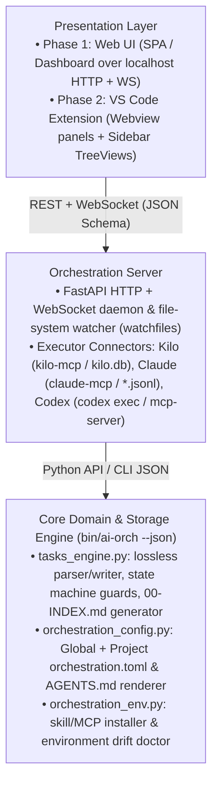

# Task Formalization & Orchestration UI Architecture

> **Status:** Initial architectural analysis & design blueprint (2026-10-15)
> **Goal:** Formalize the task definition model, acceptance criteria, state machine, and constraints into a machine-verifiable specification that is **100% independent of the execution mechanism** (supporting both **Single-Framework Native** parallel sub-sessions/worktrees in Kilo or Claude and **Multi-Framework MCP** delegation), and design the Python Server + Web UI (evolving later into a VS Code extension).

---

## 1. Critical Analysis of the Current Task Model (What We Have vs. What Breaks When Automated)

Today the task model is split across three prose documents:
- `agentic-coding-kit` → `macroplan-authoring/SKILL.md` (+ `references/template.md`)
- `ai-architect-executor` → `orchestration-methodology/SKILL.md` ("Track task state as a path, not a label")
- `ai-architect-executor` → `task-spec-authoring/SKILL.md`

When read by a human or an LLM, these conventions work well. However, to build a **deterministic Python engine + Web UI** on top of them, **seven structural ambiguities/frictions** in the current prose must be resolved and formalized first:

### 1.1 Two Different State Machines in Two Skills
- **`macroplan-authoring`** defines 8 states for emergent tasks:
  `open`, `in progress`, `waiting`, `blocked`, `delivered`, `verified`, `done` (or `done with a caveat`), `dropped`.
  And 3 folder states for initiatives:
  `active` (`tasks/NN-<slug>/`) → `done/` → `merged/`.
- **`orchestration-methodology`** ("Track task state as a path, not a label") defines 7 states:
  `in progress`, `delivered`, `verified`, `integrated`, `done with a caveat`, `bounced`, `blocked`.
- **Friction to resolve:** `bounced` and `integrated` exist in `orchestration-methodology` but not in `macroplan-authoring` (which says emergent tasks have no `merged/` step, only initiatives do). Conversely, `open`, `waiting`, and `dropped` exist in `macroplan-authoring` but not in `orchestration-methodology`. A single formal state machine must unify these (e.g., whether `bounced` is a first-class state or a transition `delivered → in progress` with a recorded bounce counter/reason, and how `integrated` maps to branch merges).

### 1.2 Asymmetry Between Planned Initiative Tasks (`NN.T`) and Emergent Tasks (`T###`)
- **Emergent tasks (`T###`)** have a strict 13-field `key: value` header (`id`, `title`, `category`, `priority`, `priority-reason`, `next-up`, `state`, `executor`, `depends-on`, `decider`, `sources`, `paths`, `handoff`).
- **Initiative tasks (`NN.T`)** inside `NN-<slug>/plan.md` (or `NN.T-<name>.md`) have **no formal metadata header at all**—only prose `**Goal**: ...`, `Steps:`, `Verification:`. Their state is tracked only at the coarse initiative level in `00-INDEX.md` (`open / partial / done`), or ad-hoc in prose.
- **Friction to resolve:** In a UI (and for an orchestrator), an initiative task `04.2` being executed by `kilo` needs the exact same runtime lifecycle (`state`, `executor`, `worktree/branch`, `session_id`/`task_id`, `Verification` status) as an emergent task `T012`.

### 1.3 Header Syntax: Markdown Bullet List vs. YAML Frontmatter
- Currently, `macroplan-authoring` uses Markdown bullets after the H1 title:
  ```markdown
  # T012 Title

  - id: T012
  - title: Title
  ...
  ```
- **Pros:** Greppable with `grep "^- state:"`, renders visibly in plain Markdown previews.
- **Cons for a parser/UI:** Multiline values (e.g. `handoff`, `decider`, lists of `paths` or `depends-on`) have no escaping or list syntax; `verification pending: ...` sits as a bare line after the bullets.
- **Formalization needed:** Define an exact, unambiguous grammar (whether strict bullet-list key-value with typed parsing rules for lists/enums, or YAML frontmatter, or round-trip support) so a Python parser can read and write task files losslessly without corrupting Markdown formatting.

### 1.4 Manual Dual-Write Between Task Files and `00-INDEX.md`
- Today, the LLM is instructed: *"Update the task and the registry (`00-INDEX.md`) in the same change, every time. On a mismatch, the header wins."*
- **Why this matters:** LLMs frequently forget to update one of the two, break relative links when running `git mv` to `done/`, or mis-sort tables.
- **Formalization needed:** Once task headers are formally specified, **`00-INDEX.md` should be 100% deterministically generated/reconciled by the Python core** from the task files on disk (just like `generate_skill_indices.py` generates `index.json`).

### 1.5 Missing Runtime / Execution Binding Fields
- When a task is delegated to `kilo-mcp` or `claude-mcp`, runtime artifacts are produced: `task_id` (MCP background handle), `run_id` (metrics id), `session_id` (for `continue_session_id` steering), `worktree_path`, `branch`, `commit_sha`, and verification run logs.
- Today, `macroplan-authoring` says *"Extra fields are not allowed in the header: put the information in the body / PROGRESS.md."*
- **Formalization needed:** Standardize where runtime execution state lives (e.g. a structured section in `PROGRESS.md` or a sidecar/state block) so the Web UI can link a task card directly to its live `kilo-mcp` / `claude-mcp` session, worktree diff, and verification output.

### 1.6 Concurrency & Multi-Session Ownership (`owner-session`)
- Today, `<category>/README.md` has `owner-session: <name>` and task IDs (`T###`) are reserved by scanning `tasks/*/T*` and `tasks/done/*/T*`.
- With a Python server + Web UI + multiple CLI agents running concurrently, ID allocation, state transitions, and file moves (`git mv` to `done/`) need atomic file-locking and link-rewriting rules.

### 1.7 Workspace vs. Project Tasks (`pseudo-tasks`)
- `macroplan-authoring` defines **pseudo-tasks** in a workspace root `tasks/` that mirror a sub-project's `tasks/`.
- A Python server pointed at a workspace root (`ai-coding-tools`) can natively aggregate all sub-repositories' `tasks/` trees into a unified multi-project view, plus validate or auto-sync workspace pseudo-tasks.

### 1.8 Optional Cross-Agent Verification (Already Proven in Existing Tasks/Reviews, Needs First-Class Model Support)
Across the workspace, **independent cross-agent verification** is already used in three places, but each encodes it slightly differently:
1. **Execution gate (`macroplan-authoring` & `T011`)**: `delivered → verified` requires *someone other than the executor* (a peer session, another agent, or the owner's explicit approval logged in `PROGRESS.md`) to run the task's `Verification` section; otherwise the task can only close as `done with a caveat: self-verified only`. While `delivered`, the task carries `verification pending: <what is left to check, and by whom>`.
2. **Multi-engine spec & deliverable review (`task-spec-authoring` & `claude-mcp/reviews/001-spec-review-kilo-gemini-3.7-flash.md`)**: non-trivial specs/deliverables are reviewed by one or more independent engines (e.g. Claude authored → reviewed by Kilo `google/gemini-3.7-flash` and Codex, or a fresh context-blind subagent with zero authorship bias). Reviews produce a structured markdown file with YAML frontmatter (`target`, `date`, `commit`, `engine`, `model`, `verdict: proceed | proceed with changes | blocked`) and categorized findings (`Blocking Findings B1..Bn`, `Important Non-Blocking Findings I1..In`). On cycle 2+, most reviewers receive prior findings to check fixes while **at least one reviewer remains genuinely blind**.
3. **Triple-verification (`is-gui` `testplan-manager`, cited in `ai-architect-executor/STATUS.md`)**: `🤖 Executor | 🧠 Verifier/Orchestrator Agent | 👤 User`.

**How `ai-orchestration` unifies and automates this as an optional, configurable mechanism (both Single-Framework and Multi-Framework):**
- **Optional per-task verification policy**: a task (or category default) can specify whether verification beyond the executor's self-check is:
  - `self` (closes as `done with a caveat: self-verified only` or via deterministic check script),
  - `independent-session` (**Single-Framework mode, zero MCP required**: a fresh, context-blind subagent or worktree session inside the *same* framework—using the `deep-reasoning` profile or a different model in the same tool—executes the `Verification` checks and audits the diff without authorship bias),
  - `cross-agent` (**Multi-Framework mode**: a *different* agent/engine—guaranteed `verifier_tool != executor_tool`—executes the `Verification` checks and audits the diff against the spec),
  - `panel` (multi-engine or multi-session blind/primed review panel producing `reviews/NNN-<slug>-<engine>.md`, ideal for specs and high-risk tasks),
  - `owner` (explicit human approval in UI or conversation).
- **Automated dispatch from the Orchestration Server / UI**: when a task reaches `delivered` (or a spec is drafted), the user or orchestrator can trigger **"Cross-Verify with Agent"** in one click (selecting e.g. Kilo, Claude, Codex, or a blind subagent), automatically enforcing independence, capturing the structured verdict (`verified` vs `bounced` with `B1..Bn` findings), and—on bounce—feeding the blocking findings straight back into the original Executor's `continue_session_id`.

---

## 2. Proposed Architecture: Python Core + Web Server → VS Code Extension

To ensure the effort invested in the Python server + Web UI carries over cleanly to a future VS Code extension, the system is split into **three decoupled layers**:



### Why This Evolves Cleanly to a VS Code Extension

1. **Markdown files in `tasks/` remain the single source of truth.** There is no proprietary database that gets out of sync with git. If an agent edits a `T###` file via CLI, the file watcher updates the Web UI in real time; if the user clicks "Approve (`verified`)" or changes priority in the Web UI, the server updates the Markdown file and regenerates `00-INDEX.md` atomically.
2. **Protocol boundary (REST + WebSocket):** The Web UI talks to the Python backend via a clean JSON API. When transitioning to a VS Code extension later, we have two zero-rewrite options:
   - Embed the exact same Web UI bundles inside VS Code Webviews while adding native VS Code `TreeDataProvider` views for the sidebar, talking to the local Python daemon (or CLI); or
   - Port the thin parser/state-machine using the formal JSON Schema & test suite built in Phase 1.

---

## 3. Roadmap & Phased Plan in `ai-orchestration` (Aligned with `tasks/00-INDEX.md`)

The work in `ai-orchestration/tasks/` is organized into **5 Initiatives** matching [`../tasks/00-INDEX.md`](../tasks/00-INDEX.md):

### Initiative 01 — Consolidate Orchestration & Task Skills into `ai-orchestration` (`tasks/01-repo-consolidation/`)
- **01.1:** Rename `ai-architect-executor` → `ai-orchestration` across manifests, scripts, and docs (`done`).
- **01.2:** Consolidate `macroplan-authoring` into `plugins/architect-side/skills/` (`done`).
- **01.3 (`T009`):** Product-level & per-skill usability, documentation (`docs/00-QUICKSTART-AND-PLAYBOOK.md`, `docs/INSTALLATION.md`), and Quick Reference headers (`done`).

### Initiative 02 — Formal Task Model, State Machine & `orchestration.toml` Specification (`tasks/02-task-and-config-spec/`)
- **02.1:** Lock `tasks/specs/task-and-state-model.md` (13+3 header grammar, unified state machine `open → in progress → delivered → verified → done` + `bounced`, optional verification modes `self | independent-session | cross-agent | panel | owner`) and `tasks/specs/orchestration-config-and-agents-md.md`, and align `macroplan-authoring` and `orchestration-methodology` (`done`).

### Initiative 03 — Configuration & Task Management Skill + Python Scripts (`tasks/03-skill-and-script-engine/`)
- **03.1:** Complete `orchestration_config.py` (Global + Project `orchestration.toml` deep merge, `set-profile`, `validate`, `render-agents-md`), unit tests (`test_orchestration_config.py`), and `interactive-role-setup` skill update (`done`).
- **03.2:** Implement `tasks_engine.py` (lossless parser, validator, state-transition guard engine, and deterministic `00-INDEX.md` synchronizer) + unit tests (`test_tasks_engine.py`) (`done`).

### Initiative 04 — Orchestration Methodology & Skill Refinements (`tasks/04-methodology-refinements/`)
- **`T003`:** Phase 5 explicit 4-way decision point & worktree cleanup on cancel/discard (`done`).
- **`T004`:** Rework `conflict-resolver` for Architect audience and incompatible-design fork (`done`).
- **`T005`:** Harden `headless-executor-contract` (1-task-1-commit, worktree blast-radius, `Final Report` skeleton) (`done`).
- **`T006`:** Extract incident narratives to `references/incidents.md` (`open`).

### Initiative 05 — Standalone CLI (`ai-orch`), From-Scratch Installer & Extension Control Plane (`tasks/05-cli-and-ui-handoff/`)
- **05.1:** Unified `bin/ai-orch` CLI entrypoint (`config`, `tasks`, `env`, `render-agents-md`, `describe --json`) (`done`).
- **05.2:** From-scratch installer & environment doctor (`scripts/orchestration_env.py`, `install.sh`, `test_orchestration_env.py`) supporting Kilo, Claude, and Codex (`done`).
- **05.3:** Extension / Web UI Backend & Backlog Manager View (Macro-Task 1, per `tasks/specs/orchestration-extension-spec.md`) (`open`).
- **05.4:** Extension / Web UI Environment Installer, Doctor & Orchestrator Configurator (Macro-Tasks 2, 3, 4) (`open`).
