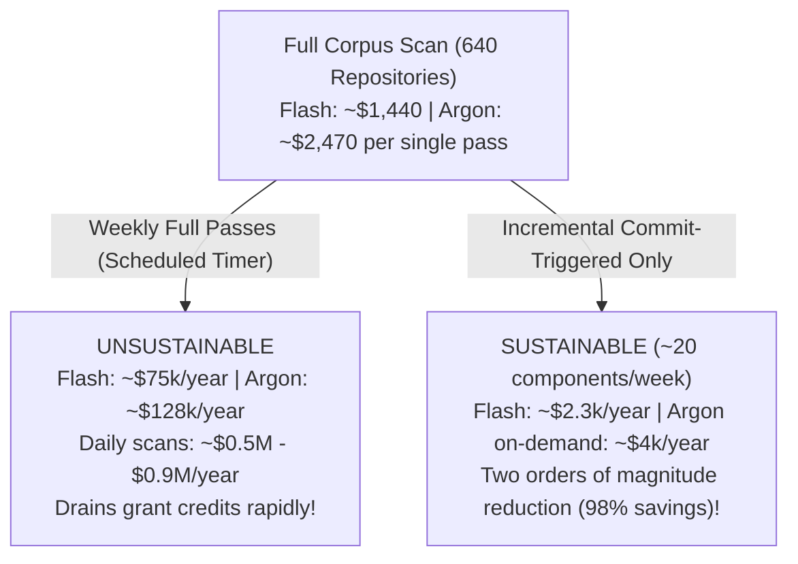

# Report: Gemini API Pricing Analysis & Cognitive Role Cost Optimization

> **Author:** Kilo Code (AI Orchestrator)  
> **Date:** 2026-10-15  
> **Target Systems:** `ai-orchestration`, `kilo-mcp`, Kilo Code CLI / VS Code Extension (`~/.config/kilo/kilo.jsonc`), continuous auditing tools  
> **Source Documents Analyzed & Cross-Referenced:**
> - [Google AI Studio — Gemini API Official Pricing (`ai.google.dev/gemini-api/docs/pricing`)](https://ai.google.dev/gemini-api/docs/pricing)
> - Google AI Studio Rate Cards: `Gemini 4 Argon` (`gemini-4-argon`) and `Gemini 3.8 Flash` (`gemini-3.8-flash`) (Standard Tier, Oct 2026)
> - **Empirical Production Audit Accounting:** [`/Users/Alfredo/works/gcube_audit/docs/reports/COST-AND-ORCHESTRATION-ECONOMICS.md`](/Users/Alfredo/works/gcube_audit/docs/reports/COST-AND-ORCHESTRATION-ECONOMICS.md) (Real-world Kilo session store `~/.local/share/kilo/kilo.db` metrics across 573 runs, $532 shadow spend)
> - Kilo Code UI Configuration (`Models` & `Model per Mode` screens)
> - Kilo Code Runtime Configuration (`~/.config/kilo/kilo.jsonc`)

---

## 1. Executive Summary

Software engineering agents operate in long-horizon, multi-turn loops. An agent reading a codebase, running tests, exploring dependencies, and self-correcting easily accumulates 30k–200k tokens per turn.

By cross-referencing the **official Google Gemini API price list** with **real-world empirical accounting from 573 production runs in `gcube_audit` ($532 total shadow spend)**, this report establishes the factual foundation for our orchestration architecture:

1. **Theoretical vs. Real-World Cost Ratio (2.7× list vs. 1.7× measured):**  
   While `gemini-4-argon` is **2.67× more expensive than `gemini-3.8-flash` on list price**, real audit runs show an effective multiplier of **~1.7× per component** (`$3.86` for Argon vs. `$2.25` for Flash). This gap is explained by Gemini's aggressive **implicit context caching**, which already serves **89% of read tokens** in sustained sessions.
2. **The "Silent Argon Leak" in Kilo Code:**  
   In default Kilo Code setups where `Subagent Model` and `Compaction model` are left `Not set` / `Use chat model`, **every background subagent (e.g. `task(explore)`) and every periodic context compaction inherits the `Default Model` (`Gemini 4 Argon`)**. Routine discovery and mechanical summarization burn tokens at $10.00–$20.00/M instead of $3.75–$7.50/M.
3. **The Daily Burn & Full-Scan Sustainability Trap:**  
   The audit revealed an active daily burn rate of **~$195/day** ($271 on Oct 14, $119 on Oct 15). Running continuous full scans of a 640-repo corpus costs **~$1,440 (Flash) to ~$2,470 (Argon) per single pass**. Weekly full scans would drain **~$75k–$128k/year**; daily scans would require **~$0.5M–$0.9M/year**. Full re-scans on timers are completely unsustainable. The only viable production model is **incremental commit-triggered dispatch (~$2.3k/year)**.
4. **Where the Money Actually Goes (The Uncached Input Bottleneck):**  
   In the $372 Argon audit spend, **47% ($176)** went to fresh (uncached) input tokens. Because implicit caching already hits 89%, the primary financial lever is **reducing duplicate fresh input** via **byte-stable prompt prefixes** and **session reuse (`continue_session_id`)** between review and refutation (preventing code from being re-read from scratch in isolated sandboxes).
5. **The Free Tier Risk (IP Exposure vs. Paid Privacy):**  
   On Google's Free Tier, `Used to improve our products` is **`Yes`**, allowing code, prompts, and credentials to be inspected by human reviewers and used for model training. The **Paid Tier** guarantees **`No`**. For any institutional, enterprise, or private codebase, the Paid Tier is mandatory and `"Hide Prompt-Training Models"` must be **ON**.

---

## 2. Official Pricing Matrix (Per 1 Million Tokens in USD)

Extracted from the official Google AI Studio rate cards:

| Pricing Dimension | `Gemini 4 Argon` (`gemini-4-argon`) | `Gemini 3.8 Flash` (`gemini-3.8-flash`) | Ratio / Savings (`Flash` vs `Argon`) |
| :--- | :--- | :--- | :--- |
| **Model Role** | Flagship Reasoning Model (deep math, architecture, long-decode) | Autonomous Agent & Long-Horizon Software Engineering Model | Specialized Cognitive Split |
| **Free Tier Available?** | ❌ **No** (Not available on Free Tier or Google AI Pro) | ✅ **Yes** (Free of charge, but data used for training) | Flash only |
| **Input Price (Current Promo)** | **$2.00** / 1M tokens *(thru Nov 30, 2026)* | **$0.75** / 1M tokens *(thru Dec 31, 2026)* | **Flash is 2.67× cheaper (-62.5%)** |
| **Input Price (Standard Post-Promo)** | **$4.00** / 1M tokens *(starting Dec 1, 2026)* | **$1.50** / 1M tokens *(starting Jan 1, 2027)* | **Flash is 2.67× cheaper (-62.5%)** |
| **Output + Thinking (Current Promo)** | **$10.00** / 1M tokens *(thru Nov 30, 2026)* | **$3.75** / 1M tokens *(thru Dec 31, 2026)* | **Flash is 2.67× cheaper (-62.5%)** |
| **Output + Thinking (Standard)** | **$20.00** / 1M tokens *(starting Dec 1, 2026)* | **$7.50** / 1M tokens *(starting Jan 1, 2027)* | **Flash is 2.67× cheaper (-62.5%)** |
| **Context Caching (Read / Hit)** | **$0.10** *(promo)* → **$0.20** *(standard)*<br>*(Implicit caching only; explicit storage unsupported)* | **$0.075** *(promo)* → **$0.15** *(standard)*<br>*(Supports explicit storage: $0.50→$1.00/1M/hr)* | **Flash is 25% cheaper on cached hits** |
| **December 2026 Promo Divergence** | Full standard price: **$4.00 in / $20.00 out** | Still discounted: **$0.75 in / $3.75 out** | **Flash is 5.33× cheaper (-81.25%)!** |
| **Grounding with Google Search** | 5,000 free/month, then $14 / 1,000 requests | 5,000 free/month, then $14 / 1,000 requests | Identical |
| **Data Privacy (Paid Tier)** | `Used to improve our products: No` | `Used to improve our products: No` | Contractually private |
| **Data Privacy (Free Tier)** | *(N/A — No Free Tier)* | `Used to improve our products: Yes` | ⚠️ **Public training risk** |

---

## 3. Empirical Production Evidence: The `gcube_audit` Real-World Spend

Source: Kilo session database (`~/.local/share/kilo/kilo.db`), column `cost`, filtered by audit sandbox runs as documented in `gcube_audit/docs/reports/COST-AND-ORCHESTRATION-ECONOMICS.md`:

### 3.1 Cumulative Measured Shadow Spend
- **Total Realized Cost:** **~$532** (€0 billed to lab today due to Google credits; daily burn is the real ceiling).
- **Runs analyzed:** **573 runs**:
  - `gemini-4-argon`: **$372 across 370 runs**
  - `gemini-3.8-flash`: **$150 across 196 runs**
  - Other models: **$8 across 7 runs**

### 3.2 Real Cost per Component (The Planning Unit)
- **Round 1 (55 components on `Gemini 3.8 Flash`):** **~$2.25 / component** (review + refutation).
- **Blind Re-run `gcube_audit_g4` (99 components on `Gemini 4 Argon`):** **~$3.86 / component** (review + refutation).
- **The Empirical Multiplier:** In real multi-turn agent sessions, Argon costs **~1.7× Flash** (significantly lower than the 2.67× theoretical price list ratio).
- **Why?** Argon's long context retention and Kilo's session flow benefit heavily from implicit caching at `$0.10/M`, dampening the headline $2.00–$4.00 input fee.

### 3.3 Token Class Breakdown of the $372 Argon Spend
Where did the $372 actually go?

```text
ARGON TOKEN CLASS EXPENDITURE BREAKDOWN ($372 Total)
────────────────────────────────────────────────────────────────────────────
Fresh (Uncached) Input:   $176  ████████████████████████ (47.3%)
Output Tokens:             $87  ████████████             (23.4%)
Cache-Read (Hits):         $71  ██████████               (19.1%)
Reasoning (Thinking):      $38  █████                    (10.2%)
```

**Key Discovery:** Implicit caching already serves **89% of all read tokens** at 20× less than fresh input. Therefore:
- Trying to push cache hit rate higher yields marginal returns.
- **The true financial lever is reducing fresh uncached input**.
- Today, review and refutation running in separate sandboxes re-read the entire codebase from scratch, paying the fresh input fee twice. On the 99-component Argon run alone, **re-reading code in separate sandboxes wasted ~$67**.

---

## 4. Daily Burn and the Sustainability Ceiling

The empirical burn rate observed during active audit days was **~$195/day** ($271 on 2026-10-14, $119 on 2026-10-15).

Extrapolating this to the complete gCube corpus (~640 repositories):



**Architectural Law:** Scheduled full re-scans of an entire repository corpus on a timer are an economic anti-pattern. Work must be triggered **incrementally on git commit changes only**.

---

## 5. Seven Binding Economic Rules for Orchestration

Based on the empirical evidence, the following 7 economic rules are formally bound into `ai-orchestration` (`orchestration-workflow`, `orchestration-metrics`, `orchestration-setup`):

1. **Incremental Dispatch, Not Scheduled Full Passes:**
   Only dispatch an agent task on a component or repository when its pinned commit hash has changed in Git. Never re-scan unchanged trees on a timer.
2. **Flash by Default, Argon on Demand:**
   Use `Gemini 3.8 Flash` for all bulk execution, exploration, and baseline scanning (~$2.25/component). Promote to `Gemini 4 Argon` (~$3.86/component) only where the stronger reasoning model changes the verdict: independent verification of high/critical findings, complex architectural specs, and subtle semantic conflict resolution.
3. **Maximize Implicit Cache via Byte-Stable Prompt Prefixes:**
   Keep invariant prompt text (grounding clause, methodology instructions, templates) strictly at the beginning of prompts, byte-identical across runs. Put variable context (file paths, diffs, findings) at the very end. This ensures Gemini's prefix caching hits on every turn.
4. **Session Reuse for Review → Refutation (`continue_session_id`):**
   When an agent reviews code and then refutes or fixes findings, reuse the same session (`continue_session_id` / `--resume`) rather than spawning a fresh sandbox. This eliminates the duplicate fresh input fee ($67 saved per 100 components).
5. **Driver-Level Budget Guardrails:**
   The orchestration driver (`kilo-mcp`, `bin/ai-orch`, or continuous audit tools) must read Kilo's `cost` column from `kilo.db`, log the daily shadow spend, and automatically pause dispatch if a configured daily or per-run cost ceiling is exceeded.
6. **Asynchronous Batch Path for Bulk Scans:**
   For latency-tolerant background sweeps, investigate Gemini's Batch API (-50% cost reduction). Split "bulk background scan" (batchable, asynchronous) from "interactive developer orchestration" (synchronous).
7. **Budget Planning for Scheduled Price Step-Ups:**
   Argon prices double on **2026-12-01** ($2→$4 in, $10→$20 out). Flash prices double on **2027-01-01** ($0.75→$1.50 in, $3.75→$7.50 out). During December 2026, Flash offers a **5.33× price advantage** over Argon.

---

## 6. Audit of Kilo Code Settings (`kilo.jsonc`) & Production Remediation

### 6.1 The "Silent Argon Leak" Identified in Kilo Settings

In the user's current settings:
- **`Default Model`:** `Gemini 4 Argon` (Correct for the Architect session).
- **`Subagent Model`:** `Not set` → According to Kilo's tooltip, *“Leave unset to inherit the calling agent's model”*. When Kilo spawns subagents (`task(explore)`, background workers), **they silently run on Argon**, burning $10.00–$20.00/M.
- **`Compaction Model`:** `Use chat model` → Compacting 150k context windows uses Argon instead of Flash.
- **`Hide Prompt-Training Models`:** `OFF` → Consumer endpoints capable of training on code remain active.
- **`Model per Mode`:** Most specialized modes are unset, inheriting Argon across the board.

### 6.2 Recommended Agent-to-Model Mapping in `kilo.jsonc`

```jsonc
{
  "$schema": "https://app.kilo.ai/config.json",
  "model": "google/gemini-4-argon",
  "small_model": "google/gemini-flash-latest",
  "subagent_model": "google/gemini-flash-latest",
  "compaction": {
    "model": "google/gemini-flash-latest"
  },
  "agent": {
    // ── DEEP-REASONING & ORCHESTRATION (Argon: $2-$4 in / $10-$20 out) ──
    "architect": {
      "model": "google/gemini-4-argon",
      "mode": "primary"
    },
    "code-reviewer": {
      "model": "google/gemini-4-argon",
      "mode": "primary"
    },
    "code-skeptic": {
      "model": "google/gemini-4-argon",
      "mode": "primary"
    },
    "debug": {
      "model": "google/gemini-4-argon",
      "mode": "primary"
    },
    "merge-resolver": {
      "model": "google/gemini-4-argon"
    },
    "orchestrator": {
      "model": "google/gemini-4-argon"
    },
    "kilo-mcp-orchestrator-agent": {
      "model": "google/gemini-4-argon"
    },
    "plan": {
      "model": "google/gemini-4-argon"
    },

    // ── BULK-EXECUTION & EXPLORATION (Flash: $0.75-$1.50 in / $3.75-$7.50 out) ──
    "code-simplifier": {
      "model": "google/gemini-flash-latest",
      "mode": "primary"
    },
    "frontend-specialist": {
      "model": "google/gemini-flash-latest",
      "mode": "primary"
    },
    "test-engineer": {
      "model": "google/gemini-flash-latest",
      "mode": "primary"
    },
    "docs-specialist": {
      "model": "google/gemini-flash-latest",
      "mode": "primary"
    },
    "ask": {
      "model": "google/gemini-flash-latest"
    },
    "kilo-customizer": {
      "model": "google/gemini-flash-latest"
    }
  },
  "skills": {
    "paths": [],
    "urls": [
      "https://raw.githubusercontent.com/primax79/ai-orchestration/main/plugins/architect-side/skills/",
      "https://raw.githubusercontent.com/primax79/ai-orchestration/main/plugins/executor-side/skills/",
      "https://raw.githubusercontent.com/primax79/ai-orchestration/main/plugins/shared/skills/"
    ]
  }
}
```

---

## 7. Strategic Cross-Analysis Summary

| Metric / Dimension | Theoretical Price List (`ai.google.dev`) | Empirical Audit (`gcube_audit`) | Orchestration Policy Action |
| :--- | :--- | :--- | :--- |
| **Cost Multiplier (Argon vs Flash)** | 2.67× list ($2.00 vs $0.75 in; $10 vs $3.75 out) | **1.72× measured** ($3.86 vs $2.25 per component) | Use Flash as primary bulk engine; reserve Argon for verification and architecture. |
| **December 2026 Promo Window** | Argon doubles 2026-12-01; Flash discount holds until 2026-12-31. | Multiplier jumps to **5.33×** for 31 days. | Shift maximum execution volume to Flash during December 2026. |
| **Primary Cost Driver** | Output & thinking tokens look highest per token ($10/$20). | **Fresh (uncached) input was 47% ($176)** of all spend! | Use byte-stable prompt prefixes; reuse sessions (`continue_session_id`) to avoid double-reading code. |
| **Context Caching Effectiveness** | Documented as implicit caching at $0.10/M. | **89% of read tokens hit cache** in real sessions. | Caching is already optimal; focus on reducing the 11% fresh input. |
| **Corpus Scan Sustainability** | N/A | Full scan of 640 repos = **$1,440–$2,470/pass**. | Ban timer-based full sweeps; enforce **commit-triggered incremental scanning ($2.3k/yr)**. |
| **Data Privacy & Governance** | Free Tier uses data for training; Paid Tier does not. | Audit ran under Google grant credits on Paid Tier. | Set `"Hide Prompt-Training Models": true` to protect proprietary code. |
