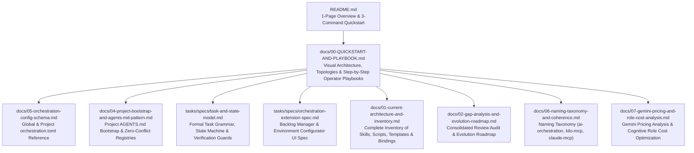

# Structured Documentation — `ai-orchestration`

Central index of the technical documentation for `ai-orchestration`. While [`../README.md`](../README.md) provides a 1-page overview and 3-command quickstart, the documents below cover every architectural and operational detail in depth.

---

## Documentation Structure

---

## Reading Order by Goal

| If you want to... | Read this document |
| :--- | :--- |
| **Install skills & MCP servers from scratch or across Kilo, Claude & Codex** | **[`INSTALLATION.md`](INSTALLATION.md)** |
| **Understand the workflows, visual diagrams & run commands step-by-step** | **[`00-QUICKSTART-AND-PLAYBOOK.md`](00-QUICKSTART-AND-PLAYBOOK.md)** |
| **Configure tools (`kilo`, `claude`, `codex`), models & verification modes** | **[`05-orchestration-config-schema.md`](05-orchestration-config-schema.md)** |
| **Analyze model costs, Gemini 4 Argon vs 3.8 Flash, and Kilo model assignment** | **[`07-gemini-pricing-and-role-cost-analysis.md`](07-gemini-pricing-and-role-cost-analysis.md)** |
| **Understand how project `AGENTS.md` is generated and kept in sync** | **[`04-project-bootstrap-and-agents-md-pattern.md`](04-project-bootstrap-and-agents-md-pattern.md)** |
| **Check the formal task format (`T###`, `NN.T`), state machine & guards** | **[`../tasks/specs/task-and-state-model.md`](../tasks/specs/task-and-state-model.md)** |
| **See the spec for the Backlog Manager & Environment Extension/UI** | **[`../tasks/specs/orchestration-extension-spec.md`](../tasks/specs/orchestration-extension-spec.md)** |
| **Inspect the technical inventory of all plugins, templates & bindings** | **[`01-current-architecture-and-inventory.md`](01-current-architecture-and-inventory.md)** |
| **Review the design analysis of the Python Server + Web UI → VS Code** | **[`03-task-model-and-ui-architecture.md`](03-task-model-and-ui-architecture.md)** |
| **Check the naming conventions across repos and MCP tools** | **[`06-naming-taxonomy-and-coherence.md`](06-naming-taxonomy-and-coherence.md)** |
| **Review the audit trail from the consolidated external review** | **[`02-gap-analysis-and-evolution-roadmap.md`](02-gap-analysis-and-evolution-roadmap.md)** |
