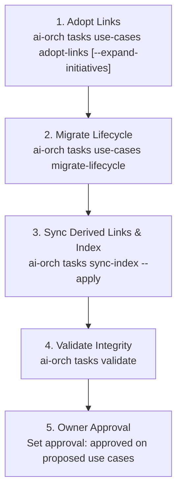

# Use Case Migration Guide: Adopting Links & Two-Way Lifecycle

This guide describes how to migrate a repository's `tasks/` tree to the **Initiative 17** two-way lifecycle model and task-driven linking architecture.

---

## 1. Architectural Changes (What and Why)

Initiative 17 ([`tasks/specs/use-cases-drive-tasks.md`](../tasks/specs/use-cases-drive-tasks.md)) fundamentally updates how Use Cases relate to Tasks and AI Validation:

1. **Tasks Own the Link (Single Source of Truth):**
   - In legacy trees, use cases hand-maintained a writable list `- linked-tasks: ...`.
   - Now, the **task is the source of truth**:
     - Emergent tasks carry `- use-cases: UC001, UC004` in their header (canonical order: after `run-id`, before `short`).
     - Initiative tasks carry `**Use cases:** UC001, UC004` in their status line (canonical order: immediately after `**Depends on:**`).
   - The use case header field `- linked-tasks:` is **derived automatically** by the engine on every `sync-index` and link mutation. Hand-edits to `linked-tasks` are overwritten.
2. **Separation of Author Intent (`approval`) from Live Progress (`stage`):**
   - The hand-written `status: draft|active|deprecated` is removed.
   - **`approval:`** (`proposed` | `approved` | `deprecated`) captures persisted author/owner intent. Newly created use cases start as `proposed` and are approved by the project owner.
   - **`stage:`** (`draft`, `planned`, `in development`, `ready`, `verified`, `failing`, `partial`, `untested`, `ready (revalidation pending)`) is a pure dynamic projection computed by the engine based on the states of all non-dropped linked tasks and recent validation verdicts. It is never edited by hand.
3. **Readiness Gating & Regression Protection:**
   - Single validation (`ai-orch tasks use-cases validate`) refuses to run (exit code 2) unless all linked tasks are finished (`stage: ready`, `verified`, or `failing`), unless overridden with `--force`.
   - Product campaigns (`ai-orch tasks use-cases campaign`) probe only ready use cases, reporting unfinished use cases under "Not ready (N/M)" without marking them failing.
   - Reopening, bouncing, or redelivering a task linked to a verified use case flags `revalidation: pending` and queues it in `ai-orch tasks use-cases queue`.
   - A task cannot reach `verified` or `done` while an approved linked use case is `failing` without explicit `--owner-approved` override.

---

## 2. The 5-Step Migration Procedure

Follow these five steps in exact order to migrate an existing repository without losing links, test history, or validation logs.



### Step 1: Adopt Existing Links (`adopt-links`)

This step copies all existing written `linked-tasks` from the use case headers onto the referenced tasks' headers, establishing tasks as the new source of truth.

1. **Preview the adoption:**
   ```bash
   ai-orch tasks use-cases adopt-links
   ```
   *If your use cases cite entire initiative IDs (e.g. `01`, `08`) rather than individual task leaf IDs (e.g. `01.1`), pass `--expand-initiatives`:*
   ```bash
   ai-orch tasks use-cases adopt-links --expand-initiatives
   ```
   The preview displays:
   - How many use cases contain written links.
   - Every task that will gain `use-cases` or `**Use cases:**`.
   - Any unknown, non-canonical, or cross-workspace task IDs (fail-closed).
   - The unique `plan_hash`.

2. **Handle unresolved IDs (if any):**
   If the preview reports unknown task IDs, either fix the typos in the source use case files or pass `--skip-unknown` to proceed while recording them as unresolved in the adoption report.

3. **Apply the adoption:**
   ```bash
   ai-orch tasks use-cases adopt-links [--expand-initiatives] --apply --expect-plan-hash <hash>
   ```
   **Safety:** Before writing to disk, the engine automatically creates a full backup snapshot under `tasks/_reviews/adopt-links-<timestamp>/` with a cryptographic `manifest.json`.

---

### Step 2: Migrate Lifecycle Status to Approval & Verdict (`migrate-lifecycle`)

This step converts legacy hand-written `status` fields into persisted `approval` intent while backfilling test verdicts into `last-verdict`.

1. **Preview the migration:**
   ```bash
   ai-orch tasks use-cases migrate-lifecycle
   ```
   The engine maps legacy `status` values:
   - `draft` → `approval: proposed`
   - `active` → `approval: approved`
   - `verified` → `approval: approved` and sets `last-verdict: pass`
   - `failing` → `approval: approved` and sets `last-verdict: fail`
   - `partial` → `approval: approved` and sets `last-verdict: partial`
   - `deprecated` → `approval: deprecated`

   Existing validation logs in `## AI Validation Log` are preserved byte-for-byte.

2. **Apply the lifecycle migration:**
   ```bash
   ai-orch tasks use-cases migrate-lifecycle --apply --expect-plan-hash <hash>
   ```
   **Safety:** Like Step 1, an automatic snapshot is saved to `tasks/_reviews/migrate-lifecycle-<timestamp>/` before changes are applied.

---

### Step 3: Synchronize Derived Links & Index (`sync-index`)

Now that tasks hold the links and use cases hold approval, synchronize derived fields:

```bash
# Preview changes to 00-INDEX.md and use case headers
ai-orch tasks sync-index

# Apply synchronization
ai-orch tasks sync-index --apply
```

This step:
- Computes `linked-tasks` on every use case from the task headers, formatting them in deterministic sorted order.
- Updates `00-INDEX.md` tables with use case stages, approvals, and linked task counts.
- Removes the pre-adoption guard flag once all use cases are adopted.

---

### Step 4: Validate Tree Integrity (`validate`)

Run the full validation suite to verify the repository is clean:

```bash
ai-orch tasks validate
```

Ensure the command exits `0` with no errors. Common warnings to check:
- *Feature/fix task without use cases:* informational warning encouraging linkage.
- *Use case approved with no linked tasks:* indicates an approved capability waiting for task authoring.

---

### Step 5: Review & Owner Approval

Inspect the migrated use cases:

```bash
ai-orch tasks use-cases list
```

Use cases that were previously in `draft` will now have `approval: proposed`. The project owner or designated decider reviews these and approves them:

```bash
# Edit approval: proposed -> approved directly or via tooling
```

Once approved, a use case whose linked tasks are complete enters `stage: ready` and is eligible for automated AI validation and campaigns.

---

## 3. Rollback Mechanics with `_reviews/` Snapshots

Both `adopt-links` and `migrate-lifecycle` operate transactionally with pre-execution snapshots:

1. **Snapshot Location:**
   Snapshots are stored in:
   - `tasks/_reviews/adopt-links-<timestamp>/`
   - `tasks/_reviews/migrate-lifecycle-<timestamp>/`

2. **Snapshot Contents:**
   - Exact pre-mutation copies of every file that was modified.
   - `manifest.json`: contains file paths, timestamps, operations, and SHA-256 hashes of the original contents.

3. **How to Roll Back:**
   If you need to revert the migration before committing to git:
   ```bash
   # Option A: Restore files from the snapshot directory
   cp -R tasks/_reviews/adopt-links-<timestamp>/* tasks/  # adjust paths as needed
   
   # Option B: Use git checkout (if working tree was clean before migration)
   git checkout -- tasks/
   ```

---

## 4. Real-World Migration Examples

Three production repositories have successfully executed this migration:

### 1. `ai-orchestration` (Task 17.12)
- **Scope:** 37 use cases (UC001–UC037).
- **Result:**
  - 36 use cases with written links adopted.
  - **109 links** mapped across 91 tasks.
  - 0 unknown task IDs; fail-closed check clean.
  - 37 use cases transitioned to `approval: proposed`.
  - `tasks sync-index --apply` and `tasks validate` completed with zero errors.

### 2. `ai-swissknife` (Task 17.13)
- **Scope:** 34 use cases (UC001–UC034).
- **Challenge:** Many use cases referenced whole initiative numbers (e.g. `- linked-tasks: 01, 02, 05`).
- **Solution:** Executed `adopt-links --expand-initiatives`.
- **Result:**
  - **62 initiative-level links** were expanded into **226 concrete leaf task links** across active, done, and merged initiatives.
  - All leaf tasks received explicit `use-cases` or `**Use cases:**` entries.
  - Tree validated cleanly with 100% link integrity.

### 3. `git-code-rag` (Task 17.14)
- **Scope:** 41 use cases (UC001–UC041).
- **Challenge:** Prior to migration, automated campaigns ran against all use cases indiscriminately. 9 draft use cases (UC031–UC040) had no implemented tasks and were incorrectly marked `failing`, creating false alarms.
- **Result:**
  - Adopted 71 links across 32 implemented use cases.
  - After migration, `ai-orch tasks use-cases campaign` probed **only the 32 ready use cases** (all 32 `verified`, 100% readiness score).
  - The 9 draft use cases (UC031–UC040) were cleanly reported under **"Not ready (0/0 tasks done)"** without being probed or failing the test suite.
