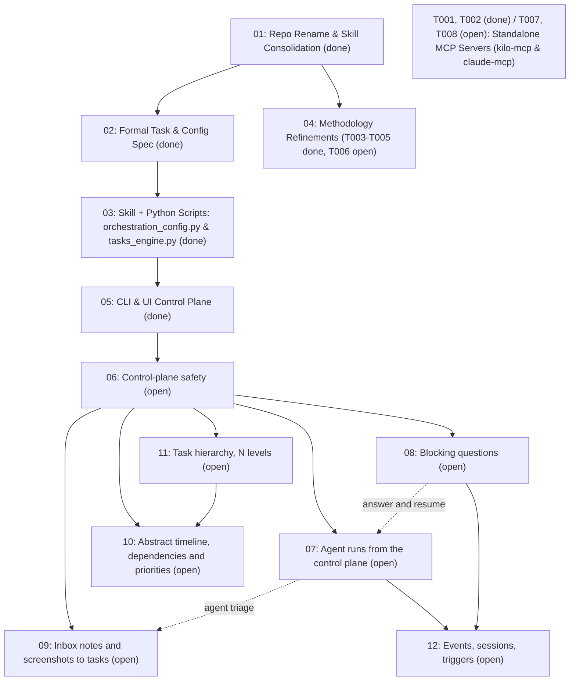

# Task Index — ai-orchestration

Live registry of planned initiatives and emergent tasks for `ai-orchestration`. Convention: [`AGENTS.md`](AGENTS.md). Shared context: [`CONTEXT.md`](CONTEXT.md).

## Initiatives
`#` is the stable id (folder/task prefix); `Priority` is execution order. Each task (`NN.T`) is sized for one independently-verifiable commit and ready for delegation.

<!-- ai-orch:generated initiatives -->
| Priority | # | Initiative | Status | Depends on | Size |
| --- | --- | --- | --- | --- | --- |
| 1 | 01 | [Consolidate Orchestration & Task Skills into `ai-orchestration`](done/01-repo-consolidation/plan.md) | done | - | M |
| 2 | 02 | [Formal Task Model, State Machine & `orchestration.toml` Specification](done/02-task-and-config-spec/plan.md) | done | 01 | M |
| 3 | 03 | [Configuration & Task Management Skill + Python Scripts (`orchestration_config.py`, `tasks_engine.py`)](done/03-skill-and-script-engine/plan.md) | done | 02 | M |
| 4 | 04 | [Orchestration Methodology & Skill Refinements (Review Tier 2)](done/04-methodology-refinements/plan.md) | done | 01 | M |
| 5 | 05 | [Standalone CLI (`ai-orch`), From-Scratch Installer & Extension Control Plane](done/05-cli-and-ui-handoff/plan.md) | done | 02, 03 | L |
| 6 | 06 | [Control-plane safety (Doctor, index, UI backend, VS Code bridge)](done/06-control-plane-safety/plan.md) | done | 05 | L |
| 7 | 07 | [Agent runs from the control plane (choose who does the work)](done/07-agent-runs-from-ui/plan.md) | done with a caveat (done: 07.1–07.12) | 05, 06 | L |
| 8 | 08 | [Blocking questions (format, engine, pending-answers UI)](done/08-blocking-questions/plan.md) | done | 06 | M |
| 9 | 09 | [Inbox: draft notes, reports and screenshots, processed into tasks](done/09-inbox-notes/plan.md) | done with a caveat (done: 09.1–09.11) | 06 (07 for agent triage) | M |
| 10 | 10 | [Abstract timeline: dependencies and priorities](done/10-timeline-gantt/plan.md) | done | 06, 09.1 | S |
| 11 | 11 | [First-class task hierarchy (N levels)](done/11-subtasks/plan.md) | done | 06, 09.1 | M |
| 12 | 12 | [Events, orchestration sessions and triggers](done/12-events-and-triggers/plan.md) | done with a caveat (done: 12.1, 12.3–12.17) | 07, 08, 11 | L |
| 13 | 13 | [Doctor rework: findings that are true, actionable and resolvable](done/13-doctor-rework/plan.md) | done with a caveat (done: 13.1–13.7) | 06 | M |
| 15 | 15 | [Use-Case Driven Specification, Task Definition & Product Validation](done/15-use-case-driven-validation/plan.md) | done | 01, 11 | L |
| 16 | 16 | [Orchestration broker: one MCP server per user, workspaces, projects, mail](16-orchestration-broker/plan.md) | in progress (done: 16.1–16.4, 16.6, 16.9; running: 16.5) | T026, T027, T028 | L |
<!-- /ai-orch:generated initiatives -->
## Specs

<!-- ai-orch:generated specs -->
| Spec | Drives |
| --- | --- |
| [agent-runs-from-ui](specs/agent-runs-from-ui.md) | - |
| [blocking-questions](specs/blocking-questions.md) | - |
| [control-plane-safety](specs/control-plane-safety.md) | - |
| [events-and-triggers](specs/events-and-triggers.md) | - |
| [executor-housekeeping-and-completion](specs/executor-housekeeping-and-completion.md) | - |
| [inbox-notes](specs/inbox-notes.md) | - |
| [orchestration-broker-mcp](specs/orchestration-broker-mcp.md) | - |
| [orchestration-config-and-agents-md](specs/orchestration-config-and-agents-md.md) | - |
| [orchestration-extension-spec](specs/orchestration-extension-spec.md) | - |
| [peer-messaging](specs/peer-messaging.md) | - |
| [subtasks](specs/subtasks.md) | - |
| [task-and-state-model](specs/task-and-state-model.md) | - |
| [timeline-gantt](specs/timeline-gantt.md) | - |
| [tracker-links](specs/tracker-links.md) | - |
| [ui-multi-project](specs/ui-multi-project.md) | - |
| [use-case-management-and-ai-validation](specs/use-case-management-and-ai-validation.md) | - |
<!-- /ai-orch:generated specs -->

## Specs

| Spec | Drives |
| --- | --- |
| [agent-runs-from-ui](specs/agent-runs-from-ui.md) | 07 |
| [blocking-questions](specs/blocking-questions.md) | 08 |
| [control-plane-safety](specs/control-plane-safety.md) | 06 |
| [events-and-triggers](specs/events-and-triggers.md) | 12 (supersedes 08.6) |
| [executor-housekeeping-and-completion](specs/executor-housekeeping-and-completion.md) | - |
| [inbox-notes](specs/inbox-notes.md) | 09 |
| [orchestration-broker-mcp](specs/orchestration-broker-mcp.md) | - |
| [orchestration-config-and-agents-md](specs/orchestration-config-and-agents-md.md) | 02, 03 |
| [orchestration-extension-spec](specs/orchestration-extension-spec.md) | 05 |
| [peer-messaging](specs/peer-messaging.md) | - |
| [subtasks](specs/subtasks.md) | 11 (and 10.1 builds on 11.1) |
| [task-and-state-model](specs/task-and-state-model.md) | 02, 03, 05 |
| [timeline-gantt](specs/timeline-gantt.md) | 10 |
| [tracker-links](specs/tracker-links.md) | - |
| [ui-multi-project](specs/ui-multi-project.md) | - |
| [use-case-management-and-ai-validation](specs/use-case-management-and-ai-validation.md) | 15 |

## Next up

<!-- ai-orch:generated next-up -->
| Id | Priority | Task | Executor | Handoff |
| --- | --- | --- | --- | --- |
<!-- /ai-orch:generated next-up -->

## Tasks by category

<!-- ai-orch:generated tasks-by-category -->
### methodology

Evolutions and refinements to the orchestration skills (`orchestration-methodology`, `conflict-resolver`, `headless-executor-contract`). Owner session: unassigned ([README](methodology/README.md)).

| Id | Priority | Task | State | Executor | Depends on |
| --- | --- | --- | --- | --- | --- |

### server-and-bindings

Standalone MCP server evolutions (`../kilo-mcp/`, `../claude-mcp/`). Owner session: unassigned ([README](server-and-bindings/README.md)).

| Id | Priority | Task | State | Executor | Depends on |
| --- | --- | --- | --- | --- | --- |

### micro

Tasks in `micro`. Owner session: unassigned ([README](micro/README.md)).

| Id | Priority | Task | State | Executor | Depends on |
| --- | --- | --- | --- | --- | --- |

### env-doctor

Tasks in `env-doctor`. Owner session: unassigned ([README](env-doctor/README.md)).

| Id | Priority | Task | State | Executor | Depends on |
| --- | --- | --- | --- | --- | --- |

### tasks

Tasks in `tasks`. Owner session: unassigned ([README](tasks/README.md)).

| Id | Priority | Task | State | Executor | Depends on |
| --- | --- | --- | --- | --- | --- |

### tooling

Tasks in `tooling`. Owner session: unassigned ([README](tooling/README.md)).

| Id | Priority | Task | State | Executor | Depends on |
| --- | --- | --- | --- | --- | --- |

### engine

Tasks in `engine`. Owner session: unassigned ([README](engine/README.md)).

| Id | Priority | Task | State | Executor | Depends on |
| --- | --- | --- | --- | --- | --- |
| T035 (One-shot close) | P1 | [One-shot close, clearer derived-state refusal, bulk close of verified](engine/T035-one-shot-close-clearer-derived-state-refusal-bulk.md) | open | kilo | - |
| T037 (Conflict-free task index) | P1 | [Task index without merge conflicts across parallel branches](engine/T037-task-index-without-merge-conflicts-across-parallel.md) | open | kilo | - |
| T050 (Non-destructive upgrade) | P1 | [upgrade and sync-index preserve project-specific content; per-project extension fields](engine/T050-upgrade-and-sync-index-preserve-project-specific-c.md) | open | kilo | - |
| T051 (reopen crash) | P1 | [tasks reopen crashes on emergent tasks (TypeError in _update_index_task_path)](engine/T051-tasks-reopen-crashes-on-emergent-tasks-typeerror-i.md) | open | kilo | - |
| T052 (Move answered question guard) | P3 | [questions move refuses or warns on an already answered question](engine/T052-questions-move-refuses-or-warns-on-an-already-answ.md) | open | kilo | - |
<!-- /ai-orch:generated tasks-by-category -->

## Decisions waiting

<!-- ai-orch:generated decisions -->
| Key | Question | Blocks | Decider | Recommended |
| --- | --- | --- | --- | --- |
| - | None. | - | - | - |
<!-- /ai-orch:generated decisions -->

## Done

<!-- ai-orch:generated done -->
| Id | Task | Result | Closed |
| --- | --- | --- | --- |
| T010 (Skill renames decision) | [Core skill renames decision (docs/06 taxonomy vs. current skill names)](done/methodology/T010-core-skill-naming-decision.md) | done | 2026-10-15 |
| T009 (Usability and quickstart) | [Product & per-skill usability, quickstart playbook, and instruction clarity](done/methodology/T009-usability-and-complete-documentation.md) | done | 2026-10-15 |
| T005 (Executor contract hardening) | [Hardening headless-executor-contract and evaluating Kilo agent mode](done/methodology/T005-headless-contract-and-agent-mode.md) | done | 2026-10-15 |
| T004 (Conflict-resolver rework) | [Rework conflict-resolver for Architect audience and incompatible designs](done/methodology/T004-conflict-resolver-rework.md) | done | 2026-10-15 |
| T003 (Phase 5 closure) | [Phase 5 explicit decision point and worktree lifecycle closure](done/methodology/T003-phase5-decision-and-worktree-cleanup.md) | done | 2026-10-15 |
| T002 (Decision telemetry rework) | [Decision telemetry (kilo_log_decision) and ROI analysis rework](done/server-and-bindings/T002-decision-telemetry-and-roi-rework.md) | done | 2026-10-15 |
| T001 (Task wait guidance) | [Task completion wait (kilo_task_wait) and watcher guidance](done/server-and-bindings/T001-task-completion-wait-and-watcher.md) | done | 2026-10-15 |
| T011 (render-agents-md topology) | [render-agents-md: render rules that match the actual orchestrator/executor topology](done/methodology/T011-render-agents-md-topology.md) | done | 2026-10-17 |
| T013 (Answer dialog wording) | [Answer confirmation dialog says "No modifications required"](done/micro/T013-answer-dialog-wording.md) | done | 2026-10-17 |
| T014 (Flaky backend test) | [One backend test failed once in eleven runs](done/micro/T014-flaky-backend-test.md) | done | 2026-10-17 |
| T006 (Incident narratives extraction) | [Extract incident narratives to references/incidents.md (progressive disclosure)](done/methodology/T006-incidents-progressive-disclosure.md) | done | 2026-10-17 |
| T007 (Verification gate tool) | [Structured verification gate tool in kilo-mcp](done/server-and-bindings/T007-verification-gate-tool.md) | done | 2026-10-17 |
| T008 (claude-mcp spike) | [claude-mcp Phase 1 empirical spike (Option A --bg vs Option B detached -p)](done/server-and-bindings/T008-claude-mcp-phase1-spike.md) | done | 2026-10-17 |
| T020 (Flaky run tests) | [Flaky run-engine tests under load](done/micro/T020-flaky-run-engine-tests-under-load.md) | done | 2026-10-17 |
| T015 (Navbar label wrapping) | [Navbar labels wrap on narrow widths](done/micro/T015-navbar-narrow-width.md) | done | 2026-10-18 |
| T012 (Hung kilo runs) | [kilo-mcp: detect kilo run processes that hang after finishing](done/server-and-bindings/T012-kilo-run-hangs-after-completion.md) | done | 2026-10-18 |
| T031 (Conditional done follow-ups) | [Conditional done: question age in the index; conditions: header position](done/server-and-bindings/T031-conditional-done-question-age-in-the-index-conditi.md) | done | 2026-10-21 |
| T034 (Built-in feedback channel) | [Tooling feedback built into the product: ai-orch feedback, skill rule, upgrade AGENTS.md](done/server-and-bindings/T034-tooling-feedback-built-into-the-product-ai-orch-fe.md) | done | 2026-10-21 |
| T019 (Duplicate skills alignment) | [Apply Q005: per-skill diff of the gcube-jenkins, gcube-security-audit and frontend-design copies](done/env-doctor/T019-apply-q005-per-skill-diff-of-the-gcube-jenkins-gcu.md) | done | 2026-10-21 |
| T036 (Steps by command) | [Steps and verification authored by command; placeholders rejected](done/engine/T036-steps-and-verification-authored-by-command-placeho.md) | done | 2026-10-23 |
| T039 (Adoption helpers) | [Adopting existing trees: legacy plans/, next-id preview, discover before registering](done/engine/T039-adopting-existing-trees-legacy-plans-next-id-previ.md) | done | 2026-10-23 |
| T041 (Question workflow gaps) | [Questions: unapplied answers surfaced, moved-to-tracker status, Notes section](done/engine/T041-questions-unapplied-answers-surfaced-moved-to-trac.md) | done | 2026-10-23 |
| T042 (Waiting-on qualifier) | [Waiting-on qualifier for waiting tasks](done/engine/T042-waiting-on-qualifier-for-waiting-tasks.md) | done | 2026-10-23 |
| T044 (Durable verification requests) | [Durable verification requests addressed to a workspace or session](done/engine/T044-durable-verification-requests-addressed-to-a-works.md) | done | 2026-10-23 |
| T016 (Doctor findings study) | [Study: are the Doctor's persistent findings real, and do we handle them right?](done/env-doctor/T016-doctor-findings-study.md) | done with a caveat: validated by the architect, no user yet | 2026-10-23 |
| T017 (Remove project skill copies) | [Apply Q002: remove the untracked project-scope skill copies in ai-orchestration](done/env-doctor/T017-apply-q002-remove-the-untracked-project-scope-skil.md) | done with a caveat: validated by the architect, no user yet | 2026-10-23 |
| T018 (Orchestration skill precedence) | [Q003 follow-up: precedence when orchestration-workflow and the generic orchestration skill coexist](done/env-doctor/T018-q003-follow-up-precedence-when-orchestration-workf.md) | done with a caveat: validated by the architect, no user yet | 2026-10-23 |
| T021 (Binding template drift) | [Precedence between orchestration-workflow and kilo-mcp-orchestrator; fix binding template drift](done/methodology/T021-precedence-between-orchestration-workflow-and-kilo.md) | done with a caveat: validated by the architect, no user yet | 2026-10-23 |
| T025 (Short title field) | [Short title field for tasks and questions](done/methodology/T025-short-title-field-for-tasks-and-questions.md) | done | 2026-10-23 |
| T023 (VS Code tree parity) | [VS Code parity for the Tree (11.3) and microtask (10.5) messages](done/micro/T023-vs-code-parity-for-the-tree-11-3-and-microtask-10.md) | done | 2026-10-23 |
| T022 (Run engine fixes) | [Run engine fixes found by the 07.5/12.1 live capture](done/server-and-bindings/T022-run-engine-fixes-found-by-the-07-5-12-1-live-captu.md) | done with a caveat: validated by the architect, no user yet | 2026-10-23 |
| T026 (Trigger enqueue race) | [Trigger enqueue races the orchestrator queue and advances the role cursor too early](done/server-and-bindings/T026-trigger-enqueue-races-the-orchestrator-queue-and-a.md) | done with a caveat: validated by the architect, no user yet | 2026-10-23 |
| T027 (Duplicate turn resumption) | [Stale-claim recovery relaunches a turn whose child process has not written its pid yet](done/server-and-bindings/T027-stale-claim-recovery-relaunches-a-turn-whose-child.md) | done with a caveat: validated by the architect, no user yet | 2026-10-23 |
| T028 (Unattended turn hardening) | [Unattended turns: enforce reduced capability on every tool and harden the untrusted-data delimiters](done/server-and-bindings/T028-unattended-turns-enforce-reduced-capability-on-eve.md) | done with a caveat: validated by the architect, no user yet | 2026-10-23 |
| T029 (Letter-suffix plan ids) | [Plan task ids with a letter suffix drop out of the index](done/server-and-bindings/T029-plan-task-ids-with-a-letter-suffix-drop-out-of-the.md) | done | 2026-10-23 |
| T030 (Conditional done) | [conditions: header for tasks done with open questions that may change the result](done/server-and-bindings/T030-conditions-header-for-tasks-done-with-open-questio.md) | done | 2026-10-23 |
| T032 (CLI writes through broker) | [CLI writes reach a live broker; guard ignores a stale manifest](done/server-and-bindings/T032-cli-writes-reach-a-live-broker-guard-ignores-a-sta.md) | done | 2026-10-23 |
| T033 (Test config isolation) | [Test sessions isolated from the user's global config](done/server-and-bindings/T033-test-sessions-isolated-from-the-user-s-global-conf.md) | done | 2026-10-23 |
| T040 (Workspace next) | [Workspace-wide next-up and open tasks across projects](done/server-and-bindings/T040-workspace-wide-next-up-and-open-tasks-across-proje.md) | done | 2026-10-23 |
| T043 (Cross-workspace task links) | [Cross-workspace executor and depends-on links with live state](done/server-and-bindings/T043-cross-workspace-executor-and-depends-on-links-with.md) | done | 2026-10-23 |
| T045 (Broker validation follow-ups) | [Broker follow-ups from validation: mcp --local, stable error codes, project field](done/server-and-bindings/T045-broker-follow-ups-from-validation-mcp-local-stable.md) | done | 2026-10-23 |
| T046 (Compact common queue) | [Common view Queue: compact next-up list and kind on rows](done/server-and-bindings/T046-common-view-queue-compact-next-up-list-and-kind-on.md) | done | 2026-10-23 |
| T048 (Project selector active counts) | [Project selector shows non-closed ticket counts (waiting, open, progress)](done/server-and-bindings/T048-project-selector-shows-non-closed-ticket-counts-wa.md) | done | 2026-10-23 |
| T049 (Project discovery hygiene) | [Project discovery: only task trees, no ignored folders or symlinks; ignore config; hide empty projects](done/server-and-bindings/T049-project-discovery-only-task-trees-no-ignored-folde.md) | done | 2026-10-23 |
| T038 (Stable entry point) | [Stable ai-orch entry point; clean adoption by upgrade](done/tooling/T038-stable-ai-orch-entry-point-clean-adoption-by-upgra.md) | done | 2026-10-23 |
| T047 (Architect verification without users) | [Architect verification of delivered items that have no user session](done/server-and-bindings/T047-architect-verification-of-delivered-items-that-hav.md) | done | 2026-10-23 |
| T024 (Proposal confirm engine) | [Confirm or reject trigger-proposed actions (engine + UI wiring)](done/server-and-bindings/T024-confirm-or-reject-trigger-proposed-actions-engine.md) | done with a caveat: validated by the architect, no user yet | 2026-10-23 |
<!-- /ai-orch:generated done -->

## Dependency graph

