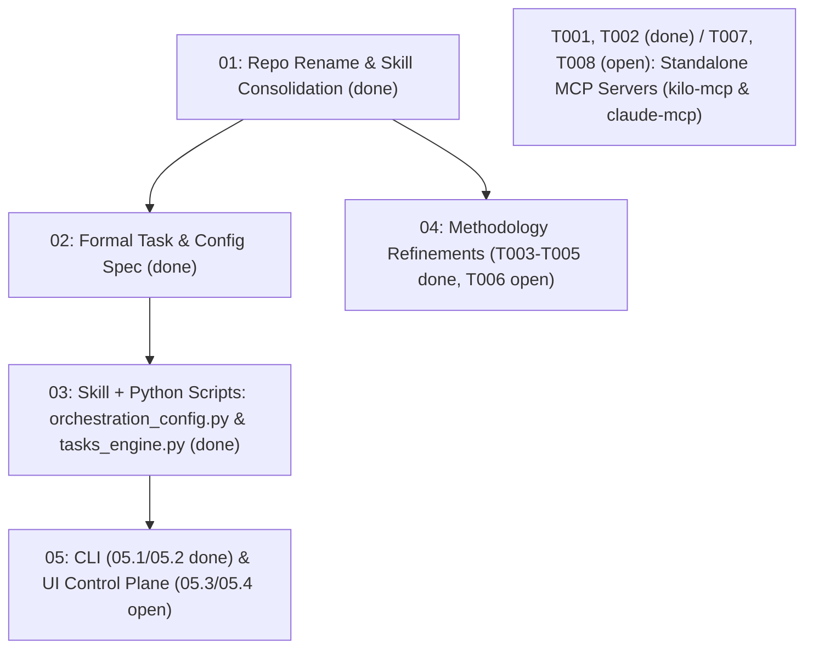

# Task Index — ai-orchestration

Live registry of planned initiatives and emergent tasks for `ai-orchestration`. Convention: [`AGENTS.md`](AGENTS.md). Shared context: [`CONTEXT.md`](CONTEXT.md).

## Initiatives

`#` is the stable id (folder/task prefix); `Priority` is execution order. Each task (`NN.T`) is sized for one independently-verifiable commit and ready for delegation.

| Priority | # | Initiative | Status | Depends on | Size |
| --- | --- | --- | --- | --- | --- |
| 1 | 01 | [Consolidate Orchestration & Task Skills into `ai-orchestration`](01-repo-consolidation/plan.md) | done | - | M |
| 2 | 02 | [Formal Task Model, State Machine & `orchestration.toml` Specification](02-task-and-config-spec/plan.md) | done | 01 | M |
| 3 | 03 | [Configuration & Task Management Skill + Python Scripts (`orchestration_config.py`, `tasks_engine.py`)](03-skill-and-script-engine/plan.md) | done | 02 | M |
| 4 | 04 | [Orchestration Methodology & Skill Refinements (Review Tier 2)](04-methodology-refinements/plan.md) | partial (`T003`–`T005` done; `T006` open) | 01 | M |
| 5 | 05 | [Standalone CLI (`ai-orch`), From-Scratch Installer & Extension Control Plane](05-cli-and-ui-handoff/plan.md) | partial (`05.1`–`05.2` done; `05.3`–`05.4` UI open) | 02, 03 | L |

## Specs

| Spec | Drives |
| --- | --- |
| [orchestration-config-and-agents-md](specs/orchestration-config-and-agents-md.md) | 02, 03 |
| [task-and-state-model](specs/task-and-state-model.md) | 02, 03, 05 |
| [orchestration-extension-spec](specs/orchestration-extension-spec.md) | 05 |

## Next up

| Id | Priority | Task | Executor | Handoff |
| --- | --- | --- | --- | --- |
| 05.3 | P1 | [Extension / Web UI Backend & Backlog Manager View (Macro-Task 1)](05-cli-and-ui-handoff/plan.md) | self / kilo | `Read tasks/05-cli-and-ui-handoff/plan.md (task 05.3) and tasks/specs/orchestration-extension-spec.md, build the Backlog Manager UI backed by bin/ai-orch tasks --json.` |
| 05.4 | P1 | [Extension / Web UI Installer, Doctor & Orchestrator Configurator (Macro-Tasks 2, 3, 4)](05-cli-and-ui-handoff/plan.md) | self / kilo | `Read tasks/05-cli-and-ui-handoff/plan.md (task 05.4) and tasks/specs/orchestration-extension-spec.md, build the Environment Installer/Doctor & Configurator UI backed by bin/ai-orch env/config --json.` |
| T008 | P1 | [claude-mcp Phase 1 empirical spike (Option A --bg vs Option B detached -p)](server-and-bindings/T008-claude-mcp-phase1-spike.md) | claude | `Read tasks/server-and-bindings/T008-claude-mcp-phase1-spike.md and ../claude-mcp/SPEC.md, run the Phase 1 spike, record findings, and update the task and the registry.` |
| T007 | P2 | [Structured verification gate tool in kilo-mcp](server-and-bindings/T007-verification-gate-tool.md) | kilo | `Read tasks/server-and-bindings/T007-verification-gate-tool.md, do the open steps, run the Verification, update the task and the registry.` |

## Tasks by category

### methodology

Evolutions and refinements to the orchestration skills (`orchestration-methodology`, `conflict-resolver`, `headless-executor-contract`). Owner session: unassigned ([README](methodology/README.md)).

| Id | Priority | Task | State | Executor | Depends on |
| --- | --- | --- | --- | --- | --- |
| T006 | P3 | [Extract incident narratives to references/incidents.md (progressive disclosure)](methodology/T006-incidents-progressive-disclosure.md) | open | self | T003 |

### server-and-bindings

Standalone MCP server evolutions (`../kilo-mcp/`, `../claude-mcp/`). Owner session: unassigned ([README](server-and-bindings/README.md)).

| Id | Priority | Task | State | Executor | Depends on |
| --- | --- | --- | --- | --- | --- |
| T008 | P1 | [claude-mcp Phase 1 empirical spike (Option A --bg vs Option B detached -p)](server-and-bindings/T008-claude-mcp-phase1-spike.md) | open | claude | - |
| T007 | P2 | [Structured verification gate tool in kilo-mcp](server-and-bindings/T007-verification-gate-tool.md) | open | kilo | - |

## Decisions waiting

| Task / Initiative | Question (exact) | Decider | Blocks |
| --- | --- | --- | --- |
| - | None currently blocking — architectural direction locked with owner on 2026-10-15 (see `docs/03`–`05`). | - | - |

## Done

| Id | Task | Result | Closed |
| --- | --- | --- | --- |
| T010 | [Core skill renames decision (docs/06 taxonomy vs. current skill names)](done/methodology/T010-core-skill-naming-decision.md) | done | 2026-10-15 |
| T009 | [Product & per-skill usability, quickstart playbook, and instruction clarity](done/methodology/T009-usability-and-complete-documentation.md) | done | 2026-10-15 |
| T005 | [Hardening headless-executor-contract and evaluating Kilo agent mode](done/methodology/T005-headless-contract-and-agent-mode.md) | done | 2026-10-15 |
| T004 | [Rework conflict-resolver for Architect audience and incompatible designs](done/methodology/T004-conflict-resolver-rework.md) | done | 2026-10-15 |
| T003 | [Phase 5 explicit decision point and worktree lifecycle closure](done/methodology/T003-phase5-decision-and-worktree-cleanup.md) | done | 2026-10-15 |
| T002 | [Decision telemetry (kilo_log_decision) and ROI analysis rework](done/server-and-bindings/T002-decision-telemetry-and-roi-rework.md) | done | 2026-10-15 |
| T001 | [Task completion wait (kilo_task_wait) and watcher guidance](done/server-and-bindings/T001-task-completion-wait-and-watcher.md) | done | 2026-10-15 |

## Dependency graph

