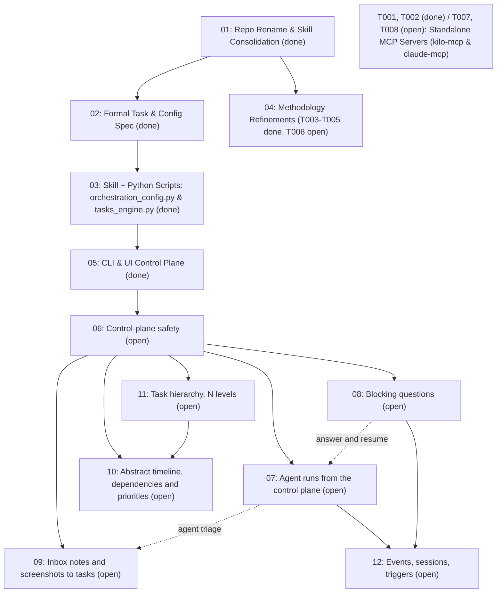

# Task Index — ai-orchestration

Live registry of planned initiatives and emergent tasks for `ai-orchestration`. Convention: [`AGENTS.md`](AGENTS.md). Shared context: [`CONTEXT.md`](CONTEXT.md).

## Initiatives
`#` is the stable id (folder/task prefix); `Priority` is execution order. Each task (`NN.T`) is sized for one independently-verifiable commit and ready for delegation.

<!-- ai-orch:generated initiatives -->
| Priority | # | Initiative | Status | Depends on | Size |
| --- | --- | --- | --- | --- | --- |
| 1 | 01 | [Consolidare le skill di orchestrazione e dei task in `ai-orchestration`](done/01-repo-consolidation/plan.md) | done | - | M |
| 2 | 02 | [Modello formale dei task, macchina a stati e specifica di `orchestration.toml`](done/02-task-and-config-spec/plan.md) | done | 01 | M |
| 3 | 03 | [Skill di configurazione e gestione dei task + script Python](done/03-skill-and-script-engine/plan.md) | done | 02 | M |
| 4 | 04 | [Affinamenti della metodologia di orchestrazione e delle skill (Revisione Tier 2)](done/04-methodology-refinements/plan.md) | done | 01 | M |
| 5 | 05 | [CLI standalone (`ai-orch`), installatore da zero e piano di controllo per l'estensione](done/05-cli-and-ui-handoff/plan.md) | done | 02, 03 | L |
| 6 | 06 | [Sicurezza del piano di controllo (Doctor, indice, backend UI, bridge VS Code)](done/06-control-plane-safety/plan.md) | done | 05 | L |
| 7 | 07 | [Esecuzioni degli agenti dal piano di controllo (scegliere chi svolge il lavoro)](done/07-agent-runs-from-ui/plan.md) | done with a caveat (done: 07.1–07.12) | 05, 06 | L |
| 8 | 08 | [Domande bloccanti (formato, motore, UI delle risposte in sospeso)](done/08-blocking-questions/plan.md) | done | 06 | M |
| 9 | 09 | [Inbox: note in bozza, report e screenshot, elaborati in task](done/09-inbox-notes/plan.md) | done with a caveat (done: 09.1–09.11) | 06 (07 for agent triage) | M |
| 10 | 10 | [Timeline astratta: dipendenze e priorità](done/10-timeline-gantt/plan.md) | done | 06, 09.1 | S |
| 11 | 11 | [Gerarchia di task di prima classe (N livelli)](done/11-subtasks/plan.md) | done | 06, 09.1 | M |
| 12 | 12 | [Eventi, sessioni di orchestrazione e trigger](done/12-events-and-triggers/plan.md) | done with a caveat (done: 12.1, 12.3–12.17) | 07, 08, 11 | L |
| 13 | 13 | [Rielaborazione del Doctor: rilievi reali, azionabili e risolvibili](done/13-doctor-rework/plan.md) | done with a caveat (done: 13.1–13.7) | 06 | M |
| 15 | 15 | [Specifiche guidate dai casi d'uso, definizione dei task e validazione del prodotto](done/15-use-case-driven-validation/plan.md) | done | 01, 11 | L |
| 16 | 16 | [Broker di orchestrazione: un server MCP per utente, workspace, progetti, posta](16-orchestration-broker/plan.md) | in progress (done: 16.1–16.4, 16.6, 16.9; running: 16.5) | T026, T027, T028 | L |
| 17 | 17 | [Gli use case guidano i task](17-use-cases-drive-tasks/plan.md) | in progress (done: 17.1–17.2; next: 17.3–17.14) | - | M |
<!-- /ai-orch:generated initiatives -->
## Specs

<!-- ai-orch:generated specs -->
| Spec | Drives |
| --- | --- |
| [agent-runs-from-ui](specs/agent-runs-from-ui.md) | - |
| [blocking-questions](specs/blocking-questions.md) | - |
| [contextual-element-chat](specs/contextual-element-chat.md) | - |
| [control-plane-safety](specs/control-plane-safety.md) | - |
| [events-and-triggers](specs/events-and-triggers.md) | - |
| [executor-housekeeping-and-completion](specs/executor-housekeeping-and-completion.md) | - |
| [inbox-notes](specs/inbox-notes.md) | - |
| [orchestration-broker-mcp](specs/orchestration-broker-mcp.md) | - |
| [orchestration-config-and-agents-md](specs/orchestration-config-and-agents-md.md) | - |
| [orchestration-extension-spec](specs/orchestration-extension-spec.md) | - |
| [owner-interactions-study](specs/owner-interactions-study.md) | - |
| [peer-messaging](specs/peer-messaging.md) | - |
| [subtasks](specs/subtasks.md) | - |
| [task-and-state-model](specs/task-and-state-model.md) | - |
| [timeline-gantt](specs/timeline-gantt.md) | - |
| [tracker-links](specs/tracker-links.md) | - |
| [ui-multi-project](specs/ui-multi-project.md) | - |
| [use-case-management-and-ai-validation](specs/use-case-management-and-ai-validation.md) | - |
| [use-cases-drive-tasks](specs/use-cases-drive-tasks.md) | - |
<!-- /ai-orch:generated specs -->

## Specs

| Spec | Drives |
| --- | --- |
| [agent-runs-from-ui](specs/agent-runs-from-ui.md) | 07 |
| [blocking-questions](specs/blocking-questions.md) | 08 |
| [control-plane-safety](specs/control-plane-safety.md) | 06 |
| [events-and-triggers](specs/events-and-triggers.md) | 12 (supersedes 08.6) |
| [executor-housekeeping-and-completion](specs/executor-housekeeping-and-completion.md) | - |
| [inbox-notes](specs/inbox-notes.md) | 09 |
| [orchestration-broker-mcp](specs/orchestration-broker-mcp.md) | - |
| [orchestration-config-and-agents-md](specs/orchestration-config-and-agents-md.md) | 02, 03 |
| [orchestration-extension-spec](specs/orchestration-extension-spec.md) | 05 |
| [peer-messaging](specs/peer-messaging.md) | - |
| [subtasks](specs/subtasks.md) | 11 (and 10.1 builds on 11.1) |
| [task-and-state-model](specs/task-and-state-model.md) | 02, 03, 05 |
| [timeline-gantt](specs/timeline-gantt.md) | 10 |
| [tracker-links](specs/tracker-links.md) | - |
| [ui-multi-project](specs/ui-multi-project.md) | - |
| [use-case-management-and-ai-validation](specs/use-case-management-and-ai-validation.md) | 15 |

## Next up

<!-- ai-orch:generated next-up -->
| Id | Priority | Task | Executor | Handoff |
| --- | --- | --- | --- | --- |
<!-- /ai-orch:generated next-up -->

## Tasks by category

<!-- ai-orch:generated tasks-by-category -->
### engine

Tasks in `engine`. Owner session: unassigned ([README](engine/README.md)).

| Id | Priority | Task | State | Executor | Depends on |
| --- | --- | --- | --- | --- | --- |
| T071 (Invito a registrarsi) | P2 | [Le sessioni che orchestrano vengono invitate a registrarsi come orchestratore](engine/T071-le-sessioni-che-orchestrano-vengono-invitate-a-reg.md) | open | kilo | - |
| T077 (Adozione note vecchie) | P2 | [Le note dell'inbox in formato vecchio vengono adottate con un id](engine/T077-le-note-dell-inbox-in-formato-vecchio-vengono-adot.md) | open | kilo | - |
| T079 (Workspace da sottocartella) | P2 | [I comandi lanciati da una sottocartella risolvono il workspace che la contiene](engine/T079-i-comandi-lanciati-da-una-sottocartella-risolvono.md) | open | kilo | - |
| T081 (Branch e sblocco dipendenti) | P2 | [tasks_engine: list --branches, sblocco dei dipendenti e validate --branch](engine/T081-tasks-engine-list-branches-sblocco-dei-dipendenti.md) | open | kilo | - |
| T083 (Rinomina sessione per provider) | P3 | [L'id del provider identifica la sessione: un nome nuovo rinomina il record invece di crearne un altro](engine/T083-l-id-del-provider-identifica-la-sessione-un-nome-n.md) | open | kilo | - |

### methodology

Tasks in `methodology`. Owner session: unassigned ([README](methodology/README.md)).

| Id | Priority | Task | State | Executor | Depends on |
| --- | --- | --- | --- | --- | --- |
| T073 (Studio pannello orchestratori) | P1 | [Studio: pannello di controllo degli orchestratori di tutti i workspace, handoff e coerenza dei registri](methodology/T073-studio-pannello-di-controllo-degli-orchestratori-d.md) | open | kilo | - |
| T074 (Chat contestuale per elemento) | P1 | [Chat contestuale con l'IA su un singolo use case, task o domanda](methodology/T074-chat-contestuale-con-l-ia-su-un-singolo-use-case-t.md) | waiting (question:Q017) | kilo | T073 |
| T076 (Studio interazioni UI) | P1 | [Studio delle interazioni del proprietario con task, use case e domande dalla UI](methodology/T076-studio-delle-interazioni-del-proprietario-con-task.md) | waiting (question:Q024) | kilo | - |
| T080 (Contratto esecutore robusto) | P1 | [executor-contract: commit a ogni passo verde, nessun segreto nei log, shell portabile su macOS/zsh](methodology/T080-executor-contract-commit-a-ogni-passo-verde-nessun.md) | open | kilo | - |
| T082 (Pattern di integrazione) | P2 | [orchestration-workflow: worktree di integrazione, kilo_cleanup, kilo_verify_worktree, verifica browser mirata](methodology/T082-orchestration-workflow-worktree-di-integrazione-ki.md) | open | kilo | - |

### ui

Tasks in `ui`. Owner session: unassigned ([README](ui/README.md)).

| Id | Priority | Task | State | Executor | Depends on |
| --- | --- | --- | --- | --- | --- |
| T075 (Valida e chiudi da UI) | P2 | [Pulsante Valida e chiudi sulla colonna Delivered e sul singolo task](ui/T075-pulsante-richiedi-validazione-sulla-colonna-done-e.md) | open | kilo | - |
| T084 (Test backend UI rossi) | P1 | [Test del backend della UI rossi su main](ui/T084-test-del-backend-della-ui-rossi-su-main.md) | open | kilo | - |
<!-- /ai-orch:generated tasks-by-category -->

## Decisions waiting

<!-- ai-orch:generated decisions -->
| Key | Question | Blocks | Decider | Recommended |
| --- | --- | --- | --- | --- |
| [Q012](questions/Q012-chi-risponde-nella-chat-contestuale-di-un-elemento.md) | Chi risponde nella chat contestuale di un elemento? | T074 | owner | A |
| [Q013](questions/Q013-con-quali-permessi-lavora-la-chat-contestuale.md) | Con quali permessi lavora la chat contestuale? | T074 | owner | A |
| [Q014](questions/Q014-cosa-succede-se-a-met-conversazione-cambi-strument.md) | Cosa succede se a metà conversazione cambi strumento o modello? | T074 | owner | A |
| [Q015](questions/Q015-quanti-fili-di-conversazione-per-elemento.md) | Quanti fili di conversazione per elemento? | T074 | owner | A |
| [Q016](questions/Q016-dove-e-quanto-conserviamo-le-trascrizioni-della-ch.md) | Dove e quanto conserviamo le trascrizioni della chat? | T074 | owner | A |
| [Q017](questions/Q017-cosa-include-la-prima-versione-della-chat-contestu.md) | Cosa include la prima versione della chat contestuale? | T074 | owner | A |
| [Q018](questions/Q018-puoi-chiudere-tu-un-task-anche-se-la-sua-modalit-d.md) | Puoi chiudere tu un task anche se la sua modalità di verifica richiede un altro agente o un panel? | T076 | owner | A |
| [Q019](questions/Q019-come-chiamiamo-il-ritorno-indietro-dopo-un-azione.md) | Come chiamiamo il ritorno indietro dopo un'azione? | T076 | owner | A |
| [Q020](questions/Q020-un-azione-di-gruppo-deve-riuscire-tutta-o-niente.md) | Un'azione di gruppo deve riuscire tutta o niente? | T076 | owner | A |
| [Q021](questions/Q021-su-quali-task-agisce-un-azione-di-gruppo-dall-inte.md) | Su quali task agisce un'azione di gruppo dall'intestazione di una colonna? | T076 | owner | A |
| [Q022](questions/Q022-per-le-modifiche-sul-posto-basta-un-solo-passaggio.md) | Per le modifiche sul posto basta un solo passaggio, invece di anteprima e conferma? | T076 | owner | A |
| [Q023](questions/Q023-come-funziona-il-comando-processa-inbox.md) | Come funziona il comando Processa inbox? | T076 | owner | A |
| [Q024](questions/Q024-come-registriamo-le-azioni-fatte-dalla-ui-e-cosa-a.md) | Come registriamo le azioni fatte dalla UI e cosa apre un clic nella barra laterale di VS Code? | T076 | owner | A |
<!-- /ai-orch:generated decisions -->

## Done

<!-- ai-orch:generated done -->
| Id | Task | Result | Closed |
| --- | --- | --- | --- |
| T010 (Decisione rinomina skill) | [Decisione sulla ridenominazione delle skill principali (tassonomia docs/06 rispetto ai nomi attuali)](done/methodology/T010-core-skill-naming-decision.md) | done | 2026-10-15 |
| T009 (Usabilità e avvio rapido) | [Usabilità del prodotto e delle singole skill, playbook di avvio rapido e chiarezza delle istruzioni](done/methodology/T009-usability-and-complete-documentation.md) | done | 2026-10-15 |
| T005 (Consolidamento contratto executor) | [Consolidamento di headless-executor-contract e valutazione della modalità agente di Kilo](done/methodology/T005-headless-contract-and-agent-mode.md) | done | 2026-10-15 |
| T004 (Rielaborazione conflict-resolver) | [Rielaborare conflict-resolver per il ruolo Architect e i design incompatibili](done/methodology/T004-conflict-resolver-rework.md) | done | 2026-10-15 |
| T003 (Chiusura Fase 5) | [Punto decisionale esplicito della Fase 5 e chiusura del ciclo di vita dei worktree](done/methodology/T003-phase5-decision-and-worktree-cleanup.md) | done | 2026-10-15 |
| T002 (Rielaborazione telemetria decisioni) | [Telemetria delle decisioni (kilo_log_decision) e rielaborazione dell'analisi ROI](done/server-and-bindings/T002-decision-telemetry-and-roi-rework.md) | done | 2026-10-15 |
| T001 (Guida attesa task) | [Attesa di completamento dei task (kilo_task_wait) e linee guida per il watcher](done/server-and-bindings/T001-task-completion-wait-and-watcher.md) | done | 2026-10-15 |
| T011 (Topologia render-agents-md) | [render-agents-md: generare regole coerenti con la reale topologia orchestratore/esecutore](done/methodology/T011-render-agents-md-topology.md) | done | 2026-10-17 |
| T013 (Testo dialogo risposta) | [La finestra di conferma della risposta mostra "No modifications required"](done/micro/T013-answer-dialog-wording.md) | done | 2026-10-17 |
| T014 (Test backend instabile) | [Un test del backend è fallito una volta su undici esecuzioni](done/micro/T014-flaky-backend-test.md) | done | 2026-10-17 |
| T006 (Estrazione analisi incidenti) | [Estrarre le analisi degli incidenti in references/incidents.md (divulgazione progressiva)](done/methodology/T006-incidents-progressive-disclosure.md) | done | 2026-10-17 |
| T007 (Tool gate di verifica) | [Tool strutturato per il gate di verifica in kilo-mcp](done/server-and-bindings/T007-verification-gate-tool.md) | done | 2026-10-17 |
| T008 (Spike claude-mcp) | [Spike empirico di Fase 1 per claude-mcp (Opzione A --bg vs Opzione B -p scollegato)](done/server-and-bindings/T008-claude-mcp-phase1-spike.md) | done | 2026-10-17 |
| T020 (Test run instabili) | [Test del motore di esecuzione instabili sotto carico](done/micro/T020-flaky-run-engine-tests-under-load.md) | done | 2026-10-17 |
| T015 (A capo etichette navbar) | [Le etichette della navbar vanno a capo su larghezze ridotte](done/micro/T015-navbar-narrow-width.md) | done | 2026-10-18 |
| T012 (Processi kilo run bloccati) | [kilo-mcp: rilevare i processi kilo run che restano bloccati dopo il completamento](done/server-and-bindings/T012-kilo-run-hangs-after-completion.md) | done | 2026-10-18 |
| T031 (Follow-up done condizionato) | [Completamento condizionato: età della domanda nell'indice; posizione dell'header conditions:](done/server-and-bindings/T031-conditional-done-question-age-in-the-index-conditi.md) | done | 2026-10-21 |
| T034 (Canale feedback integrato) | [Feedback sugli strumenti integrato nel prodotto: ai-orch feedback, regola nelle skill, upgrade di AGENTS.md](done/server-and-bindings/T034-tooling-feedback-built-into-the-product-ai-orch-fe.md) | done | 2026-10-21 |
| T019 (Allineamento skill duplicate) | [Applicare Q005: diff per singola skill delle copie di gcube-jenkins, gcube-security-audit e frontend-design](done/env-doctor/T019-apply-q005-per-skill-diff-of-the-gcube-jenkins-gcu.md) | done | 2026-10-21 |
| T036 (Passi da comando) | [Passi e verifica compilati da comando; segnaposto rifiutati](done/engine/T036-steps-and-verification-authored-by-command-placeho.md) | done | 2026-10-23 |
| T039 (Supporto adozione alberi) | [Adozione di alberi esistenti: cartella legacy plans/, anteprima di next-id, discover prima della registrazione](done/engine/T039-adopting-existing-trees-legacy-plans-next-id-previ.md) | done | 2026-10-23 |
| T041 (Lacune flusso domande) | [Domande: risposte non applicate messe in evidenza, stato moved-to-tracker, sezione Notes](done/engine/T041-questions-unapplied-answers-surfaced-moved-to-trac.md) | done | 2026-10-23 |
| T042 (Qualificatore waiting-on) | [Qualificatore waiting-on per i task in attesa](done/engine/T042-waiting-on-qualifier-for-waiting-tasks.md) | done | 2026-10-23 |
| T044 (Richieste verifica persistenti) | [Richieste di verifica persistenti indirizzate a un workspace o a una sessione](done/engine/T044-durable-verification-requests-addressed-to-a-works.md) | done | 2026-10-23 |
| T016 (Studio segnalazioni Doctor) | [Studio: le segnalazioni persistenti del Doctor sono reali e le gestiamo correttamente?](done/env-doctor/T016-doctor-findings-study.md) | done with a caveat: validated by the architect, no user yet | 2026-10-23 |
| T017 (Rimozione skill di progetto) | [Applicare Q002: rimuovere le copie non tracciate delle skill a livello di progetto in ai-orchestration](done/env-doctor/T017-apply-q002-remove-the-untracked-project-scope-skil.md) | done with a caveat: validated by the architect, no user yet | 2026-10-23 |
| T018 (Precedenza skill orchestrazione) | [Follow-up di Q003: precedenza quando coesistono orchestration-workflow e la skill di orchestrazione generica](done/env-doctor/T018-q003-follow-up-precedence-when-orchestration-workf.md) | done with a caveat: validated by the architect, no user yet | 2026-10-23 |
| T021 (Drift template di binding) | [Precedenza tra orchestration-workflow e kilo-mcp-orchestrator; correzione del disallineamento del template di binding](done/methodology/T021-precedence-between-orchestration-workflow-and-kilo.md) | done with a caveat: validated by the architect, no user yet | 2026-10-23 |
| T025 (Campo titolo breve) | [Campo titolo breve per task e domande](done/methodology/T025-short-title-field-for-tasks-and-questions.md) | done | 2026-10-23 |
| T023 (Parità albero VS Code) | [Parità VS Code per i messaggi Tree (11.3) e microtask (10.5)](done/micro/T023-vs-code-parity-for-the-tree-11-3-and-microtask-10.md) | done | 2026-10-23 |
| T022 (Fix motore di esecuzione) | [Correzioni al motore di esecuzione emerse dalla cattura live 07.5/12.1](done/server-and-bindings/T022-run-engine-fixes-found-by-the-07-5-12-1-live-captu.md) | done with a caveat: validated by the architect, no user yet | 2026-10-23 |
| T026 (Race accodamento trigger) | [L'accodamento dei trigger entra in race condition con la coda dell'orchestratore e avanza troppo presto il cursore di ruolo](done/server-and-bindings/T026-trigger-enqueue-races-the-orchestrator-queue-and-a.md) | done with a caveat: validated by the architect, no user yet | 2026-10-23 |
| T027 (Ripresa duplicata del turno) | [Il recupero dei claim scaduti riavvia un turno il cui processo figlio non ha ancora scritto il proprio pid](done/server-and-bindings/T027-stale-claim-recovery-relaunches-a-turn-whose-child.md) | done with a caveat: validated by the architect, no user yet | 2026-10-23 |
| T028 (Sicurezza turni non presidiati) | [Turni non presidiati: applicare capacità ridotte su ogni tool e irrobustire i delimitatori dei dati non attendibili](done/server-and-bindings/T028-unattended-turns-enforce-reduced-capability-on-eve.md) | done with a caveat: validated by the architect, no user yet | 2026-10-23 |
| T029 (ID piano con suffisso lettera) | [Gli ID dei task di piano con suffisso alfabetico scompaiono dall'indice](done/server-and-bindings/T029-plan-task-ids-with-a-letter-suffix-drop-out-of-the.md) | done | 2026-10-23 |
| T030 (Completamento condizionato) | [Header conditions: per i task completati con domande aperte che possono modificare il risultato](done/server-and-bindings/T030-conditions-header-for-tasks-done-with-open-questio.md) | done | 2026-10-23 |
| T032 (Scritture CLI tramite broker) | [Le scritture da CLI raggiungono un broker attivo; la guardia ignora i manifest obsoleti](done/server-and-bindings/T032-cli-writes-reach-a-live-broker-guard-ignores-a-sta.md) | done | 2026-10-23 |
| T033 (Isolamento config nei test) | [Sessioni di test isolate dalla configurazione globale dell'utente](done/server-and-bindings/T033-test-sessions-isolated-from-the-user-s-global-conf.md) | done | 2026-10-23 |
| T040 (Next di workspace) | [Task next-up e open a livello di intero workspace tra più progetti](done/server-and-bindings/T040-workspace-wide-next-up-and-open-tasks-across-proje.md) | done | 2026-10-23 |
| T043 (Link task cross-workspace) | [Collegamenti executor e depends-on tra workspace diversi con stato in tempo reale](done/server-and-bindings/T043-cross-workspace-executor-and-depends-on-links-with.md) | done | 2026-10-23 |
| T045 (Follow-up validazione broker) | [Follow-up del broker dalla validazione: mcp --local, codici di errore stabili, campo project](done/server-and-bindings/T045-broker-follow-ups-from-validation-mcp-local-stable.md) | done | 2026-10-23 |
| T046 (Coda comune compatta) | [Coda della vista comune: elenco next-up compatto e tipo di task sulle righe](done/server-and-bindings/T046-common-view-queue-compact-next-up-list-and-kind-on.md) | done | 2026-10-23 |
| T048 (Conteggi attivi selettore progetti) | [Il selettore di progetto mostra il conteggio dei ticket non chiusi (waiting, open, progress)](done/server-and-bindings/T048-project-selector-shows-non-closed-ticket-counts-wa.md) | done | 2026-10-23 |
| T049 (Igiene rilevamento progetti) | [Rilevamento dei progetti: solo alberi tasks, nessuna cartella ignorata o symlink; configurazione di esclusione; nascondere i progetti vuoti](done/server-and-bindings/T049-project-discovery-only-task-trees-no-ignored-folde.md) | done | 2026-10-23 |
| T038 (Punto di ingresso stabile) | [Punto di ingresso ai-orch stabile; adozione pulita tramite upgrade](done/tooling/T038-stable-ai-orch-entry-point-clean-adoption-by-upgra.md) | done | 2026-10-23 |
| T047 (Verifica architetto senza utenti) | [Verifica da parte dell'architetto degli elementi consegnati privi di sessione utente](done/server-and-bindings/T047-architect-verification-of-delivered-items-that-hav.md) | done | 2026-10-23 |
| T024 (Motore conferma proposte) | [Confermare o rifiutare le azioni proposte dai trigger (motore + collegamento UI)](done/server-and-bindings/T024-confirm-or-reject-trigger-proposed-actions-engine.md) | done with a caveat: validated by the architect, no user yet | 2026-10-23 |
| T051 (Crash su reopen) | [tasks reopen va in crash sui task emergenti (TypeError in _update_index_task_path)](done/engine/T051-tasks-reopen-crashes-on-emergent-tasks-typeerror-i.md) | done | 2026-10-25 |
| T054 (Anteprima predefinita in upgrade) | [tasks upgrade mostra l'anteprima per impostazione predefinita; scrive solo con --apply e un hash del piano](done/engine/T054-tasks-upgrade-previews-by-default-writes-only-with.md) | done | 2026-10-25 |
| T056 (Installazione skill aggiornate) | [Doctor: installare da un sorgente aggiornato e confrontare il contenuto della skill, non l'hash memorizzato](done/env-doctor/T056-doctor-install-from-an-up-to-date-source-and-compa.md) | done | 2026-10-25 |
| T050 (Upgrade non distruttivo) | [upgrade e sync-index preservano i contenuti specifici del progetto; campi di estensione per progetto](done/engine/T050-upgrade-and-sync-index-preserve-project-specific-c.md) | done | 2026-10-25 |
| T053 (Test trigger instabile) | [Rendere deterministico test_confirm_start_run_hash_mismatch_if_plan_changed](done/engine/T053-make-test-confirm-start-run-hash-mismatch-if-plan.md) | done | 2026-10-25 |
| T055 (Nessuna categoria fantasma) | [I report delle campagne non diventano mai categorie; sync-index rimuove le categorie scomparse](done/engine/T055-campaign-reports-never-become-categories-sync-inde.md) | done | 2026-10-25 |
| T035 (Chiusura in un comando) | [Chiusura in un solo comando, rifiuto più chiaro sullo stato derivato, chiusura massiva dei task verificati](done/engine/T035-one-shot-close-clearer-derived-state-refusal-bulk.md) | done | 2026-10-23 |
| T037 (Indice senza conflitti) | [Indice dei task senza conflitti di merge tra branch paralleli](done/engine/T037-task-index-without-merge-conflicts-across-parallel.md) | done | 2026-10-23 |
| T052 (Guardia move domanda risolta) | [questions move rifiuta o avvisa su una domanda che ha già ricevuto risposta](done/engine/T052-questions-move-refuses-or-warns-on-an-already-answ.md) | done | 2026-10-25 |
| T057 (Attribuzione passi transizione) | [L'avanzamento di transizione attribuisce ogni passo all'attore corretto](done/engine/T057-transition-walk-attributes-each-step-to-the-right.md) | done | 2026-10-25 |
| T058 (Collisioni id tra branch) | [Collisioni di id tra branch e merge driver pendente](done/engine/T058-id-collisions-across-branches-and-a-dangling-merge.md) | done | 2026-10-25 |
| T059 (Opt-in del merge driver) | [upgrade spiega o subordina a opzione la scrittura nella configurazione git locale del merge driver dell'indice](done/engine/T059-upgrade-explains-or-gates-the-local-git-config-wri.md) | done | 2026-10-25 |
| T060 (Aggiunta righe iniziative) | [sync-index aggiunge le righe per le iniziative mancanti dall'indice](done/engine/T060-sync-index-adds-rows-for-initiatives-missing-from.md) | done | 2026-10-25 |
| T061 (Ask from-task mantiene argomenti) | [questions ask --from-task mantiene gli argomenti espliciti](done/engine/T061-questions-ask-from-task-keeps-explicit-arguments.md) | done | 2026-10-25 |
| T062 (No consegna con segnaposto) | [La transizione a delivered rifiuta le sezioni con segnaposto del template](done/engine/T062-transition-to-delivered-refuses-template-placehold.md) | done | 2026-10-25 |
| T063 (Reopen verso delivered) | [reopen può avere come destinazione delivered e impostare verify-by](done/engine/T063-reopen-can-target-delivered-and-set-verify-by.md) | done | 2026-10-25 |
| T064 (Copie skill identiche nel Doctor) | [env doctor riconosce come intenzionali le copie identiche delle skill per assistente tra ~/.claude/skills e ~/.kilo/skills](done/env-doctor/T064-env-doctor-recognizes-identical-per-assistant-skil.md) | done | 2026-10-25 |
| T065 (Sezioni casi d'uso in italiano) | [Intestazioni di sezione dei casi d'uso localizzate in italiano, opzione --criteria e titoli brevi con stop-word italiane](done/engine/T065-use-case-localized-italian-section-headings-criter.md) | done | 2026-10-25 |
| T066 (Lingue per progetto) | [Lingua per progetto per i task e per le domande](done/engine/T066-per-project-language-for-tasks-and-for-questions.md) | done | 2026-10-27 |
| T067 (Mantenere evidenza in Status) | [transition mantiene la nota Status esistente dei task di iniziativa](done/engine/T067-transition-keeps-the-existing-status-note-of-initi.md) | done | 2026-10-27 |
| T068 (Etichette iniziative aggiornate) | [sync-index aggiorna le etichette delle iniziative quando cambia il titolo del piano](done/engine/T068-sync-index-aggiorna-le-etichette-delle-iniziative.md) | done | 2026-10-27 |
| T072 (config show nella cartella) | [config show usa la cartella corrente; l'anteprima di reassign mostra il percorso reale](done/engine/T072-config-show-usa-la-cartella-corrente-l-anteprima-d.md) | done | 2026-10-27 |
| T078 (Lezioni ricerca_auto) | [Smistare le lezioni di ricerca_auto del 2026-10-17 contro lo stato attuale](done/methodology/T078-smistare-le-lezioni-di-ricerca-auto-del-2026-10-17.md) | done | 2026-10-27 |
| T069 (Campagna senza bozze) | [La campagna di validazione esclude gli use case in bozza](done/engine/T069-la-campagna-di-validazione-esclude-gli-use-case-in.md) | done | 2026-10-27 |
| T070 (Reassign su sessione attuale) | [orchestrator reassign lega il ruolo a una sessione interattiva esistente](done/engine/T070-orchestrator-reassign-lega-il-ruolo-a-una-sessione.md) | done | 2026-10-27 |
<!-- /ai-orch:generated done -->

## Dependency graph

