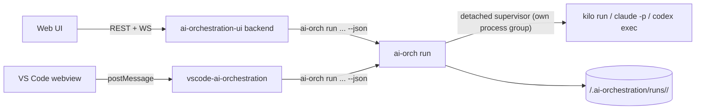

# Spec: Agent runs from the control plane (choose who does the work)

- **Status:** v2 (2026-10-16), revised after a Codex review of v1 (3 blockers, 21 major, 4 minor; all addressed below or explicitly scoped out).
- **Drives:** initiative [07](../07-agent-runs-from-ui/plan.md)
- **Requires:** [`control-plane-safety`](control-plane-safety.md) (initiative 06) is done first: auth, non-blocking backend, watcher, confirmation modal, VS Code bridge. The safety defects found in v1 (D1–D9) moved there.
- **Related:** [`blocking-questions`](blocking-questions.md) (initiative 08): runs that ask questions, and answer-and-resume.
- **Repos:** `ai-orchestration` (core engine + CLI), `ai-orchestration-ui`, `vscode-ai-orchestration`

## 0. Amendments after review 2 (normative; each overrides the section it names)

- **R1 — §4 a preview is binding.**
  - `run preview` returns `plan_hash`, a sha256 over the canonical request, the task bundle hash, the effective adapter argv (redacted), the prompt hash, the target repo `HEAD` and the effective config hash.
  - `run start` and `run cleanup` require `--expect-plan-hash` when called by the UI or the extension (`--requested-by ui|vscode`), and refuse on mismatch. The CLI may omit it.
- **R2 — §5.1/§5.3 separate process identities.**
  - `run.json` records `supervisor: {pid, start_time}` and `agent: {pid, pgid, start_time}` separately.
  - The supervisor writes its own identity **before** spawning the agent, and the agent identity right after.
  - Reconciliation checks each identity independently. A supervisor that dies before the agent identity was recorded → `lost`, and the supervisor scans its own session for a child (the run's command line is matched with `pgrep -s`) to kill.
  - Tests reuse each PID.
- **R3 — §5.5/§5.7 continuation keeps the execution settings.**
  - `model`, `variant` and `effort` are stored separately and passed on every resume. The placeholders gain `{effort}`.
  - Resume argv: Claude gets `--model`/`--effort`; Codex gets `-m` and `-c model_reasoning_effort=`; Kilo gets `-m`/`--variant`.
- **R4 — §3 actions per state (overrides the `mode` default):**

  | Task state | Allowed modes |
  | --- | --- |
  | `open`, `bounced` | `execute` (default), `orchestrate` |
  | `in progress` | `execute` (continue only, when a run exists), `orchestrate` |
  | `delivered` | `verify` (default), `orchestrate` |
  | `waiting`, `blocked` | `orchestrate` only |
  | `verified` | none: only "Close" |
  | `done`, `done with a caveat`, `dropped` | none |

  The Run dialog shows only the allowed modes.
- **R5 — §3/§5.6 verification modes.**
  - `verify` honours the full `<tool>:<profile>` entries of `verification.cross_agent_order`.
  - The modes map as follows:
    - `cross-agent` → one verify run with a different tool;
    - `independent-session` → the same tool in a fresh session (`--allow-same-tool`);
    - `panel` → N verify runs, one per `panel_reviewers` entry, launched together; `panel_require_blind` means the prompts do not include each other's verdicts. "Apply verdict" requires all of them and applies `verified` only if all agree; any `bounced` bounces, with the merged findings;
    - `owner` → no run, only the existing "Approve Verified";
    - `self` → refused for runs.
- **R6 — §3 a delivery gate in the core.**
  - `run mark-delivered RUN_ID --expect-task-hash H` is the only path from a run to `delivered`.
  - It checks under the task lock:
    - the run `succeeded`;
    - the worktree is on `run/<run_id>`, clean, and its `HEAD == final_commit`;
    - `base_commit` is an ancestor of it, with ≥ 1 commit after it;
    - a Final Report was parsed.
  - Both UIs use it; the generic transition endpoint refuses `delivered` for a task that has a run.
- **R7 — §5.3/§5.6 artifact invariants.**
  - On completion, the supervisor records `final_commit` only when the branch and cleanliness invariants hold; otherwise the status is `failed` with the reason.
  - Verify start checks that the target branch `HEAD == final_commit`.
  - The verdict is bound to `target_commit`, and `apply-verdict` refuses if the branch moved.
  - Tests cover a branch that advances, a reset, and `target_run: none` with `HEAD` drift.
- **R8 — §5.1 bundle hash.** `task_file_sha256` is replaced by `task_bundle_sha256`, a canonical hash over every file of a folder task (`README.md`, `CONTEXT.md`, `PROGRESS.md`), or the single file. It is used by verify, apply-verdict, mark-delivered and the preview.
- **R9 — §5.1/§6 log offsets.** Logs are never truncated in place. They rotate into immutable chunks (`events.000.jsonl`, …, 10 MB each), and `run logs` offsets are logical (monotonic across chunks). Retention deletes whole old chunks and reports `first_available_offset`.
- **R10 — §5.2/§5.3 platform.** macOS and Linux only (spec 06 A9). On Windows, the run commands refuse.
- **R11 — §5.7 a usable default permission policy, decided by the owner.**
  - `acceptEdits` + `--permission-prompts none` denies every Bash command that is not allow-listed, so an execute run could not run tests or commit.
  - The default allow-list per mode is **the first blocking question of this initiative**. It is filed in spec 08's format as soon as 08.1 lands; until then it is recorded in the initiative 07 plan under "Decisions waiting".
  - 07.3 ships with no default for Claude: a launch without a configured `allowed_tools` for the mode is refused with a clear message.
  - 07.5 proves a real test-and-commit run under the chosen policy.
- **R12 — §4 cleanup is race-free.** `run cleanup` refuses while any active run references the same worktree, through the whole continuation chain. It cleans a chain only when all its runs are terminal.
- **R13 — §5.1 secrets.**
  - Headless argv overrides may not contain literal secrets: values for flags matching `token|key|secret|password` must be `{env:NAME}` references, expanded only at spawn time.
  - `argv_display`, `preview` and the logs show `{env:NAME}`, never the value.
  - Tests cover the redaction.
- **R14 — question integration is a core task.** The run supervisor files ` ```ai-orch-question ` blocks (spec 08 Q8) and links their ids in `run.json` `questions`, in a dedicated task (07.10, after 07.3 and 08.1).

## 1. Goal

From the web UI or the VS Code dashboard, the owner requests the execution of a task and chooses **who** does it: which tool (Kilo, Claude, Codex), in which **mode**, with which profile and model. The owner can watch the run, cancel it, continue it, and apply the verdict of a verification run.

**v1 scope: emergent tasks (`T###`) only.** Initiative tasks (`NN.T`) have no per-task header, state or sections today: `discover_initiatives()` gives them the initiative-wide state. Every run command refuses `NN.T` with a clear message. Supporting them needs a per-task model for `plan.md`, which is a separate future spec.

## 2. Architecture: runs live in the core

The VS Code extension spawns `ai-orch` directly (`vscode-ai-orchestration/src/cli-client.ts`). So runs are implemented **once, in the core**, as `ai-orch run ...` (stdlib-only Python, `scripts/orchestration_runs.py`). The UI backend and the extension are thin callers.



All three tools are launched through their headless CLIs, through **per-tool adapters**. `kilo-mcp` is not used here: it stays the channel an orchestrating agent uses to delegate to Kilo.

## 3. The launch request: who, how

| Field | Values | Default (pre-filled, editable) |
| --- | --- | --- |
| `task` | `T###` | the task the dialog was opened from |
| `mode` | `orchestrate`, `execute`, `verify` | depends on the task state: `delivered` → `verify`; otherwise `execute` |
| `tool` | `kilo`, `claude`, `codex`; only tools that are **enabled** in the merged config **and** installed | resolution chain below |
| `profile` | `deep-reasoning`, `orchestration`, `bulk-execution`, `exploration` | `orchestrate` → `orchestration`; `execute` → task `profile` header, else `routing.default_profile`; `verify` → `deep-reasoning` |
| `model`, `variant`/`effort` | free text | `tools.<tool>.profiles.<profile>` |
| `isolation` (`execute` only) | `worktree`, `none` | `worktree` |
| `target_run` (`verify` only) | an `execute` run id of this task, or `none` | the latest `succeeded` `execute` run of the task |
| `instructions` | free text appended to the prompt | empty |

**Tool resolution chain** (the most specific wins):

1. the explicit choice;
2. the task's `executor` header, when it names a tool id;
3. the project config `routing` (`default_orchestrator` / `default_executor`; for `verify`, the first `verification.cross_agent_order` entry that passes the independence guard);
4. the global config `routing`.

Per-run choices are not persisted. Persistent defaults are changed in the config (Config tab → `config set-routing` / `set-profile`).

**Modes:**

- **`orchestrate`** — the tool acts as Architect for the task, in the workspace (no worktree). Its prompt contains:
  - the task file;
  - the instruction to follow the workspace `AGENTS.md` orchestration rules;
  - the instruction never to set `verified` on its own work;
  - the instruction to file blocking questions in the [`blocking-questions`](blocking-questions.md) format.
- **`execute`** — the tool implements the task in an isolated worktree (§5.4). Its prompt contains:
  - the task file;
  - the executor contract: zero interactivity, stay in scope, commit on the run branch, end with `## Final Report`, file blocking questions instead of guessing.
- **`verify`** — the tool runs the task's `## Verification` section **against the delivered artifact** and ends with the verdict block (§5.6).
  - The artifact is the commit recorded by `target_run` (`final_commit`), checked out in a fresh **detached throwaway worktree**. Writes there cannot reach the delivered branch.
  - `target_run: none` (the work was delivered outside a run) verifies the workspace `HEAD` in a throwaway worktree, and records that commit.

**Task state ownership** (the engine is the only automatic writer):

- An `execute` run that **spawned successfully** moves the task `open`/`bounced` → `in progress` (with `--actor <tool>`).
- On spawn failure, the task is not touched.
- Nothing else is automatic:
  - `delivered` is set by the owner or the orchestrator ("Mark delivered" is enabled when the run `succeeded`, its branch has ≥ 1 commit beyond `base_commit`, and a Final Report was parsed);
  - `verified`/`bounced` is set by "Apply verdict" (§5.6).
- A transition failure is recorded in the run record (`task_transition_error`) and shown; the run and the task state never diverge silently.

## 4. Commands (`ai-orch run`)

Every command supports `--json` and `--workspace`. Refusals return `ok: false` with `reason` and a non-zero exit.

| Command | Effect |
| --- | --- |
| `run options --task ID` | Tools with availability and version; the resolved defaults for each mode; models per profile; `execute` runs usable as verify targets. Read-only. |
| `run preview <request>` | Takes the **full** launch request (the same flags as `start`) and validates it with every guard. Returns the exact prompt, the redacted argv, the cwd, and the planned worktree/branch. No side effects. |
| `run start <request> [--requested-by ui\|vscode\|cli]` | Same validation as `preview`; reserves, records, spawns the supervisor; returns `run_id` immediately. |
| `run start --continue RUN_ID --instructions TEXT` | Continues a run (§5.5). Only `instructions` may be given. |
| `run list [--task ID] [--active]` / `run show RUN_ID` | Records, newest first, after reconciliation. |
| `run logs RUN_ID [--tail N] [--raw] [--since-offset B]` | The parsed event summary, or the raw stream. `--since-offset` lets a UI poll incrementally. |
| `run cancel RUN_ID` | SIGTERM to the agent's process group, SIGKILL after 10 s; status `cancelled`. |
| `run cleanup RUN_ID [--dry-run]` | Removes the run's worktree and branch (only for terminal runs and only if the branch is merged or the user passes `--discard`). Records are kept. |

The request flags are `--task --mode --tool --profile --model --variant --isolation --target-run --instructions --allow-same-tool --force`.

## 5. Engine design

### 5.1 Registry

- `<workspace>/.ai-orchestration/runs/<run_id>/` holds `run.json`, `prompt.md`, `events.jsonl` (agent stdout), `stderr.log`.
- `run_id` = `<YYYYMMDD-HHMMSS>-<task>-<tool>-<4 hex>`, validated against `^[0-9]{8}-[0-9]{6}-T[0-9]{3}-(kilo|claude|codex)-[0-9a-f]{4}$` wherever it is accepted.
- Directories are 0700, files 0600.
- **Kept out of git.** On first use, the engine adds `.ai-orchestration/` to `<repo>/.git/info/exclude` (a local file, never committed). Launch is refused if the path is still not ignored (`git check-ignore`).
- Retention: records are kept forever; logs above 50 MB are truncated at the head, with a marker line.

**`run.json` fields:**

- identity: `run_id`, `task_id`, `mode`, `tool`, `profile`, `model`, `variant`, `requested_by`
- location: `workspace`, `cwd`, `isolation`, `worktree_path`, `branch`, `base_commit`, `final_commit`, `target_run`, `target_commit`, `task_file_sha256`
- process: `supervisor_pid`, `pgid`, `proc_start_time` (from `ps -o lstart=`), `argv_display`
- lifecycle: `status`, `exit_code`, `started_at`, `ended_at`
- results: `session_id`, `continued_from`, `final_report`, `verdict`, `questions` (filed `Q###` ids), `task_transition_error`

### 5.2 Concurrency

- Every state-changing operation takes an exclusive `fcntl.flock` on `.ai-orchestration/runs/.lock`. Reserving a run covers reconcile + check + create + spawn.
- `starting` counts as active. A `starting` record older than 60 s with no live supervisor → `lost`.
- Record updates are serialized through the lock, written atomically (temp + rename), and **terminal states are monotonic**: `cancelled`/`succeeded`/`failed`/`lost` are never overwritten.
- **Guards:**
  - one active run per task (`--force` bypasses **only** this guard);
  - one active run per `cwd` with `isolation: none` (never bypassable);
  - task state fits the mode: `execute` ← `open`, `in progress`, `bounced`; `verify` ← `delivered`; `orchestrate` ← any non-terminal state;
  - the tool is enabled and installed;
  - the verify independence guard (§5.6).

### 5.3 Supervisor and processes

- `run start` spawns `python3 orchestration_runs.py _supervise <run_dir>` with `start_new_session=True`. The supervisor starts the agent **in its own new process group** and records `pgid` and `proc_start_time`.
- The supervisor streams stdout and stderr to the files, waits, then records the results: `exit_code`, `ended_at`, `final_commit` (execute), `session_id`, the parsed `final_report` / `verdict` / question blocks.
- **Reconciliation on read.** A record that is `running` but whose supervisor is gone (PID dead, **or** a PID whose start time differs from `proc_start_time`, which means the PID was reused):
  - becomes `lost`;
  - **the agent's process group is terminated** (SIGTERM, then SIGKILL), after checking that its leader's start time matches.

  An unsupervised agent never keeps editing.
- **Cancel** applies the same group kill, with the same start-time check.

### 5.4 Worktree isolation (`execute`)

- **Target repo.** Each path in the task's `paths` header is resolved through its nearest existing ancestor to a git toplevel. All paths must resolve to exactly **one** repo; otherwise `execute` + `worktree` is refused, naming the repos found.
- **Dirty repo.** The target repo must be clean (`git status --porcelain` empty, ignoring `.ai-orchestration/`). Otherwise the run is refused, listing the dirty files. `--allow-dirty-base` proceeds from `HEAD` and records a warning that local changes are **not** in the worktree.
- **Worktree.** `git worktree add <repo>/../.worktrees/<repo-name>/<run_id> -b run/<run_id> <HEAD>`; `base_commit` is recorded.
- **Retention.** Worktrees are never removed automatically; `run cleanup` removes them. Continue requires the worktree to exist.

### 5.5 Continue

- **Locked fields.** A continuation inherits **task, mode, tool, model, cwd, worktree and session_id** from the source record. Only `instructions` may be given.
- **Requirements:**
  - the source run is terminal;
  - its worktree still exists (for `execute`);
  - a `session_id` was captured.
- **Refusals:**
  - a `verify` run can never continue an `execute` session, and vice versa;
  - with no `session_id`, the continuation is refused; it never silently starts a fresh session.
- The resume `argv` is spawned with `cwd` set to the original cwd, because `codex exec resume` has no `-C`.

### 5.6 Verify and verdicts

- **Independence guard.** A verify run is refused when `tool` equals the task's `executor` header or the tool of `target_run`. `--allow-same-tool` downgrades to `independent-session` (a fresh session; never a continuation). The downgrade is recorded in the verdict as `verification_mode`.
- **Verdict.** The verdict is parsed **only from the final assistant message**, from a fenced block:

  ````markdown
  ```ai-orch-verdict
  {"verdict": "verified" | "bounced", "findings": [{"id": "B1", "severity": "blocker|major|minor", "text": "..."}], "checks": [{"step": "...", "result": "pass|fail", "evidence": "..."}]}
  ```
  ````

  A missing or invalid block → `verdict: null`, and the run is shown as "no verdict".
- **Apply verdict** (UI → `run apply-verdict RUN_ID [--expect-task-sha256 H]`):
  - refused if the task file hash or the target branch head changed since the verify run started;
  - otherwise it calls `tasks transition` with `--verifier <tool>:<profile>` (verified) or `--reason` set to the findings (bounced).

### 5.7 Adapters (per tool)

- **The prompt goes on stdin or as a file, never on argv** (avoids `ARG_MAX` limits and the prompt showing up in process listings).
- Built-in adapters, overridable in config under `[tools.<tool>.headless]` (keys `argv`, `resume_argv`, `prompt_via` = `stdin|file`, `permission_mode`, `allowed_tools`). The override is also how the tests point the engine at a stub agent.

| Tool | Start | Resume | Session id |
| --- | --- | --- | --- |
| claude | `claude -p --output-format stream-json --verbose --session-id <uuid> --model M [--effort E] --permission-mode <pm> --permission-prompts none [--allowedTools ...]`, prompt on stdin | `claude -p --resume <uuid> --output-format stream-json --verbose --model M [--effort E] --permission-mode <pm> --permission-prompts none [--allowedTools ...]`, stdin | **pre-assigned** UUID (`--session-id`); every event carries `session_id` |
| kilo | `kilo run --format json --dir <cwd> -m M [--variant V] -f <prompt.md> -- "Follow the attached task prompt."` | `kilo run --format json --dir <cwd> -s <id> -m M [--variant V] -f <instructions.md> -- "Continue."` | `sessionID` (`ses_…`) on every JSON event |
| codex | `codex exec --json -C <cwd> -m M -s <sandbox> [-c model_reasoning_effort=E] [-c 'sandbox_workspace_write.writable_roots=["<repo>/.git"]'] -` (stdin) | `codex exec resume <id> --json -m M -c sandbox_mode=<sandbox> [-c model_reasoning_effort=E] [-c 'sandbox_workspace_write.writable_roots=[…]'] -` with subprocess `cwd` | `thread_id` of the first event, `{"type":"thread.started"}` |

**Corrections from the 07.5 live capture (claude 2.1.296, kilo 7.8.8, codex-cli 0.147.0; fixtures in `scripts/fixtures/runs/`):**

- **Kilo needs `--` before the message.** `-f` is a yargs array option: without `--` it takes the message as a second file and the run fails with `Error: File not found: Continue.` (the resume argv had this bug).
- **Codex `execute` in a worktree cannot commit under `workspace-write`.** The worktree's git metadata lives in `<repo>/.git/worktrees/<name>`, outside the sandbox: `fatal: Unable to create '<repo>/.git/worktrees/<run>/index.lock': Operation not permitted`. The adapter adds the main repository's git dir (`git rev-parse --git-common-dir`) as a writable root with `-c sandbox_workspace_write.writable_roots=[…]`, on start and on resume (`codex exec resume` has no `--add-dir`, `-C` or `-s`). Only for `execute` with `isolation: worktree` and sandbox `workspace-write`.
- **Codex `exec resume <id>` takes a UUID or a thread name.** A value that is not a known UUID and matches no thread name silently starts a **new** thread and exits 0. The supervisor compares the session id reported by the stream with the one it resumed and fails the run (`session_mismatch`, `invariant_error`) instead of accepting a fork.
- **Claude default allow-list** gains `Bash(python3 -m pytest:*)` (execute, verify, orchestrate): macOS and Homebrew ship no `python`, so `python -m pytest` alone left execute runs unable to run their tests. A compound command (`a; b`) runs only if every part is allow-listed; otherwise the whole call is denied under `--permission-prompts none`.
- **Where the text is.** Final Report, verdict and question blocks are parsed from the assistant **messages**, not from the raw stream: Kilo `{"type":"text","part":{"text"}}` (joined per `messageID`), Claude `{"type":"assistant","message":{"content":[{"type":"text"}]}}` and the closing `{"type":"result","result"}`, Codex `{"type":"item.completed","item":{"type":"agent_message","text"}}`. Agent errors: Kilo `{"type":"error","error":{"data":{"message"}}}` on stdout (or plain stderr), Claude `result.is_error` with `errors[]`, Codex `turn.failed.error.message`; the supervisor stores the last one as `agent_error`.
- **Usage** (normalized per spec 12 §0c E8 into `input_tokens`, `cache_read`, `cache_write`, `output_tokens`, `estimated_context_tokens`, plus `cost_usd`): Kilo per step in `step_finish.part.tokens` (`input` excludes cache; context = last step's `total`) and `part.cost`; Claude `result.usage` + `total_cost_usd`, context from `result.usage.iterations[-1]` (per-message `assistant` usage when the run was killed). **Codex `turn.completed.usage` is cumulative over the thread**, `input_tokens` includes `cached_input_tokens`, and no cost is reported: per-turn values are the difference from the previous run of the chain (`usage.session_totals`), and the context comes from Codex's own rollout (`$CODEX_HOME/sessions/**/rollout-*-<thread_id>.jsonl`, `token_count.info.last_token_usage`), best effort.

- **Permission modes.** Claude `pm` defaults to `acceptEdits`; Codex `sandbox` defaults to `workspace-write`. **No adapter ever defaults to `bypassPermissions`, `--dangerously-skip-permissions` or `--dangerously-bypass-approvals-and-sandbox`.** Opting in is a config value, and the Run dialog displays it in red. The default allow-list for orchestrate runs is a blocking question for the owner (filed as a question in initiative 08's format once it exists).
- **Flags verified live** against `<tool> --help` and real runs in task 07.5 (2026-10-18); the table above is the corrected one.

## 6. UI backend

The run endpoints are thin, asynchronous wrappers (initiative 06 makes all CLI calls non-blocking):

- `GET /api/runs/options?task`
- `POST /api/runs/preview`
- `POST /api/runs`
- `GET /api/runs?task&active`
- `GET /api/runs/{id}`
- `GET /api/runs/{id}/logs?since_offset`
- `POST /api/runs/{id}/cancel`
- `POST /api/runs/{id}/continue`
- `POST /api/runs/{id}/apply-verdict`
- `POST /api/runs/{id}/cleanup`

Config endpoint: `POST /api/config/set-routing`.

The watcher watches `runs/*/run.json` only, not the logs. The logs are polled by the open run panel through `since_offset`.

## 7. Web UI

- **Run dialog** ("Run…" replaces "Start"):
  - mode, tool, profile, model, isolation / target run, instructions;
  - every field change calls `run preview` and shows the prompt, the command line and the warnings (dirty repo, same tool, red permission modes);
  - unavailable tools are disabled, with the reason.
- **Task runs panel:**
  - status, tool, duration; a live log tail;
  - actions: Cancel; Continue (instructions only); "Mark delivered" (when eligible); for verify runs, the verdict with findings and "Apply verdict"; Cleanup;
  - questions filed by the run, linking to the Decisions tab (08).
- **Runs tab:** all active and recent runs.
- **Config tab:** edit routing and the profile/model matrix, with scope (global or project-local), through preview + confirm.

## 8. VS Code extension

- A handler for every new `api.ts` method.
- The run directory is watched (`run.json` only) and forwarded as `{type:"changed", areas:["runs"]}`.

## 9. Config prerequisites (core)

- **`config set-routing`** (`--orchestrator --executor --default-profile --verification-mode --scope`). It uses a **surgical TOML updater**: it edits only the target keys and preserves comments and formatting. `set-profile` is migrated to the same updater (today it re-dumps the whole file).
- **`[tools.<tool>.headless]`** schema and validation.
- The rendered `AGENTS.md` block and the `init-project` help name the real project-config path (`<workspace>/.ai-orchestration.local.toml`, or `~/.config/ai-orchestration/projects/<name>/orchestration.toml`). The same goes for the `bin/ai-orch` catalog.
- Known limit, not fixed here: the fallback path keys projects by directory basename (two workspaces with the same basename collide). Tracked as a follow-up emergent task.

## 10. Out of scope

- Merging an `execute` worktree into the main branch. The owner or the orchestrator does that; the UI shows the branch, the diff stats and "Mark delivered" only.
- Cost telemetry for UI runs.
- Remote or multi-user access.
- `NN.T` initiative tasks (see §1).

## 11. Acceptance

All of this is checked live, in an isolated scratch workspace, with real runs of each tool, not only by unit tests:

- From the UI the owner opens a task, picks mode, tool and model, previews, and launches.
- The live log appears. The run can be cancelled (no surviving processes). It survives a backend restart. Killing the supervisor leaves no agent running.
- An `execute` run works in its own worktree and moves the task to `in progress`. "Mark delivered" becomes available when the run succeeded with a commit and a Final Report.
- A `verify` run checks the delivered commit in a throwaway worktree. The same tool is refused. The verdict is applied in one click, and the apply is refused if the task or branch changed.
- A bounced task goes back to the original executor session with the findings as instructions.
- A run that hits a decision files a `Q###` question and stops.
