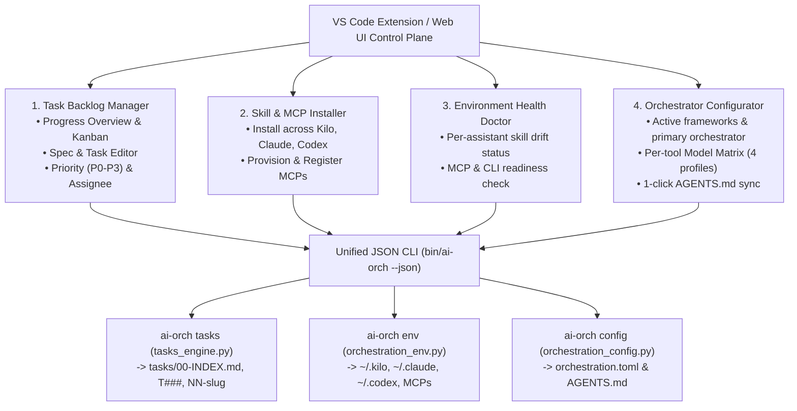

# Spec: AI Orchestration Extension & Backlog Manager (4 Macro-Responsibilities)

> **Drives initiative:** [05](../05-cli-and-ui-handoff/plan.md)
> **Status:** Active Specification (2026-10-15)

---

## 1. Overview & Value Proposition

The **AI Orchestration Extension** (initially deliverable as a local Web UI / VS Code Webview Dashboard + Sidebar TreeViews) provides a unified visual control plane over `ai-orchestration`, `kilo-mcp`, and `claude-mcp`.

Every operation in the UI is backed by the deterministic JSON CLI (`./bin/ai-orch <domain> <cmd> --json`), ensuring that **files on disk (`tasks/`, `orchestration.toml`, `AGENTS.md`) remain the single source of truth** and never drift from CLI agent sessions.

---

## 2. The Four Macro-Responsibilities

### Macro-Task 1: Task Interface & Backlog Manager (`ai-orch tasks`)

A focused, zero-friction **Backlog & Pipeline Manager** operating directly on the repository's `tasks/` directory:

1. **Progress Overview Dashboard**:
   - **Summary KPIs**: counts by state (`open`, `in progress`, `waiting`, `blocked`, `delivered`, `bounced`, `verified`, `done`), active initiatives progress bar (`NN-<slug>`), and `Decisions waiting` badge.
   - **Multi-View Switcher**:
     - *Queue / Next Up View*: top `<= 5` priority tasks with one-click copy/run `handoff` prompt.
     - *By Category / Initiative Tree*: hierarchical view of `Initiatives` (`NN-<slug>` → `NN.T` subtasks) and `Categories` (`<category>/T###`).
     - *Kanban Board*: columns mapped to the formal state machine (`open` | `in progress` | `waiting/blocked` | `delivered (needs verification)` | `verified` | `done`).
2. **Task & Subtask Detail + Spec Editor**:
   - Inspect and edit the structured header fields via dropdowns/inputs (without breaking Markdown grammar):
     - **Priority (`P0`–`P3`)** + `priority-reason`;
     - **Assignee / Executor (`executor`)**: `self`, `kilo`, `claude`, `codex`, `dedicated-session`, `user-decision`, or a person;
     - **Cognitive Profile (`profile`)**: `deep-reasoning`, `orchestration`, `bulk-execution`, `exploration`;
     - **Verification Mode (`verification-mode`)**: `self`, `independent-session`, `cross-agent`, `panel`, `owner`;
     - **Dependencies (`depends-on`)** and **Decider (`decider`)**.
   - Rich Markdown editor/preview for `## Goal`, `## Steps`, `## Verification`, linked `tasks/specs/<slug>.md`, and `PROGRESS.md`.
   - **State Transition Actions**: enforces transition guards (`delivered → verified` requires independent verifier or owner approval note; `delivered → bounced` prompts for failing criteria; closing moves to `tasks/done/` and auto-regenerates `00-INDEX.md`).

---

### Macro-Task 2: Install Skills & MCP Servers Across Environments (`ai-orch env install`)

Allows installing or updating the orchestration stack from scratch (or from local workspace clones) across **Claude Code**, **Kilo Code**, and **Codex CLI** (both `global` and `project` scopes):

1. **Curated Orchestration Catalog (Bound Repositories)**:
   - **`ai-orchestration`** (`https://github.com/primax79/ai-orchestration.git`): plugins `architect-side`, `executor-side`, `shared`.
   - **`kilo-mcp`** (`https://github.com/primax79/kilo-mcp.git`): MCP server + `kilo-mcp-*` bound skills & agent.
   - **`claude-mcp`**: MCP server + `claude-mcp-*` bound skills & agent.
2. **Skill Installation Mode Selection**:
   - Automatically prevents the anti-pattern of installing both generic `architect-side` and `kilo-mcp`'s `architect-side` into the same target (which would compete on the same trigger descriptions).
   - Lets the user pick per assistant: *Single-Framework Generic Skills* vs. *MCP-Bound Skills (`kilo-mcp` / `claude-mcp`)*.
3. **One-Click MCP Server Provisioning & Registration**:
   - Clones/updates `kilo-mcp` / `claude-mcp` under `~/.ai-orchestration/repos/` (or uses the workspace checkout), creates `.venv`, installs dependencies, and writes the MCP server registration into:
     - **Claude Code**: `~/.claude.json` (global) or `<workspace>/.mcp.json` (project);
     - **Kilo Code**: `~/.config/kilo/kilo.json` (global) or `<workspace>/.kilo/kilo.jsonc` (project).
4. **Relationship with `ai-swissknife` (Architectural Decision)**:
   - **`ai-orch env` (`scripts/orchestration_env.py`) is the self-contained installer for the orchestration stack** so `ai-orchestration` works standalone from terminal (`./install.sh`) even on machines without VS Code or `ai-swissknife`.
   - **Integration when `ai-swissknife` is present**: if `ai-swissknife` CLI (`$SWK_CLI`) or extension (`alfredooliviero.ai-swissknife`) is installed, `ai-orchestration` can register its repos as managed sources in `ai-swissknife` (`$SWK_CLI source add`) and delegate general-purpose cross-assistant artifact management to `ai-swissknife` rather than duplicating a full generic marketplace UI.

---

### Macro-Task 3: Verify Status of Skills & MCPs Across Environments (`ai-orch env status`)

An **Environment Doctor & Drift Inspector** showing at a glance whether every assistant environment is ready:

1. **Assistant CLI & Auth Readiness**:
   - Checks whether `kilo`, `claude`, `codex` binaries are on `PATH`, their version, and authentication state.
2. **Per-Environment Skill Matrix**:
   - For each assistant (`kilo`, `claude`) and scope (`global`, `project`), reports the state of every orchestration skill:
     - `up-to-date` (matches source SHA/content hash)
     - `update-available` (repo has newer version)
     - `modified-locally` (installed skill has local edits)
     - `missing` (not installed)
     - `conflict-warning` (e.g. both generic `orchestration-methodology` and bound `kilo-mcp-orchestrator` installed simultaneously).
3. **MCP Server Health**:
   - Checks whether `kilo-mcp` and `claude-mcp` are registered in Claude/Kilo configs, whether their Python `.venv` and `server.py` entrypoints exist and import cleanly, and provides a one-click **"Repair / Update"** action.

---

### Macro-Task 4: Project Orchestrator Configuration (`ai-orch config` & `render-agents-md`)

Visual editor for Global (`~/.config/ai-orchestration/orchestration.toml`) and Project (`tasks/orchestration.toml`) settings:

1. **Topology & Role Routing**:
   - Select active frameworks (`kilo`, `claude`, `codex`);
   - Choose **Primary Orchestrator** (`primary_orchestrator`) and **Default Executor** (`default_executor`) — visually indicating whether the project is in **Single-Framework Native Mode** (`orchestrator == executor`) or **Multi-Framework MCP Mode** (`orchestrator != executor`);
   - Choose **Default Verification Policy** (`self`, `independent-session`, `cross-agent`, `panel`, `owner`) and reviewer fallback order.
2. **Per-Framework Model Matrix**:
   - Configure the model + reasoning effort/variant (`low`, `medium`, `high`, `max`) for each of the 4 cognitive profiles (`deep-reasoning`, `orchestration`, `bulk-execution`, `exploration`) per enabled tool, with live validation (`validate_config`).
3. **Project Isolation & Verification Guardrails**:
   - Edit `shared_databases`, `shared_ports`, `worker_port_range`, `conflict_prone_files`, `zero_conflict_registries`, and subsystem `verification_checks` commands.
4. **Live `AGENTS.md` Preview & Sync**:
   - Preview the generated `<!-- BEGIN ai-orchestration --> ... <!-- END ai-orchestration -->` block and apply it to `<workspace>/AGENTS.md` in one click.
