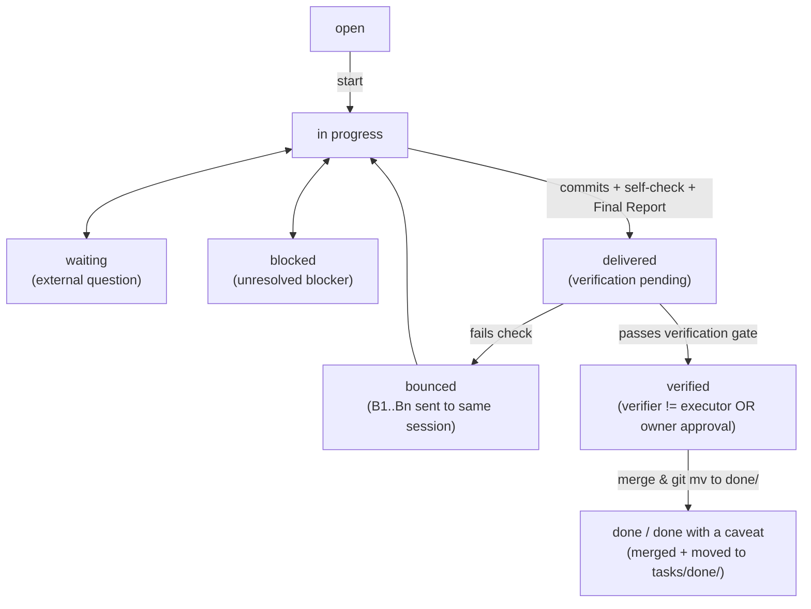

# Spec: Formal Task Definition, Unified State Machine & Cross-Agent Verification

> **Drives initiatives:** [02](../02-task-and-config-spec/plan.md), [03](../03-skill-and-script-engine/plan.md), [05](../05-cli-and-ui-handoff/plan.md)
> **Sources:** `macroplan-authoring` (v0.2.1), `orchestration-methodology` (v0.2.1), `task-spec-authoring`, `docs/03-task-model-and-ui-architecture.md`

---

## 1. Unified Task Entities (`Initiative`, `InitiativeTask`, `EmergentTask`)

Every work item in `tasks/` is represented by one of two task shapes sharing the **same state lifecycle, role profiles, and verification gate**:

1. **Emergent Task (`T###-<slug>.md` or `T###-<slug>/README.md`)**:
   - Lives under `tasks/<category>/` while active, and moves via `git mv` to `tasks/done/<category>/` when terminal (`done`, `done with a caveat`, `dropped`).
   - ID format: `T###` (zero-padded 3+ digits, globally unique across active and `done/`).
2. **Planned Initiative (`tasks/NN-<slug>/`) & Initiative Task (`NN.T`)**:
   - Driven by one or more `tasks/specs/<slug>.md` (`Drives` / `Derived from`).
   - Packaged either **inline** inside `NN-<slug>/plan.md` or **expanded** as `NN-<slug>/NN.T-<name>.md`.
   - When expanded (or tracked by `tasks_engine.py` / the UI), each `NN.T` task supports the exact same metadata fields and state transitions as `T###`.

---

## 2. Formal Task Header Grammar

Immediately following the `# <ID> <Title>` H1 heading, a task file carries a contiguous block of `- <key>: <value>` Markdown list items.

### 2.1 Core Header Fields (13 Mandatory Fields, Fixed Order)

| # | Field | Type / Allowed Values | Default when empty |
| --- | --- | --- | --- |
| 1 | `id` | `T\d{3,}` or `\d{2,}\.\d+` | *(required)* |
| 2 | `title` | Single-line string | *(required)* |
| 3 | `category` | Category folder name (or initiative slug for `NN.T`) | *(required)* |
| 4 | `priority` | `P0` \| `P1` \| `P2` \| `P3` | *(required)* |
| 5 | `priority-reason` | Single-line explanation of priority | *(required)* |
| 6 | `next-up` | `yes` \| `no` | `no` |
| 7 | `state` | See §3 State Machine below | `open` |
| 8 | `executor` | `self` \| `kilo` \| `claude` \| `codex` \| `dedicated-session` \| `user-decision` \| `<person>` | `self` |
| 9 | `depends-on` | Comma-separated task IDs (`T001, 01.2`) or `-` | `-` |
| 10 | `decider` | `<actor>: <question>` when waiting on a decision, else `-` | `-` |
| 11 | `sources` | Comma-separated origin references or `-` | `-` |
| 12 | `paths` | Comma-separated repo/file paths in scope | `-` |
| 13 | `handoff` | Single-line self-contained prompt to start/resume the task | *(required)* |

### 2.2 Optional Orchestration Extension Fields (Placed Immediately After `handoff`)

Permitted by `macroplan-authoring` ("A project that needs extra fields lists them in `tasks/AGENTS.md` and puts them after `handoff`"):
- `profile`: `deep-reasoning` \| `orchestration` \| `bulk-execution` \| `exploration` (selects the model/variant from `orchestration.toml` for the chosen `executor`, whether executed natively in the same framework or via MCP).
- `verification-mode`: `self` \| `independent-session` \| `cross-agent` \| `panel` \| `owner` (overrides `[verification].default_mode` in `orchestration.toml`: `independent-session` uses a fresh context-blind subagent/worktree in the *same* framework; `cross-agent` uses a *different* framework/engine; `panel` runs multiple reviewers; `owner` requires human approval).
- `verifier`: `-` \| `<tool>:<profile>` \| `blind-subagent:<profile>` \| `owner` \| `panel(<tool>:<profile>, ...)` (records who is assigned or performed the independent verification).

### 2.3 Required Body Sections
1. `## Goal`
2. `## Steps`
3. `## Verification` (concrete, runnable commands and expected outputs; mandatory full regression suite if the task rests on a negative claim).

---

## 3. Unified State Machine & Transition Guards

Unifies `macroplan-authoring` and `orchestration-methodology` into a single state machine:

### Transition Invariants (Enforced by `tasks_engine.py`)
1. **No direct `in progress → done` or `open → done`:** every implementation task must pass through `delivered`.
2. **Independent Verification Guard (`delivered → verified`):**
   - If `verification-mode` is `cross-agent` or `panel`: transition to `verified` requires a verification record where `verifier_tool != executor` (or an explicitly blind session) and `verdict == "proceed"`.
   - If `verification-mode` is `owner`: requires an explicit owner approval entry in `PROGRESS.md` (with date and what was approved).
   - If `verification-mode` is `self` (no independent verifier and no owner approval): the task **cannot** enter `verified`; it transitions `delivered → done with a caveat: self-verified only`.
3. **Bounce Guard (`delivered → bounced → in progress`):**
   - When verification fails, the failing criterion or blocking findings (`B1..Bn`) are appended to `PROGRESS.md` and passed back to the **same** Executor session (`continue_session_id`).
4. **Closure Side-Effect (`→ done` / `done with a caveat` / `dropped`):**
   - Moves the task file/folder via `git mv` into `tasks/done/<category>/`, rewrites relative links if needed, and updates `tasks/00-INDEX.md`.
