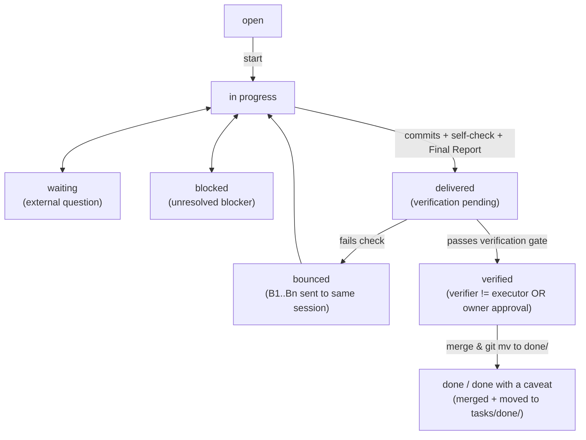

# Spec: Formal Task Definition, Unified State Machine & Cross-Agent Verification

> **Drives initiatives:** [02](../done/02-task-and-config-spec/plan.md), [03](../done/03-skill-and-script-engine/plan.md), [05](../done/05-cli-and-ui-handoff/plan.md)
> **Sources:** `macroplan-authoring` (v0.2.1), `orchestration-methodology` (v0.2.1), `task-spec-authoring`, `docs/03-task-model-and-ui-architecture.md`

---

## 1. Unified Task Entities (`Initiative`, `InitiativeTask`, `EmergentTask`, `N-level Task Tree`)

Every work item in `tasks/` is part of a first-class task hierarchy of arbitrary depth (specified formally in [`subtasks.md`](subtasks.md)):

- **Roots:** Planned Initiatives (`NN`, always containers) and Emergent Tasks (`T###`, zero-padded 3+ digits, globally unique across active and `done/`). Microtasks (`tasks/micro/`) are roots only.
- **Children:** Dotted IDs `<parent>.<n>` (`NN.T`, `NN.T.x`, `T###.x`, etc.) at any depth. Inside files, children are `### <id> - <title>` blocks; deeper nesting is expanded into `<id>-<slug>/README.md` folders holding child blocks under `## Subtasks`.
- **Leaves vs Containers:** Only leaves are units of execution (runs, transitions, commits). Nodes with children are containers whose state is derived (S5 total function: empty container is `open`; all dropped is `dropped`; all done/dropped is `done` / `done with a caveat`; any in progress/delivered/bounced/verified is `in progress`; any blocked is `blocked`; any waiting is `waiting`; otherwise `open`). Container transitions are refused.
- **Inheritance:** `Executor`, `Priority`, `Profile`, `Repo`, and `Paths` are inherited from the nearest ancestor setting them; `Labels` are the union of own and ancestor labels; `Depends on` is additive across ancestors.
- **Dependencies & Questions:** Any node may be a dependency (container dependencies expand to all their leaf descendants; cycles on the expanded graph are refused). Blocking questions accept any leaf ID (`T###` or dotted leaf), refusing containers.
- **Closed Placement:** Closed work lives apart from open work (blocks in `## Closed`, folders in `done/`). The logical tree includes open and archived nodes.

Every work item shares the **same state lifecycle, role profiles, and verification gate**:

1. **Emergent Task (`T###-<slug>.md` or `T###-<slug>/README.md`)**:
   - Lives under `tasks/<category>/` while active, and moves via `git mv` to `tasks/done/<category>/` when terminal (`done`, `done with a caveat`, `dropped`).
   - ID format: `T###` (zero-padded 3+ digits, globally unique across active and `done/`).
2. **Planned Initiative (`tasks/NN-<slug>/`) & Child Tasks (`NN.T`)**:
   - Driven by one or more `tasks/specs/<slug>.md` (`Drives` / `Derived from`).
   - Packaged inline inside `NN-<slug>/plan.md` as `### NN.T - <title>` blocks or expanded as `NN-<slug>/NN.T-<name>/README.md`.
   - Each child leaf task supports the exact same metadata fields and state transitions as `T###`. Container initiatives have derived states.

---

## 2. Formal Task Header Grammar

Immediately following the `# <ID> <Title>` H1 heading, a task file carries a contiguous block of `- <key>: <value>` Markdown list items.

### 2.1 Core Header Fields (13 Mandatory Fields, Fixed Order)

| # | Field | Type / Allowed Values | Default when empty |
| --- | --- | --- | --- |
| 1 | `id` | `T\d{3,}` or `\d{2,}\.\d+` | *(required)* |
| 2 | `title` | Single-line string | *(required)* |
| 3 | `category` | Category folder name (or initiative slug for `NN.T`) | *(required)* |
| 4 | `priority` | `P0` \| `P1` \| `P2` \| `P3` | *(required)* |
| 5 | `priority-reason` | Single-line explanation of priority | *(required)* |
| 6 | `next-up` | `yes` \| `no` | `no` |
| 7 | `state` | See §3 State Machine below | `open` |
| 8 | `executor` | `self` \| `kilo` \| `claude` \| `codex` \| `dedicated-session` \| `user-decision` \| `<person>` | `self` |
| 9 | `depends-on` | Comma-separated task IDs (`T001, 01.2`) or `-` | `-` |
| 10 | `decider` | `<actor>: <question>` when waiting on a decision, else `-` | `-` |
| 11 | `sources` | Comma-separated origin references or `-` | `-` |
| 12 | `paths` | Comma-separated repo/file paths in scope | `-` |
| 13 | `handoff` | Single-line self-contained prompt to start/resume the task | *(required)* |

### 2.2 Optional Orchestration Extension Fields (Placed Immediately After `handoff`)

Permitted by `task-pipeline` ("A project that needs extra fields lists them in `tasks/AGENTS.md` and puts them after `handoff`"):
- `profile`: `deep-reasoning` \| `orchestration` \| `bulk-execution` \| `exploration` (selects the model/variant from `orchestration.toml` for the chosen `executor`, whether executed natively in the same framework or via MCP).
- `verification-mode`: `self` \| `independent-session` \| `cross-agent` \| `panel` \| `owner` (overrides `[verification].default_mode` in `orchestration.toml`: `independent-session` uses a fresh context-blind subagent/worktree in the *same* framework; `cross-agent` uses a *different* framework/engine; `panel` runs multiple reviewers; `owner` requires human approval).
- `verifier`: `-` \| `<tool>:<profile>` \| `blind-subagent:<profile>` \| `owner` \| `panel(<tool>:<profile>, ...)` (records who is assigned or performed the independent verification).
- `branch`: Git branch name of the isolated worktree assigned to this task (e.g. `feat/08-t1-app-shell` or `kilo/t012-scraper`).
- `worktree`: Relative or absolute physical filesystem path to the active worktree checkout (e.g. `.kilo/worktrees/08-t1-app-shell`).
- `run-id`: Unique identifier of the executing run or background MCP task handle (e.g. `ctask_123` or `ses_abc`).

### 2.3 Required Body Sections
1. `## Goal`
2. `## Steps`
3. `## Verification` (concrete, runnable commands and expected outputs; mandatory full regression suite if the task rests on a negative claim).

---

## 3. Unified State Machine & Transition Guards

Unifies `macroplan-authoring` and `orchestration-methodology` into a single state machine:

### Transition Invariants (Enforced by `tasks_engine.py`)
1. **No direct `in progress → done` or `open → done`:** every implementation task must pass through `delivered`.
2. **Independent Verification Guard (`delivered → verified`):**
   - If `verification-mode` is `cross-agent` or `panel`: transition to `verified` requires a verification record where `verifier_tool != executor` (or an explicitly blind session) and `verdict == "proceed"`.
   - If `verification-mode` is `owner`: requires an explicit owner approval entry in `PROGRESS.md` (with date and what was approved).
   - If `verification-mode` is `self` (no independent verifier and no owner approval): the task **cannot** enter `verified`; it transitions `delivered → done with a caveat: self-verified only`.
3. **Bounce Guard (`delivered → bounced → in progress`):**
   - When verification fails, the failing criterion or blocking findings (`B1..Bn`) are appended to `PROGRESS.md` and passed back to the **same** Executor session (`continue_session_id`).
4. **Closure Side-Effect (`→ done` / `done with a caveat` / `dropped`):**
   - Moves the task file/folder via `git mv` into `tasks/done/<category>/`, rewrites relative links if needed, and updates `tasks/00-INDEX.md`.

---

## 4. Blocking Questions & Decision Linkage

Formalized in [`tasks/specs/blocking-questions.md`](blocking-questions.md) (Initiative 08):

1. **Question Entities (`tasks/questions/Q###-<slug>.md`)**:
   - ID format: `Q###` (unique across tree, reserved via atomic `O_EXCL` file creation).
   - Strict 10-field header (`id`, `question`, `status`, `blocks`, `decider`, `asked-by`, `asked`, `origin-run`, `open-answer`, `recommended`).
   - Three required sections: `## Context`, `## Options` (labeled bullets `- **A** — <label>: <consequence>`), and `## Answer` (`choice`, `answered-by`, `answered`, plus multi-line fenced text block).
2. **Task Linkage & State Transitions**:
   - `questions ask`: transitions blocked `open` / `in progress` tasks to `waiting`, setting `decider: Q###` and recording prior state in the question header (`blocks: T013 (in progress)`). If already `waiting` on other questions, appends the new question (`decider: Q004, Q007`) and records `(waiting)`. Asking against tasks waiting/blocked for non-question reasons or terminal tasks is refused.
   - `questions answer` / `withdraw`: when all questions in a task's `decider` are resolved, restores the task to the prior state recorded by the earliest linked question and resets `decider: -`.
3. **Waiting Invariant**:
   - `tasks transition` refuses to move a task out of `waiting` while its `decider` lists open questions.
   - `--force-unblock --reason TEXT` allows owners to bypass the invariant, automatically withdrawing the open questions with the provided reason.
