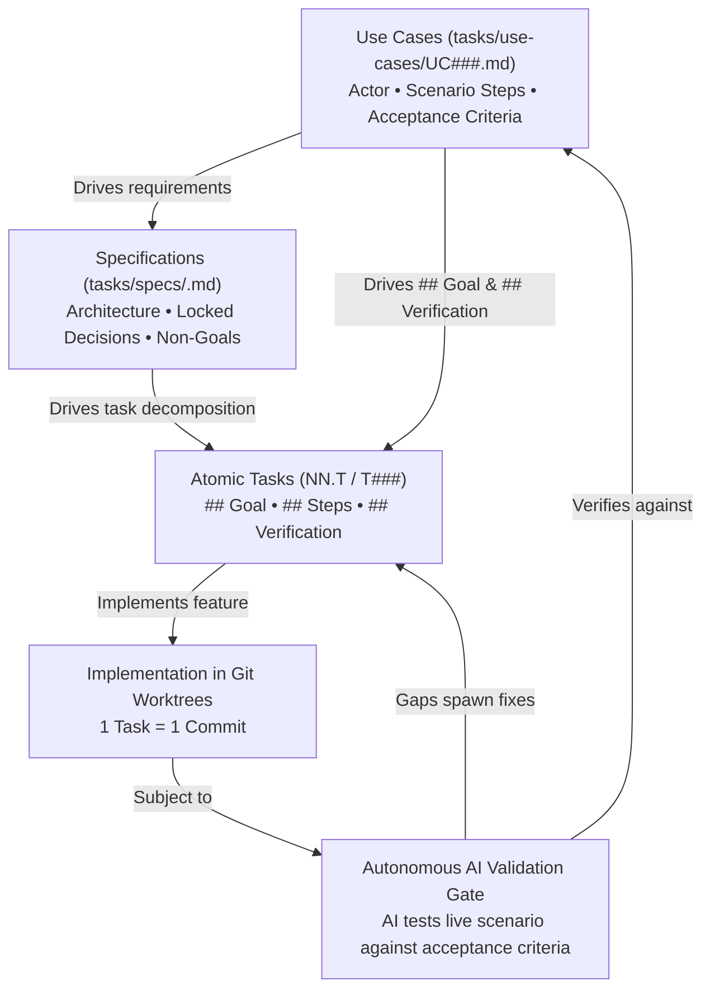
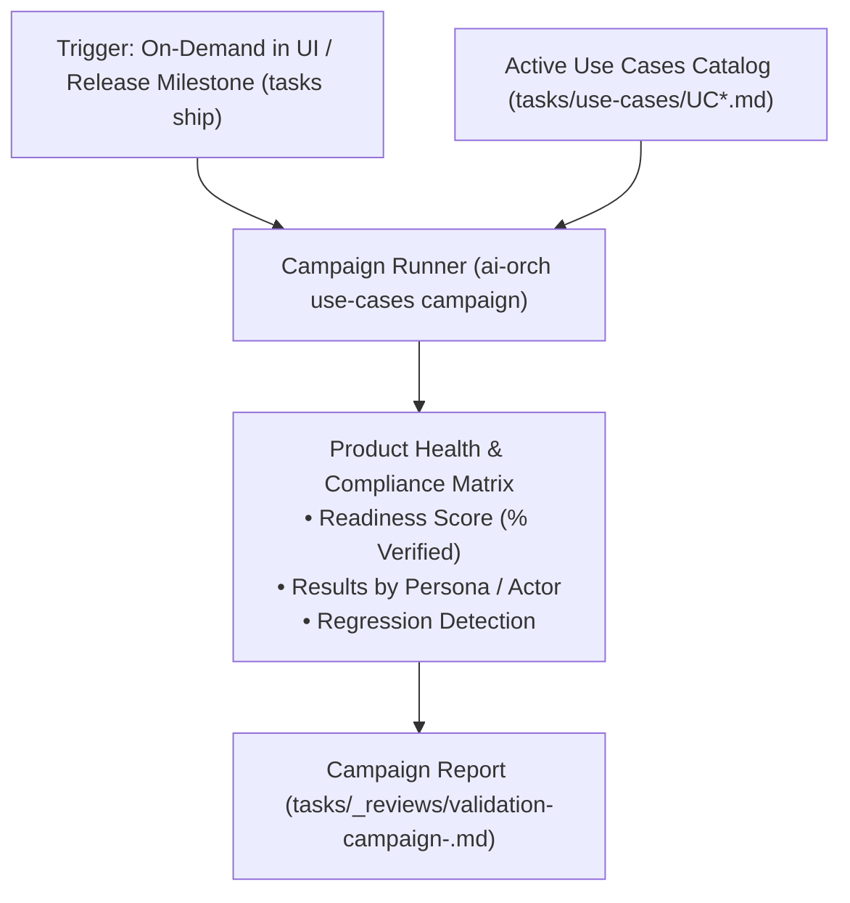

# Spec: Use Case Definition, Management & Autonomous AI Validation

> **Status:** Draft v1 (2026-10-17)  
> **Drives Initiative:** 15 (Use Cases Management & Autonomous AI Validation)  
> **Target Repos:** `ai-orchestration` (spec, engine, CLI), `ai-orchestration-ui` (Web UI), `vscode-ai-orchestration` (extension)

---

## 1. Goal & Bidirectional Traceability (Use Cases ⇄ Specs ⇄ Tasks)

A software system is built to fulfill user scenarios. Therefore, **Use Cases are the primary source of truth for both task specifications and acceptance/validation criteria**:



### The Two Traceability Directions:
1. **Top-Down (Use Cases drive Task Specs & Acceptance Criteria):**
   - When an Architect authors a task specification (`task-spec-authoring`), the task's **`## Goal`** states which Use Case scenario step it satisfies, and its **`## Verification` criteria and commands are derived directly from the Use Case's acceptance criteria**.
   - The task header includes `- use-cases: UC001, UC003`.
2. **Bottom-Up (Implemented Tasks enable Autonomous AI Validation):**
   - The Use Case header tracks `- linked-tasks: 08.T1, 08.T3, T012`.
   - When linked tasks reach `delivered` or `verified`, the operator can trigger **"Validate with AI"**:
     - The AI tests whether the combined implementation across the linked tasks actually satisfies the full end-to-end scenario;
     - The AI runs the automated probes or exercises the API/UI;
     - If gaps are found, the AI generates a structured report and offers 1-click creation of an Emergent Task (`T###`) to fix the defect.

---

## 2. On-Disk Use Case File Format (`tasks/use-cases/UC###-<slug>.md`)

Every Use Case is stored as a Markdown file with a strict, machine-validated header:

```markdown
# UC001 - Car Search by Budget and Fuel Type

- id: UC001
- title: Car Search by Budget and Fuel Type
- actor: Buyer / End-User
- status: active
- priority: P1
- linked-tasks: 08.T1, 08.T3, T012
- verification-type: automated-probe
- last-tested: 2026-10-17
- last-verdict: pass

## Description & Business Value
Allows a buyer to filter scraped car listings by budget ceiling and fuel type (hybrid, electric, diesel).

## Preconditions
- Backend server running on `:8765` or mock database seeded with car records.
- At least 10 car listings exist in the test database.

## Scenario / Interaction Steps
1. The user navigates to `/search` or sends `GET /api/cars?max_price=25000&fuel=hybrid`.
2. The system filters available records matching both criteria.
3. The response contains only cars with `price <= 25000` and `fuel == "hybrid"`.
4. If no records match, the response returns an empty array with HTTP 200 (not 404 or 500).

## Automated Verification Command
```bash
curl -fsS "http://localhost:8765/api/cars?max_price=25000&fuel=hybrid" | jq -e 'length > 0 and all(.[]; .price <= 25000 and .fuel == "hybrid")'
```

## Acceptance Criteria
- [x] Query parameters `max_price` and `fuel` are handled correctly by the API router.
- [x] Response time is under 500ms on a 50,000-row dataset.
- [ ] UI dropdown automatically populates available fuel types from database taxonomy.

## AI Validation Log

### [2026-10-17 17:45 UTC] AI Validation by Kilo (google/gemini-4-argon)
- **Verdict:** `PASS`
- **Summary:** All 3 criteria tested against live SQLite DB. Query router returns 24 matching rows.
- **Evidence:**
  - Ran: `curl -fsS "http://localhost:8765/api/cars?max_price=25000&fuel=hybrid" | jq '.[:2]'`
  - Exit code: 0
  - Output: `[{"id": "auto-1", "price": 19500, "fuel": "hybrid"}, ...]`
- **Gaps Found:** None.
```

---

## 3. Autonomous AI Validation Protocol

When the user triggers **"Validate with AI"**:

1. **Agent Prompt Assembly**:
   The orchestrator constructs a dedicated audit prompt:
   - Injects the Use Case markdown (Preconditions, Scenario Steps, Verification Command);
   - Injects the project's `AGENTS.md` isolation and test rules;
   - Injects paths of linked tasks and changed files;
   - Mandates running the verification command or inspecting relevant routes/components;
   - Mandates emitting a structured fenced block ` ```ai-orch-validation ` matching:
     ```json
     {
       "verdict": "pass", // "pass" | "partial" | "fail"
       "summary": "Concise verdict summary",
       "executed_commands": [
         { "command": "...", "output": "...", "exit_code": 0 }
       ],
       "verified_points": [
         "Query parameter validation works",
         "Returns empty list with HTTP 200 when no match"
       ],
       "gaps_found": [
         "Missing dropdown auto-population in frontend view"
       ],
       "proposed_emergent_tasks": [
         {
           "title": "Fix fuel dropdown auto-population in search UI",
           "category": "frontend",
           "priority": "P2",
           "steps": ["Read taxonomy from /api/taxonomy/fuels", "Bind to select component"]
         }
       ]
     }
     ```
2. **Audit Log Persistence**:
   The engine parses the JSON block, updates `last-tested: <date>` and `last-verdict: <verdict>`, and appends the formatted entry to `## AI Validation Log`.
3. **Emergent Task Generation on Failure**:
   If gaps are found and proposed tasks exist, the UI surfaces a 1-click button: **"Create Task to Fix Gap"**, which creates `tasks/<category>/T###-<slug>.md` linked back to the Use Case.

---

## 5. Product-Level Use-Case Driven Validation Campaigns

Beyond validating single Use Cases in isolation, the system provides **Product Validation Campaigns**:



1. **Campaign Scope:**
   - Evaluates the entire product (or a tag/actor subset) against the running application or staging environment.
2. **Regression Detection:**
   - Flags any Use Case that was previously `PASS` / `verified` and has now flipped to `FAIL` / `partial` after recent task commits.
3. **Product Readiness Score:**
   - Calculates the overall percentage of verified Use Cases: e.g. `85% Functional Readiness (12/14 Use Cases Verified)`.
4. **Artifact:**
   - Produces a timestamped audit report in `tasks/_reviews/validation-campaign-<timestamp>.md`.

---

## 6. Phased Implementation Plan (Initiative 15)

The work is broken down into atomic tasks in `tasks/15-use-case-driven-validation/plan.md`:
- **15.1:** Engine & Data Model (`tasks/use-cases/`, parser, validator, `- use-cases:` header field).
- **15.2:** Top-Down Skill Integration (`task-spec-authoring` and `task-pipeline` skills).
- **15.3:** Autonomous AI Validation Runner (`ai-orch use-cases validate`).
- **15.4:** Product Validation Campaign Runner (`ai-orch use-cases campaign` + regression detection).
- **15.5:** Backend REST & WebSocket Endpoints (`ai-orchestration-ui/backend/server.py`).
- **15.6:** UI Dashboard & Kanban Integration (Tab: `Use Cases & Validation`, KPI score, AI runner modal, gap-to-task creation).
- **15.7:** VS Code Sidebar TreeView (`aiOrchestration.useCasesView`).

